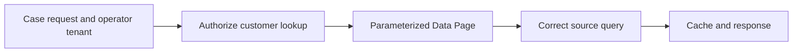

# Parameterized Data Pages at scale and tenant isolation

**PFA-061** | Lead System Architect scenario | Verification pending in Pega lab

## Failure scenario

Thousands of agent sessions retrieve customer-specific balances from a parameterized Data Page. The cache uses CustomerID only although the same ID exists in two tenants. A Node-scoped optimization shares the page across users and leaks balances.

The key architectural distinction is between what the Pega engine or data page can execute and what a business transaction guarantees. Rules and scope settings must reflect the data owner, security context, concurrency pattern and recovery policy.

## Technical design flow

## Rules and execution boundaries

1. **D_CustomerBalance**. Record the actual rule class/version, source mapping and owner for this boundary.
2. **TenantID and CustomerID params**. Record the actual rule class/version, source mapping and owner for this boundary.
3. **scope setting**. Record the actual rule class/version, source mapping and owner for this boundary.
4. **Access Control Policy**. Record the actual rule class/version, source mapping and owner for this boundary.
5. **Connect REST**. Record the actual rule class/version, source mapping and owner for this boundary.

## Proposed implementation

1. Define the full effective business key including tenant, customer and any relevant entitlement dimensions before declaring the Data Page parameters.

2. Choose a scope based on who can legally see the data. Node-scope reuse across requestors requires genuine common-data semantics.

3. Map the Data Page parameters into its source connector or Report Definition; declaring parameters without source mapping is insufficient.

4. Implement server-side current entitlements; a cached page must not grant access simply because it was loaded earlier.

5. Measure memory of distinct parameter combinations and refresh age under realistic concurrency; avoid false assumptions that all nodes share one cache.

These are deliberate architectural choices rather than instructions to copy unknown settings into an application. For every integration or rule, capture the request/response contract, the authenticated caller and the version that was tested.

## Alternative approaches

- **Approach 1:** Requestor cache isolates sessions but can retain many keys.
- **Approach 2:** Node cache reduces calls but can violate tenant boundaries.

Use an ADR to record not just which approach wins, but why the rejected alternatives fail the agreed security, performance, audit and consistency requirements.

## Diagnostic questions

A customer key is reused across tenants, or entitlement is revoked after cache load; stale or cross-tenant results surface under a generic parameter.

Reproduce with the same user, case type, actual parameter values and active application stack. Use Clipboard, Tracer, PAL or partner logs as appropriate, and compare the state before and after the failing interaction.

## Test and acceptance plan

1. **Experiment 1:** Two tenants with same CustomerID. Capture expected and actual outcomes, including source-system state when applicable.
2. **Experiment 2:** 100 parameters in one requestor. Capture expected and actual outcomes, including source-system state when applicable.
3. **Experiment 3:** revoke access and retry lookup. Capture expected and actual outcomes, including source-system state when applicable.

No live Pega tests were performed for this publication. Lab-validation requires real redacted rule screenshots, installed platform version, and evidence of both positive and negative behaviors.

## Operating controls

Assign an owner to the failure state, make unresolved work visible, and define safe replay/recovery where a side effect may have been committed independently. For time-sensitive user journeys, measure p95 response and dependency time separately. For Data Pages, test isolation and refresh as well as latency.

## Further reading

- [Pega Academy: Data Pages](https://academy.pega.com/topic/data-pages/v5)

*Independent scenario-driven article, not an official Pegasystems document.*
