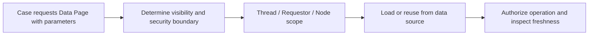

# Data Page Scope Decision: Thread, Requestor or Node for Sensitive Enterprise Data

**PFA-062** | **Target reader:** Pega SSA / LSA | **Evidence:** Architecture design, live test pending

## Why this matters in a real enterprise application

An agent portal fetches reference codes, customer addresses and live account balances. Engineers want to use Node scope for everything to reduce connectors. All three datasets have different sharing boundaries. A reference code list can safely be shared widely; a private customer address is operator- and entitlement-specific; an account balance may change while an action is being approved.

The technical target is not simply to configure a rule that works once. The design must remain correct when authorization changes, multiple requestors interact, dependent services fail and different rule versions coexist during deployment.

## Runtime architecture and trust boundaries

The diagram is an implementation proposal, not a screenshot or observed runtime trace.

## Pega rule and component inventory

| Pega component | What the architect must control |
|---|---|
| Read-only Data Page Scope field | Define the component's business ownership and version |
| Parameter definitions including tenant identity | Specify input fields, classes and caller contract |
| Load Management refresh settings | Confirm scope, access privileges and applicable rulesets |
| External Connector / Report Definition | Expose useful diagnostic evidence and correlation IDs |
| Access Control Policy / service-side entitlement check | Define failure/recovery behavior and verification owner |

All custom names in the example should be replaced with classes and rule names from the target application. Do not blindly apply design examples to a different Pega release.

## Implementation design

1. **Step 1:** Classify data by owner, sensitivity, legitimate readers and maximum stale age; this classification must precede cache selection.

2. **Step 2:** For thread scope, treat each case/thread as its own caching context. Measure duplication when the same agent opens many cases concurrently.

3. **Step 3:** For requestor scope, determine whether two cases in the same session may safely reuse values, and how revocation is handled during the session.

4. **Step 4:** For node scope, prove that the content is genuinely common to requestors on that node. Do not assume node caches constitute one globally consistent cluster cache.

5. **Step 5:** Design a parameter set reflecting the effective business identity: TenantID, CustomerID and other context affecting results. A plain CustomerID often fails in multi-tenant integrations.

6. **Step 6:** Protect access at the operation boundary even when the page is already loaded. Cache visibility does not replace ABAC or remote service entitlement.

7. **Step 7:** Measure actual requestor count, parameter cardinality and heap overhead; keep a bounded footprint and appropriate refresh policy.

### Decision contract

Before writing the rule, record the caller, authoritative system of record, access-group or service identity, acceptable stale age, latency target and required behaviour under duplicate execution. Where the feature supports multiple execution modes, the choice must be justified against these constraints.

## Alternative patterns

| Design approach | Why it may or may not fit |
|---|---|
| Thread | Best natural isolation per case, may create repeated loads |
| Requestor | Reuses between cases in a user session, retains session-specific state |
| Node | Good for common low-sensitivity reference data, shared by users on a node |

A more scalable option is not necessarily the most secure or operationally supportable. The decision should be driven by the application's actual workload and failure modes, not the convenience of one dev-environment demo.

## Production failure and diagnosis

A node-level page can leak values if the parameter does not carry a tenant identifier. Requestor scope can reuse data after the operator loses an entitlement. A thread-level page can multiply remote calls when agents open many cases. Distinguish authorization errors from stale results in logs; do not solve security issues by shortening TTL alone.

When diagnosing a failure, capture the exact case ID in an approved test environment, the active application and ruleset versions, Pega node, relevant Data Page or flow state, and the downstream correlation ID. Avoid including tokens, customer personal information or confidential attachments.

## Verification plan

| Scenario | Evidence required |
|---|---|
| Experiment 1 | Load distinct tenant data with colliding customer IDs; no cross-tenant rows. |
| Experiment 2 | Requestor with two open cases observes expected per-scope instance boundaries. |
| Experiment 3 | Revoke access after cache load; subsequent protected operation denied. |
| Experiment 4 | At 100 distinct parameter keys, measure memory and connector counts. |

**These are test instructions, not completed test results.** Once a supported Pega sandbox is available, record the installed release and attach redacted, authentic rule screenshots, Tracer/PAL or Clipboard evidence and expected versus observed outcomes.

## Operational acceptance and release considerations

Specify an accountable owner for this design, expected business volume, Pega and dependent-system resource limits, monitoring signals and a recovery runbook. Confirm an older persisted case or queued operation can safely resume after deployment where applicable. Create an Architecture Decision Record so future maintainers understand both the accepted approach and its rejected alternatives.

## Primary references and version caveat

- [Pega Academy: Data Pages and scope](https://academy.pega.com/topic/data-pages/v6)
- [Pega Academy: Designing enterprise data access](https://academy.pega.com/topic/designing-enterprise-data-access-pega-live-data/v1)

This independent article is based on published Pega concepts and a fictional scenario. UI labels, exact method semantics and feature availability must be verified in the chosen platform release.
