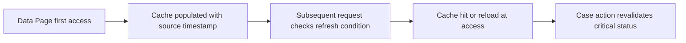

# Data Page Refresh Strategies: Why a Five-Minute TTL Is Not a Consistency Guarantee

**PFA-063** | **Target reader:** Pega SSA / LSA | **Evidence:** Architecture design, live test pending

## Why this matters in a real enterprise application

A claims handler sees a payment status from D_PaymentStatus, and the payment system updates seconds later. The Data Page is configured Reload if older than five minutes. Product owners assume it refreshes in the background exactly every five minutes and guarantees all actions use data less than five minutes old. In reality, Pega checks refresh conditions on access and reloads when qualifying conditions are met. The business still needs a separate write-time correctness check.

The technical target is not simply to configure a rule that works once. The design must remain correct when authorization changes, multiple requestors interact, dependent services fail and different rule versions coexist during deployment.

## Runtime architecture and trust boundaries

The diagram is an implementation proposal, not a screenshot or observed runtime trace.

## Pega rule and component inventory

| Pega component | What the architect must control |
|---|---|
| Data Page Load Management | Define the component's business ownership and version |
| Reload once per interaction | Specify input fields, classes and caller contract |
| Do not reload when condition | Confirm scope, access privileges and applicable rulesets |
| Reload if older than interval | Expose useful diagnostic evidence and correlation IDs |
| Source timestamp / freshness evidence | Define failure/recovery behavior and verification owner |

All custom names in the example should be replaced with classes and rule names from the target application. Do not blindly apply design examples to a different Pega release.

## Implementation design

1. **Step 1:** Specify an observable freshness requirement per field: a label may allow minutes of staleness while an irreversible action needs a current source-of-record check.

2. **Step 2:** Map each documented refresh option to the needed semantics; Reload once per interaction is available for Thread/Requestor and cannot be combined with other refresh options in the referenced guidance.

3. **Step 3:** With Reload if older than, model it as age-based validity checked on access, not a timer refreshing continuously in the absence of interactions.

4. **Step 4:** For a Do not reload when rule, ensure the When logic has a testable business predicate and does not preserve values forever after source change.

5. **Step 5:** When users perform critical state transitions, call a protected validation service or otherwise prove source currency at commit time.

6. **Step 6:** Model parallel requestors and node-local caching explicitly; refresh timestamps differ by scope and may not align across nodes.

7. **Step 7:** Capture source-as-of timestamp in evidence and measure refresh load during simultaneous cache expiries. Consider partner rate limiting and outage behavior.

### Decision contract

Before writing the rule, record the caller, authoritative system of record, access-group or service identity, acceptable stale age, latency target and required behaviour under duplicate execution. Where the feature supports multiple execution modes, the choice must be justified against these constraints.

## Alternative patterns

| Design approach | Why it may or may not fit |
|---|---|
| Short interval reload | Lower staleness, higher connector load and thundering-herd risk |
| Once per interaction | Fresh per interaction in supported scopes, high dependency latency |
| Write-time revalidation with tolerant display cache | Balances usability and correctness, needs clear design |

A more scalable option is not necessarily the most secure or operationally supportable. The decision should be driven by the application's actual workload and failure modes, not the convenience of one dev-environment demo.

## Production failure and diagnosis

A 300-second age threshold does not automatically poll the source at second 300. Repeated access may be served from cache until stale criteria are met. A cached successful result can mislead the UI while the source has revoked an operation. Measure data age at observed accesses and partner calls, not merely the configured interval.

When diagnosing a failure, capture the exact case ID in an approved test environment, the active application and ruleset versions, Pega node, relevant Data Page or flow state, and the downstream correlation ID. Avoid including tokens, customer personal information or confidential attachments.

## Verification plan

| Scenario | Evidence required |
|---|---|
| Experiment 1 | Access at t=0, t=100 seconds, t=301 seconds and compare load count. |
| Experiment 2 | No users access for one hour; verify reload occurs on the next access. |
| Experiment 3 | Update source behind a cached status and attempt protected business action. |
| Experiment 4 | Repeat on two runtime nodes and compare observed source timestamps. |

**These are test instructions, not completed test results.** Once a supported Pega sandbox is available, record the installed release and attach redacted, authentic rule screenshots, Tracer/PAL or Clipboard evidence and expected versus observed outcomes.

## Operational acceptance and release considerations

Specify an accountable owner for this design, expected business volume, Pega and dependent-system resource limits, monitoring signals and a recovery runbook. Confirm an older persisted case or queued operation can safely resume after deployment where applicable. Create an Architecture Decision Record so future maintainers understand both the accepted approach and its rejected alternatives.

## Primary references and version caveat

- [Pega Academy: Refresh strategies for Data Pages](https://academy.pega.com/topic/refresh-strategies-data-pages/v3)
- [Pega Academy: Data Pages](https://academy.pega.com/topic/data-pages/v6)

This independent article is based on published Pega concepts and a fictional scenario. UI labels, exact method semantics and feature availability must be verified in the chosen platform release.
