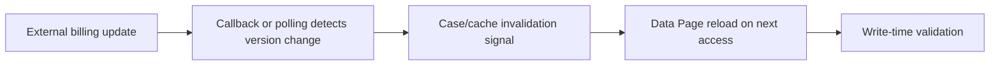

# Invalidating a Data Page After External Changes: Why Refresh Intervals Alone Fail

**PFA-064** | **Audience:** Pega SSA / LSA | **Lab status:** Not yet executed in a live Pega environment

## Enterprise problem

A billing integration posts a new invoice status while an operator has its invoice detail Data Page loaded. The configured refresh interval is fifteen minutes, so the operator sees Pending after the source already confirmed PaymentReceived. If the user then triggers debt collection based on cached state, the business outcome is wrong. The architectural decision is whether to invalidate, reread or use a stronger confirmation contract.

The purpose is to decide how Pega should behave when there are simultaneous users, service failures, stale state and a deployment boundary. A feature can be configured correctly at rule level but still be wrong for the business process.

## Component and runtime sequence

This is a conceptual design. It is not a claim about actual traces or a particular Pega version.

## Pega artefacts and execution context

| Rule or component | Design requirement |
|---|---|
| Parameterized invoice Data Page | Architectural responsibility and identity boundary |
| Load Management refresh condition | Rule or configuration must be version controlled |
| Service REST callback | Inputs/outputs and failure model must be documented |
| Version or updated-at property | Expected observability and support ownership |
| Case action entitlement/freshness check | Explicit integration or release validation required |

Before implementation, record the actual Apply To class, ruleset and access group. Business responsibility must remain with the correct system of record. Context supplied through UI request parameters should be treated as untrusted until server-side authorization is applied.

## Technical implementation sequence

1. Document which source actually owns invoice status, allowed user-visible lag and whether the value can authorize an irreversible action.

2. Store source as-of/version information in the retrieved data object so age and order can be reasoned about.

3. When billing updates, deliver an authenticated versioned event to Pega or use a scheduled reconciliation that marks the case as having newer known state.

4. Use a supported Data Page reload/refresh path for the relevant scope and parameter combination. Do not assume one node's cache invalidation affects all nodes.

5. For critical collection actions, obtain a fresh authorization/status check from the billing source regardless of the displayed cache freshness.

6. If the billing event is duplicated or out-of-order, compare its version and avoid regressing the case from Paid to Pending.

7. Monitor difference between source update time and UI observation time, as well as the rate of additional source calls.

### Design review questions

Who owns each state transition? Which operation is allowed to run again after a lost response? Can a cached value be shared across a session or node? How will an administrator see a failure when the original user has signed out? Each answer must be supported by a reproducible test and a named on-call owner.

## Alternatives and when to reject them

| Approach | Architectural cost and applicability |
|---|---|
| TTL only | Simple, permits bounded staleness that may be unacceptable for collection decisions |
| Versioned event + refresh | Faster visibility with event-delivery and cache-coordination complexity |
| Fresh read before every critical action | Strong decision control, dependency latency on important actions |

Avoid adopting the fastest development path merely because it passes a single-user test. State where complexity has been moved: infrastructure scaling, cache invalidation, support recovery, version migration or customer authorization.

## Production diagnosis

A callback can update the persisted case while an already-loaded Requestor Data Page remains unchanged. Node caches may refresh at different times. A stale or duplicate event can reorder business status if receipt version is not checked. Cross-requestor invalidation should be verified with multiple users and nodes.

Build incident evidence around the case/operation identity, exact requestor or processing node, release/ruleset stack, timestamps and external correlation IDs. The same user-visible symptom can arise from rule resolution, database state, queue processing or a remote API. Investigate the layer that actually owns the failing transition.

## Controlled verification

| Test scenario | Expected behavior to observe |
|---|---|
| Lab test 1 | Load invoice, send payment update, compare source and cached status. |
| Lab test 2 | Repeat with two requestors and separate web nodes. |
| Lab test 3 | Deliver older status event after newer status; no regression. |
| Lab test 4 | Perform protected collection action while cache is stale; must revalidate. |

For acceptance, store actual screenshots of the rule configuration and sanitized Clipboard/Tracer/PAL data only after the experiment runs in a permitted Pega environment. Do not present theoretical timings as observed measurements.

## Production readiness checklist

- Define data classification and identity boundaries for this capability.
- Capture interface contract and dependency versions.
- Agree business freshness, latency and failure-response requirements.
- Verify retries, duplicates and parallel interactions where relevant.
- Monitor the supported recovery signal, not merely the happy-path success message.
- Retain rollback or forward-repair steps for active cases crossing a release.
- Record the target Pega version and the observed lab result before declaring the design verified.

## References

- [Pega Academy: Refresh strategies for Data Pages](https://academy.pega.com/topic/refresh-strategies-data-pages/v3)
- [Pega Academy: Data Pages](https://academy.pega.com/topic/data-pages/v6)

Independent architectural analysis. Examples use fictional business details. This article is not affiliated with Pegasystems, and exact runtime options may vary by release.
