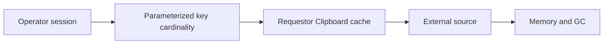

# Handling large parameter cardinality in agent sessions

**PFA-065** | Lead System Architect scenario | Verification pending in Pega lab

## Failure scenario

A contact-centre agent navigates 200 customers during a shift. A parameterized Requestor Data Page creates an instance per unique key and retains many large embedded lists. Heap pressure grows gradually even though each lookup is fast.

The key architectural distinction is between what the Pega engine or data page can execute and what a business transaction guarantees. Rules and scope settings must reflect the data owner, security context, concurrency pattern and recovery policy.

## Technical design flow

## Rules and execution boundaries

1. **Data Page parameters**. Record the actual rule class/version, source mapping and owner for this boundary.
2. **Requestor scope**. Record the actual rule class/version, source mapping and owner for this boundary.
3. **Load Management**. Record the actual rule class/version, source mapping and owner for this boundary.
4. **Clipboard**. Record the actual rule class/version, source mapping and owner for this boundary.
5. **JVM heap**. Record the actual rule class/version, source mapping and owner for this boundary.

## Proposed implementation

1. Measure distinct keys per requestor over a full shift, not only per action, and record average payload size with realistic object overhead.

2. Reduce result shapes to what the View actually consumes; avoid caching large documents or entire histories with a summary page.

3. Set refresh/reuse policy to match user need and decide whether a one-at-a-time instance is appropriate; never enable it blindly for concurrent references.

4. Move reusable non-sensitive static reference values into a separate page with a safe scope rather than a per-customer payload.

5. Load-test 100 or 200 keys in one session, measure retained heap after GC and response time when data is revisited.

These are deliberate architectural choices rather than instructions to copy unknown settings into an application. For every integration or rule, capture the request/response contract, the authenticated caller and the version that was tested.

## Alternative approaches

- **Approach 1:** Keep every parameter instance maximizes reuse but raises memory.
- **Approach 2:** single-instance overwrite bounds retention but may reload and disrupt concurrent use.

Use an ADR to record not just which approach wins, but why the rejected alternatives fail the agreed security, performance, audit and consistency requirements.

## Diagnostic questions

A cached list remains in session beyond useful life and causes memory pressure after hours; fixing by Node scope risks cross-customer visibility.

Reproduce with the same user, case type, actual parameter values and active application stack. Use Clipboard, Tracer, PAL or partner logs as appropriate, and compare the state before and after the failing interaction.

## Test and acceptance plan

1. **Experiment 1:** Measure 10,50,200 unique params. Capture expected and actual outcomes, including source-system state when applicable.
2. **Experiment 2:** compare reuse with single instance. Capture expected and actual outcomes, including source-system state when applicable.
3. **Experiment 3:** repeat with concurrent case tabs. Capture expected and actual outcomes, including source-system state when applicable.

No live Pega tests were performed for this publication. Lab-validation requires real redacted rule screenshots, installed platform version, and evidence of both positive and negative behaviors.

## Operating controls

Assign an owner to the failure state, make unresolved work visible, and define safe replay/recovery where a side effect may have been committed independently. For time-sensitive user journeys, measure p95 response and dependency time separately. For Data Pages, test isolation and refresh as well as latency.

## Further reading

- [Pega Academy: Data Pages](https://academy.pega.com/topic/data-pages/v5)

*Independent scenario-driven article, not an official Pegasystems document.*
