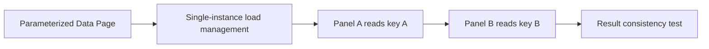

# Limit to a single Data Page and overwritten instances

**PFA-066** | Lead System Architect scenario | Verification pending in Pega lab

## Failure scenario

A page lookup for C1001 is visible in one part of the portal while a second panel loads C2002. 'Limit to a single Data Page' was enabled to reduce memory, and the first panel's shared page instance is overwritten with another parameter value.

The key architectural distinction is between what the Pega engine or data page can execute and what a business transaction guarantees. Rules and scope settings must reflect the data owner, security context, concurrency pattern and recovery policy.

## Technical design flow

## Rules and execution boundaries

1. **D_OrdersByCustomer**. Record the actual rule class/version, source mapping and owner for this boundary.
2. **Load Management Limit to a single Data Page**. Record the actual rule class/version, source mapping and owner for this boundary.
3. **Parameters tab**. Record the actual rule class/version, source mapping and owner for this boundary.
4. **Data Page references**. Record the actual rule class/version, source mapping and owner for this boundary.

## Proposed implementation

1. Determine whether the UI must hold results for multiple parameter combinations simultaneously. If so, single-instance overwrite is the wrong caching contract.

2. Pega documents that limiting to one instance overwrites the existing page when parameter values change; test actual behavior with target scope.

3. If only one selected customer exists at a time, single-instance mode can control memory but requires consistent refresh of dependent Views.

4. For multi-panel compare scenarios retain distinct parameter instances or store carefully managed immutable results per panel.

5. Check source parameter mapping and authorisation at every load so another customer result is never mistaken for current selection.

These are deliberate architectural choices rather than instructions to copy unknown settings into an application. For every integration or rule, capture the request/response contract, the authenticated caller and the version that was tested.

## Alternative approaches

- **Approach 1:** Multiple instances preserve concurrent parameter data but cost memory.
- **Approach 2:** single instance bounds cache but changes reuse semantics.

Use an ADR to record not just which approach wins, but why the rejected alternatives fail the agreed security, performance, audit and consistency requirements.

## Diagnostic questions

A panel binds to a shared clipboard reference while another parameter load overwrites content. User sees one customer's result under another label.

Reproduce with the same user, case type, actual parameter values and active application stack. Use Clipboard, Tracer, PAL or partner logs as appropriate, and compare the state before and after the failing interaction.

## Test and acceptance plan

1. **Experiment 1:** Load key A then B and revisit A. Capture expected and actual outcomes, including source-system state when applicable.
2. **Experiment 2:** use two panels simultaneously. Capture expected and actual outcomes, including source-system state when applicable.
3. **Experiment 3:** inspect Clipboard instance count. Capture expected and actual outcomes, including source-system state when applicable.

No live Pega tests were performed for this publication. Lab-validation requires real redacted rule screenshots, installed platform version, and evidence of both positive and negative behaviors.

## Operating controls

Assign an owner to the failure state, make unresolved work visible, and define safe replay/recovery where a side effect may have been committed independently. For time-sensitive user journeys, measure p95 response and dependency time separately. For Data Pages, test isolation and refresh as well as latency.

## Further reading

- [Pega Academy: Data Pages](https://academy.pega.com/topic/data-pages/v5)

*Independent scenario-driven article, not an official Pegasystems document.*
