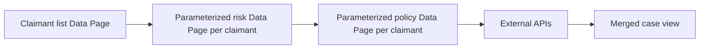

# Chained Data Pages: The Hidden Integration Fan-Out Behind a Single View

**PFA-067** | **Audience:** Senior and Lead System Architects | **Status:** Architecture design, live Pega verification pending

## The actual failure

A claims screen lists 25 claimants and loads each person's risk and policy details from separate parameterized Data Pages. One apparently simple screen now triggers one list lookup and fifty remote lookups. When 200 agents open cases together, the partner's rate limit is reached even though the UI itself contains only a table.

## System interaction and ownership

This is a conceptual reference architecture, not a product screenshot or observed runtime trace. Its boundaries must be verified for the actual Pega deployment version and external systems.

## Pega implementation inventory

| Component or rule | Design consideration |
|---|---|
| D_Claimants List | Owns a defined runtime decision or state boundary |
| D_RiskByCustomer[CustomerID] | Needs a documented input/output contract |
| D_PoliciesByCustomer[CustomerID] | Requires version-specific access and execution testing |
| Connect REST adapters | Produces diagnostics for failure isolation |
| Paginated or bulk enrichment design | Carries operational ownership |

## How to implement and validate the architecture

1. Draw the complete Data Page reference tree, including nested Data Transforms and hidden loading via view fields.

2. Capture number of unique parameters and connector calls for one, ten and fifty rows under cold and warm cache conditions.

3. Evaluate bulk APIs or batch fetching with a security-checked set of customer IDs when the partner can support it.

4. Load only the first visible page where business requirements allow; postpone optional enrichment.

5. Choose scope based on data isolation and freshness. Sharing sensitive customer results across users simply to save calls is unacceptable.

6. Set end-to-end timeout budgets and partial-data rules rather than letting one failed child lookup collapse the entire form.

For a production build, annotate the actual class names, access group, ruleset version, node role and recovery owner. Ensure each external operation has an explicit system of record; a successful Pega case save does not, by itself, certify that an external service committed a change.

## Architectural choices

| Pattern | Consequence |
|---|---|
| Per-row parameterized lookups | Easy rule reuse but N+1 connector cost |
| Bulk request | Predictable bounded calls but requires source-side support |
| Paged lazy enrichment | Strong initial latency control, needs clear progressive-loading UX |

Choose by the actual confidentiality, scale, consistency and failure-recovery constraints. A seemingly quicker configuration can shift cost into production support, data repair or lost auditability.

## Failure mechanics and support diagnosis

Performance problems may come from a Data Transform unintentionally referencing a nested Data Page, eager load of hidden fields, or refresh rules invalidating the whole dependency graph. Cached error results can also extend a temporary outage after the service is restored.

Correlate one affected case ID and operation ID across rule execution, logs and dependent services. Record the effective application/ruleset versions and node. Avoid exporting live client data or confidential prompts in community evidence.

## Test matrix

| Test | Expected verification |
|---|---|
| Experiment 1 | Trace calls for one, ten and fifty claimants. |
| Experiment 2 | Throttle risk API and observe total p95 view response. |
| Experiment 3 | Load two tenants with same customer key and verify isolation. |
| Experiment 4 | Compare batch and paged approach at realistic concurrency. |

These are **experiments to execute**, not assertions of a completed test. Include Pega configuration screenshots and sanitized Clipboard, Tracer, PAL or service evidence only after an authorised lab run. A failing experiment is valuable evidence and should update the design.

## Release and production readiness

Before promoting the design, confirm: observable business state; retry and rollback constraints; tenant and privilege isolation; capacity target; accountable support team; release-specific configuration; and a documented repair procedure. A green rule test or a running node does not imply the complete business operation succeeded.

## Primary reference

- [Pega Academy technical documentation](https://academy.pega.com/topic/data-pages/v6)

This article is an independent architectural study. The example scenario is fictional. It is not affiliated with Pegasystems, and no performance measurement or live test result is claimed.
