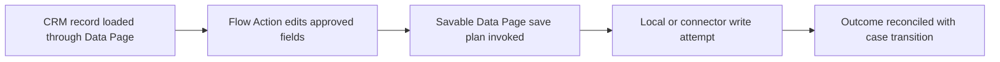

# Read-only, Editable and Savable Data Pages: Drawing the Real Transaction Boundary

**PFA-068** | **Target reader:** Pega SSA / LSA | **Evidence:** Architecture design, live test pending

## Why this matters in a real enterprise application

An onboarding case edits a customer address sourced from CRM. A developer makes a Data Page editable and assumes the source record will be updated when the Pega case saves. The screen shows changed values but the CRM remains unchanged. Data Page editability and persistence are separate concerns: read-only controls local modification, editable permits local modification, and savable uses a declared save plan.

The technical target is not simply to configure a rule that works once. The design must remain correct when authorization changes, multiple requestors interact, dependent services fail and different rule versions coexist during deployment.

## Runtime architecture and trust boundaries

The diagram is an implementation proposal, not a screenshot or observed runtime trace.

## Pega rule and component inventory

| Pega component | What the architect must control |
|---|---|
| Read-only or Editable Data Page mode | Define the component's business ownership and version |
| Savable Data Page data save plan | Specify input fields, classes and caller contract |
| Save Data Page automation step | Confirm scope, access privileges and applicable rulesets |
| Save-DataPage activity method | Expose useful diagnostic evidence and correlation IDs |
| CRM Connect REST / local database save | Define failure/recovery behavior and verification owner |

All custom names in the example should be replaced with classes and rule names from the target application. Do not blindly apply design examples to a different Pega release.

## Implementation design

1. **Step 1:** Identify the system of record for the data object and whether the case should retain a historical snapshot, a reference or a live editable source projection.

2. **Step 2:** For read-only retrieval, keep source data immutable in the consuming case context. Do not use a writable page to bypass a validation rule.

3. **Step 3:** Where editing is required, choose a supported savable single-record data page and configure a save plan with database/connector or supported activity options.

4. **Step 4:** Use explicit create-versus-update conditions. Ensure entity identity is stable and record version conflicts are detectable by the CRM.

5. **Step 5:** Trigger save through the supported flow automation or Flow Action post-processing where transactional participation is documented for your release.

6. **Step 6:** Do not assume a remote REST service shares the same ACID transaction as Pega's database merely because the save is coordinated through Pega. Handle uncertain outcomes and idempotent retries.

7. **Step 7:** Test validation failure, remote timeout after remote commit, and case cancellation; determine which artifacts persist and document compensations.

### Decision contract

Before writing the rule, record the caller, authoritative system of record, access-group or service identity, acceptable stale age, latency target and required behaviour under duplicate execution. Where the feature supports multiple execution modes, the choice must be justified against these constraints.

## Alternative patterns

| Design approach | Why it may or may not fit |
|---|---|
| Read-only reference | Safe display, no modification semantics |
| Editable unsaved Data Page | Allows local changes, persistence requires deliberate other mechanism |
| Savable Data Page | Explicit save plan and supported case integration, still requires external consistency design |

A more scalable option is not necessarily the most secure or operationally supportable. The decision should be driven by the application's actual workload and failure modes, not the convenience of one dev-environment demo.

## Production failure and diagnosis

The UI may bind to a clipboard copy instead of the savable source, so the save plan never receives the intended changes. A successful local case commit may accompany a failed external connector. A timeout can occur after CRM has committed. The acceptance test must inspect the system of record, not just the Pega clipboard.

When diagnosing a failure, capture the exact case ID in an approved test environment, the active application and ruleset versions, Pega node, relevant Data Page or flow state, and the downstream correlation ID. Avoid including tokens, customer personal information or confidential attachments.

## Verification plan

| Scenario | Evidence required |
|---|---|
| Experiment 1 | Edit an address and confirm actual CRM record changes. |
| Experiment 2 | Trigger a validation failure before save and confirm no premature remote write. |
| Experiment 3 | Force CRM timeout after commit and retry with stable operation identity. |
| Experiment 4 | Switch between new customer creation and existing customer update paths. |

**These are test instructions, not completed test results.** Once a supported Pega sandbox is available, record the installed release and attach redacted, authentic rule screenshots, Tracer/PAL or Clipboard evidence and expected versus observed outcomes.

## Operational acceptance and release considerations

Specify an accountable owner for this design, expected business volume, Pega and dependent-system resource limits, monitoring signals and a recovery runbook. Confirm an older persisted case or queued operation can safely resume after deployment where applicable. Create an Architecture Decision Record so future maintainers understand both the accepted approach and its rejected alternatives.

## Primary references and version caveat

- [Pega Academy: Savable Data Pages](https://academy.pega.com/topic/savable-data-pages/v6/in/102061)
- [Pega Academy: Creating Data Page save plan](https://academy.pega.com/topic/creating-data-page-save-plan/v5)

This independent article is based on published Pega concepts and a fictional scenario. UI labels, exact method semantics and feature availability must be verified in the chosen platform release.
