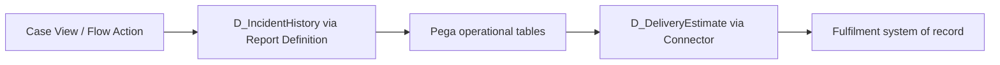

# Report-backed or Connector-backed Data Pages: Choosing Based on Data Ownership

**PFA-069** | **Target reader:** Pega SSA / LSA | **Evidence:** Architecture design, live test pending

## Why this matters in a real enterprise application

A service case needs the latest delivery estimate and a list of historic customer incidents. The delivery estimate belongs to an external fulfilment service while incidents are persisted in Pega. A team proposes using Report Definitions everywhere to avoid API latency, including replicating partner estimates into the operational database without a synchronization design. Another team proposes Connect REST for the entire case history. Both blur ownership and add unnecessary complexity.

The technical target is not simply to configure a rule that works once. The design must remain correct when authorization changes, multiple requestors interact, dependent services fail and different rule versions coexist during deployment.

## Runtime architecture and trust boundaries

The diagram is an implementation proposal, not a screenshot or observed runtime trace.

## Pega rule and component inventory

| Pega component | What the architect must control |
|---|---|
| Report Definition as Data Page source | Define the component's business ownership and version |
| Connect REST as Data Page source | Specify input fields, classes and caller contract |
| Data Page Parameters and Load Management | Confirm scope, access privileges and applicable rulesets |
| Pega class-to-table mapping | Expose useful diagnostic evidence and correlation IDs |
| API contract / correlation IDs | Define failure/recovery behavior and verification owner |

All custom names in the example should be replaced with classes and rule names from the target application. Do not blindly apply design examples to a different Pega release.

## Implementation design

1. **Step 1:** Record field-level ownership and freshness requirements before selecting how a Data Page loads.

2. **Step 2:** For operational Pega case data, use supported Report Definitions or database lookups when the query is indexed and the case database is authoritative.

3. **Step 3:** For volatile external fulfilment state, use an API contract returning version/as-of information and explicit unavailable status.

4. **Step 4:** Parameterize the query with customer and tenant context, but enforce record entitlement separately from user-supplied filter criteria.

5. **Step 5:** Measure each source's load shape: SQL plan, result cardinality, joins and selectivity versus connector latency, quota and failure rate.

6. **Step 6:** Do not replicate external records for convenience without defining lag, reconciliation, retention and authoritative updates.

7. **Step 7:** Set distinct refresh/error policies for the two Data Pages so a failure in fulfilment does not make historic incidents unavailable.

### Decision contract

Before writing the rule, record the caller, authoritative system of record, access-group or service identity, acceptable stale age, latency target and required behaviour under duplicate execution. Where the feature supports multiple execution modes, the choice must be justified against these constraints.

## Alternative patterns

| Design approach | Why it may or may not fit |
|---|---|
| Report Definition | Works naturally for local persisted data, exposes database performance/permission concerns |
| Connect REST | Honours external ownership and independent lifecycle, depends on network reliability |
| Replicated read model | Useful for high-volume reads but introduces synchronization and support burden |

A more scalable option is not necessarily the most secure or operationally supportable. The decision should be driven by the application's actual workload and failure modes, not the convenience of one dev-environment demo.

## Production failure and diagnosis

A report may query a stale replica if the architecture expects current assignment ownership. A connector-backed list can overload a partner when invoked per row. A replicated table becomes contradictory when neither side owns update conflict rules. Diagnose sources separately; do not apply one cache TTL to unrelated datasets.

When diagnosing a failure, capture the exact case ID in an approved test environment, the active application and ruleset versions, Pega node, relevant Data Page or flow state, and the downstream correlation ID. Avoid including tokens, customer personal information or confidential attachments.

## Verification plan

| Scenario | Evidence required |
|---|---|
| Experiment 1 | Compare report results with source Pega case records after status update. |
| Experiment 2 | Cause partner timeout and ensure incident history still loads. |
| Experiment 3 | Load 500 history rows and examine query plan plus pagination. |
| Experiment 4 | Revoke one customer's access and verify neither query path leaks records. |

**These are test instructions, not completed test results.** Once a supported Pega sandbox is available, record the installed release and attach redacted, authentic rule screenshots, Tracer/PAL or Clipboard evidence and expected versus observed outcomes.

## Operational acceptance and release considerations

Specify an accountable owner for this design, expected business volume, Pega and dependent-system resource limits, monitoring signals and a recovery runbook. Confirm an older persisted case or queued operation can safely resume after deployment where applicable. Create an Architecture Decision Record so future maintainers understand both the accepted approach and its rejected alternatives.

## Primary references and version caveat

- [Pega Academy: Data Pages and data sources](https://academy.pega.com/topic/data-pages/v5)
- [Pega Academy: Data access patterns](https://academy.pega.com/topic/data-access-patterns/v1/in/5301)

This independent article is based on published Pega concepts and a fictional scenario. UI labels, exact method semantics and feature availability must be verified in the chosen platform release.
