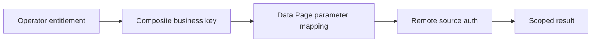

# Designing a business-safe cache key

**PFA-070** | Lead System Architect scenario | Verification pending in Pega lab

## Failure scenario

An insurance group has separate tenant records with the same external CustomerID. A developer uses CustomerID alone as Data Page parameter and caches entitlement-specific pricing, assuming the UI already knows the tenant.

The key architectural distinction is between what the Pega engine or data page can execute and what a business transaction guarantees. Rules and scope settings must reflect the data owner, security context, concurrency pattern and recovery policy.

## Technical design flow

## Rules and execution boundaries

1. **Data Page Parameters**. Record the actual rule class/version, source mapping and owner for this boundary.
2. **TenantID**. Record the actual rule class/version, source mapping and owner for this boundary.
3. **CustomerID**. Record the actual rule class/version, source mapping and owner for this boundary.
4. **Authorization policy**. Record the actual rule class/version, source mapping and owner for this boundary.
5. **Connect REST**. Record the actual rule class/version, source mapping and owner for this boundary.

## Proposed implementation

1. List every field influencing the result: tenant, customer, product, role, locale and effective business date where relevant.

2. Separate identity that selects data from permission to see it. Passing TenantID is necessary for isolation in some systems but not sufficient authorization.

3. Use a stable opaque key and source mapping that faithfully transmits the appropriate tenant context to backend data ownership checks.

4. Avoid including unnecessary volatile context in key, which increases cardinality and destroys cache value.

5. Test collision cases with identical CustomerID across different tenants, roles and product versions.

These are deliberate architectural choices rather than instructions to copy unknown settings into an application. For every integration or rule, capture the request/response contract, the authenticated caller and the version that was tested.

## Alternative approaches

- **Approach 1:** Small key maximizes cache hits but risks wrong results.
- **Approach 2:** complete business key preserves semantics but increases memory.

Use an ADR to record not just which approach wins, but why the rejected alternatives fail the agreed security, performance, audit and consistency requirements.

## Diagnostic questions

A role change yields a page loaded under old authorization context; a key includes UI locale but omits tenant ID.

Reproduce with the same user, case type, actual parameter values and active application stack. Use Clipboard, Tracer, PAL or partner logs as appropriate, and compare the state before and after the failing interaction.

## Test and acceptance plan

1. **Experiment 1:** Colliding customer IDs across tenants. Capture expected and actual outcomes, including source-system state when applicable.
2. **Experiment 2:** different roles on same customer. Capture expected and actual outcomes, including source-system state when applicable.
3. **Experiment 3:** source mapping fails tenant parameter. Capture expected and actual outcomes, including source-system state when applicable.

No live Pega tests were performed for this publication. Lab-validation requires real redacted rule screenshots, installed platform version, and evidence of both positive and negative behaviors.

## Operating controls

Assign an owner to the failure state, make unresolved work visible, and define safe replay/recovery where a side effect may have been committed independently. For time-sensitive user journeys, measure p95 response and dependency time separately. For Data Pages, test isolation and refresh as well as latency.

## Further reading

- [Pega Academy: Data Pages](https://academy.pega.com/topic/data-pages/v5)

*Independent scenario-driven article, not an official Pegasystems document.*
