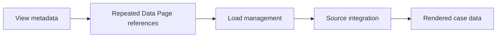

# Avoiding repeated load during complex view rendering

**PFA-071** | Lead System Architect scenario | Verification pending in Pega lab

## Failure scenario

A Constellation case screen shows dozens of related policies and each card loads the same Data Page through nested references. The page refreshes multiple times during view initialization because scope, parameters or refresh settings prevent reuse.

The key architectural distinction is between what the Pega engine or data page can execute and what a business transaction guarantees. Rules and scope settings must reflect the data owner, security context, concurrency pattern and recovery policy.

## Technical design flow

## Rules and execution boundaries

1. **Data Page**. Record the actual rule class/version, source mapping and owner for this boundary.
2. **View rules**. Record the actual rule class/version, source mapping and owner for this boundary.
3. **Load Management**. Record the actual rule class/version, source mapping and owner for this boundary.
4. **PAL**. Record the actual rule class/version, source mapping and owner for this boundary.
5. **Connect REST**. Record the actual rule class/version, source mapping and owner for this boundary.

## Proposed implementation

1. Trace all Data Page references triggered by one view, including declarative expressions and nested Data Transforms.

2. Compare parameter values precisely; a whitespace, missing or different context parameter may create separate instances.

3. Check whether reload-on-interaction semantics intentionally causes repeated loads under the chosen scope.

4. Consolidate shared page data and pass a normalized data object to view components instead of each card independently querying a source.

5. Quantify connector count per user interaction before and after; avoid caching stale data merely to reduce calls.

These are deliberate architectural choices rather than instructions to copy unknown settings into an application. For every integration or rule, capture the request/response contract, the authenticated caller and the version that was tested.

## Alternative approaches

- **Approach 1:** Direct per-component loading is convenient but opaque.
- **Approach 2:** aggregate data loading improves predictable fan-out.

Use an ADR to record not just which approach wins, but why the rejected alternatives fail the agreed security, performance, audit and consistency requirements.

## Diagnostic questions

Hidden dependencies generate N+1 calls and API throttling; multiple identical-looking pages may have different effective parameter keys.

Reproduce with the same user, case type, actual parameter values and active application stack. Use Clipboard, Tracer, PAL or partner logs as appropriate, and compare the state before and after the failing interaction.

## Test and acceptance plan

1. **Experiment 1:** Count loads on 1 and 30 cards. Capture expected and actual outcomes, including source-system state when applicable.
2. **Experiment 2:** modify one parameter and inspect instances. Capture expected and actual outcomes, including source-system state when applicable.
3. **Experiment 3:** simulate API rate limit. Capture expected and actual outcomes, including source-system state when applicable.

No live Pega tests were performed for this publication. Lab-validation requires real redacted rule screenshots, installed platform version, and evidence of both positive and negative behaviors.

## Operating controls

Assign an owner to the failure state, make unresolved work visible, and define safe replay/recovery where a side effect may have been committed independently. For time-sensitive user journeys, measure p95 response and dependency time separately. For Data Pages, test isolation and refresh as well as latency.

## Further reading

- [Pega Academy: Data Pages](https://academy.pega.com/topic/data-pages/v5)

*Independent scenario-driven article, not an official Pegasystems document.*
