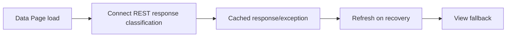

# Managing error states on cached external responses

**PFA-072** | SSA/LSA engineering case | Design study, laboratory proof pending

## Production symptom and business risk

A connector-backed Data Page returns 503 while the customer portal loads. The implementation copies the error text into a response page and caches it like a successful customer record. Even after the external API recovers, every requestor sees a stale error state.

The outcome must be provable across the case record, the data source and any cached or indexed read model. A green Flow Action is not a substitute for verifying where the authoritative state was committed.

## System sequence

## Pega components and design responsibilities

1. **Read-only Data Page.** Record the rule/class mapping, execution context, data owner and a measurable acceptance condition.
2. **Connect REST.** Record the rule/class mapping, execution context, data owner and a measurable acceptance condition.
3. **Data Page load response.** Record the rule/class mapping, execution context, data owner and a measurable acceptance condition.
4. **Load Management.** Record the rule/class mapping, execution context, data owner and a measurable acceptance condition.
5. **error response model.** Record the rule/class mapping, execution context, data owner and a measurable acceptance condition.

## Architecture and implementation steps

1. Separate successful data from technical error and business not-found outcomes; do not write error text into customer data fields.

2. Define whether a failed load can be cached at all and how the next access should retry. Record source timestamp and error category.

3. Use a default/alternate source only where it provides acceptable data semantics, not silently different customer identity.

4. Surface Unavailable or RetryLater in the view, while preserving any safely usable last-known data only when the business accepts staleness.

5. Test source recovery after a cached failure and confirm error state clears without leaking previous user data.

A detailed implementation should name classes, property types, parameters, indexes and connector contracts for the chosen product release. Where sample names are needed, use domain-specific names, not copied vendor rules.

## Options and design decision

- **Option 1:** Cached negative results can reduce thundering herd but delay recovery.
- **Option 2:** immediate retry can overload the source.

Evaluate cost under realistic result cardinality, transaction rate, retry load and permission changes. An optimized read path that violates ownership or consistency is not a valid optimization.

## Failure analysis

A load exception is mistaken for an empty customer record, triggering creation of duplicates; a previously cached success hides a permanent permission revocation.

Collect source record IDs, case version, exact Data Page parameters or SQL query, node/requestor, rule stack and partner operation ID as applicable. Separate a stale cache/index result from a failed database write.

## Reproducible tests

1. **Scenario 1:** Return 503 then success. Capture expected values and the actual committed/source state.
2. **Scenario 2:** return 404 for real absence. Capture expected values and the actual committed/source state.
3. **Scenario 3:** change authorization after previous successful load. Capture expected values and the actual committed/source state.

No tests described here have yet been executed by this publication. Verify in a release-matched Pega sandbox with sanitized Clipboard, DBTrace, Tracer, integration logs and screenshots where applicable.

## Capacity, security and recovery

Document source-specific freshness and tenant isolation, peak query/request volume, failure backlog and a supportable recovery action. Retain historical case/audit integrity during migration and do not infer successful external transactions from a Pega commit alone.

## Pega technical reading

- [Data Pages](https://academy.pega.com/topic/data-pages/v5)

*Independent design study with fictional scenario, not a report of production benchmarks.*
