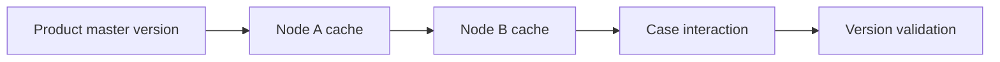

# Reference data distribution across multiple nodes

**PFA-073** | SSA/LSA engineering case | Design study, laboratory proof pending

## Production symptom and business risk

A Node-scoped product-code Data Page is refreshed on node A after catalogue update, while node B continues to serve the old product labels. During load-balancer failover, the same agent sees contradictory values.

The outcome must be provable across the case record, the data source and any cached or indexed read model. A green Flow Action is not a substitute for verifying where the authoritative state was committed.

## System sequence

## Pega components and design responsibilities

1. **Node-scoped Data Page.** Record the rule/class mapping, execution context, data owner and a measurable acceptance condition.
2. **Load Management.** Record the rule/class mapping, execution context, data owner and a measurable acceptance condition.
3. **reference data version.** Record the rule/class mapping, execution context, data owner and a measurable acceptance condition.
4. **cache refresh.** Record the rule/class mapping, execution context, data owner and a measurable acceptance condition.
5. **cluster routing.** Record the rule/class mapping, execution context, data owner and a measurable acceptance condition.

## Architecture and implementation steps

1. Confirm the data is genuinely safe for shared Node scope: public product codes rather than customer-specific price eligibility.

2. Attach a source version or valid-as-of time so node divergence is observable.

3. Define a refresh/invalidation mechanism for every node; do not assume one Node Data Page instance is cluster-global.

4. During a transition, allow display labels to be eventually consistent but reject critical product decisions if source version is obsolete.

5. Test in a two-node environment and capture source version on each response.

A detailed implementation should name classes, property types, parameters, indexes and connector contracts for the chosen product release. Where sample names are needed, use domain-specific names, not copied vendor rules.

## Options and design decision

- **Option 1:** Node scope minimizes repeated loads on each node but permits divergence.
- **Option 2:** short scope reduces reuse at higher source cost.

Evaluate cost under realistic result cardinality, transaction rate, retry load and permission changes. An optimized read path that violates ownership or consistency is not a valid optimization.

## Failure analysis

A case begins on node A and finishes on B with different allowed product codes. An update event reaches only one node.

Collect source record IDs, case version, exact Data Page parameters or SQL query, node/requestor, rule stack and partner operation ID as applicable. Separate a stale cache/index result from a failed database write.

## Reproducible tests

1. **Scenario 1:** Update source while two nodes serve traffic. Capture expected values and the actual committed/source state.
2. **Scenario 2:** force failover. Capture expected values and the actual committed/source state.
3. **Scenario 3:** compare effective version in validation rule. Capture expected values and the actual committed/source state.

No tests described here have yet been executed by this publication. Verify in a release-matched Pega sandbox with sanitized Clipboard, DBTrace, Tracer, integration logs and screenshots where applicable.

## Capacity, security and recovery

Document source-specific freshness and tenant isolation, peak query/request volume, failure backlog and a supportable recovery action. Retain historical case/audit integrity during migration and do not infer successful external transactions from a Pega commit alone.

## Pega technical reading

- [Data Pages](https://academy.pega.com/topic/data-pages/v5)

*Independent design study with fictional scenario, not a report of production benchmarks.*
