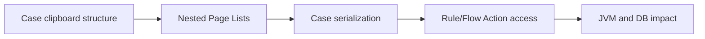

# Clipboard growth in deeply nested case models

**PFA-074** | SSA/LSA engineering case | Design study, laboratory proof pending

## Production symptom and business risk

A complex mortgage application stores hundreds of deeply nested Page Lists directly on pyWorkPage. Each Flow Action renders only a small subset, but cases serialize large data structures and requestor heap continues to grow as users move between stages.

The outcome must be provable across the case record, the data source and any cached or indexed read model. A green Flow Action is not a substitute for verifying where the authoritative state was committed.

## System sequence

## Pega components and design responsibilities

1. **pyWorkPage.** Record the rule/class mapping, execution context, data owner and a measurable acceptance condition.
2. **Data Objects.** Record the rule/class mapping, execution context, data owner and a measurable acceptance condition.
3. **Page Lists.** Record the rule/class mapping, execution context, data owner and a measurable acceptance condition.
4. **Data Pages.** Record the rule/class mapping, execution context, data owner and a measurable acceptance condition.
5. **PAL.** Record the rule/class mapping, execution context, data owner and a measurable acceptance condition.

## Architecture and implementation steps

1. Separate durable case facts from reusable reference and external detail data. Store only what the case actually owns.

2. Normalize large associated collections into Data Objects or separate child records where they need independent lifecycle or query access.

3. Replace copied partner payloads with stable references and minimal snapshots required for audit; keep secrets and binary attachments out of the clipboard.

4. Measure serialized case size and live requestor heap under real case shapes, not an empty new case.

5. Profile repeated page traversal and declarative expressions; a nested list can cause unexpected full copies or repeated lookups.

A detailed implementation should name classes, property types, parameters, indexes and connector contracts for the chosen product release. Where sample names are needed, use domain-specific names, not copied vendor rules.

## Options and design decision

- **Option 1:** Embedding all details simplifies initial bindings but raises cost.
- **Option 2:** separate data objects add joins or retrieval but bound case footprint.

Evaluate cost under realistic result cardinality, transaction rate, retry load and permission changes. An optimized read path that violates ownership or consistency is not a valid optimization.

## Failure analysis

One large Page List copied in a Data Transform doubles memory during validation; old cases carry obsolete repeated partner snapshots.

Collect source record IDs, case version, exact Data Page parameters or SQL query, node/requestor, rule stack and partner operation ID as applicable. Separate a stale cache/index result from a failed database write.

## Reproducible tests

1. **Scenario 1:** Compare 10 and 1000 child rows. Capture expected values and the actual committed/source state.
2. **Scenario 2:** measure case BLOB and heap. Capture expected values and the actual committed/source state.
3. **Scenario 3:** exercise last-stage save under high concurrency. Capture expected values and the actual committed/source state.

No tests described here have yet been executed by this publication. Verify in a release-matched Pega sandbox with sanitized Clipboard, DBTrace, Tracer, integration logs and screenshots where applicable.

## Capacity, security and recovery

Document source-specific freshness and tenant isolation, peak query/request volume, failure backlog and a supportable recovery action. Retain historical case/audit integrity during migration and do not infer successful external transactions from a Pega commit alone.

## Pega technical reading

- [Data modeling](https://academy.pega.com/topic/data-modeling/v1)

*Independent design study with fictional scenario, not a report of production benchmarks.*
