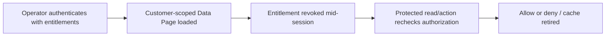

# Access Revocation with Cached Data Pages: Avoiding Stale Entitlement Leaks

**PFA-075** | **Audience:** Pega SSA / LSA | **Lab status:** Not yet executed in a live Pega environment

## Enterprise problem

A business agent is removed from a regulated client's account, but a customer-specific Data Page remains loaded in the agent's requestor session. The portal might continue to show cached details even though the identity provider changed the entitlement. Lowering the cache TTL helps reduce one window but does not establish secure access revocation for every data operation.

The purpose is to decide how Pega should behave when there are simultaneous users, service failures, stale state and a deployment boundary. A feature can be configured correctly at rule level but still be wrong for the business process.

## Component and runtime sequence

This is a conceptual design. It is not a claim about actual traces or a particular Pega version.

## Pega artefacts and execution context

| Rule or component | Design requirement |
|---|---|
| Operator/Access Group roles | Architectural responsibility and identity boundary |
| Access Control Policy | Rule or configuration must be version controlled |
| Customer/Tenant Data Page | Inputs/outputs and failure model must be documented |
| Requestor scope and refresh | Expected observability and support ownership |
| External data-source access controls | Explicit integration or release validation required |

Before implementation, record the actual Apply To class, ruleset and access group. Business responsibility must remain with the correct system of record. Context supplied through UI request parameters should be treated as untrusted until server-side authorization is applied.

## Technical implementation sequence

1. Define revocation timeliness in policy: immediate, at session renewal or within an approved interval. The architecture cannot promise instantaneous revocation without a signal/control path.

2. Separate authentication session validity from record-level business entitlement, which can change independently.

3. Include relevant identity parameters in Data Page lookups only as part of isolation; do not rely on parameter key as an access decision.

4. Apply an Access Control Policy for local protected data, and enforce equivalent checks at remote REST adapters where platform policies alone do not protect the source.

5. On every sensitive read, update, export and irreversible operation, check current entitlement at the server boundary. UI field visibility does not count.

6. If a revocation event is available, invalidate affected session content or require reauthentication according to supported mechanisms and risk appetite.

7. Test active browser tabs, cached data, exported reports and background jobs separately; elevated system requestors need their own bounded privileges.

### Design review questions

Who owns each state transition? Which operation is allowed to run again after a lost response? Can a cached value be shared across a session or node? How will an administrator see a failure when the original user has signed out? Each answer must be supported by a reproducible test and a named on-call owner.

## Alternatives and when to reject them

| Approach | Architectural cost and applicability |
|---|---|
| Session authorization only | Fast but ignores mid-session entitlement changes |
| Refresh the cached page more frequently | Reduces staleness but cannot replace access enforcement |
| Server-side current policy plus scoped cache | More robust access control with explicit revocation contract |

Avoid adopting the fastest development path merely because it passes a single-user test. State where complexity has been moved: infrastructure scaling, cache invalidation, support recovery, version migration or customer authorization.

## Production diagnosis

An agent might continue to view an already-rendered browser screenshot even after server revocation; no server can erase past visual access. The enforceable guarantee is denial of future protected server actions and responses. Beware cached search reports or Node Data Pages with different identity parameters.

Build incident evidence around the case/operation identity, exact requestor or processing node, release/ruleset stack, timestamps and external correlation IDs. The same user-visible symptom can arise from rule resolution, database state, queue processing or a remote API. Investigate the layer that actually owns the failing transition.

## Controlled verification

| Test scenario | Expected behavior to observe |
|---|---|
| Lab test 1 | Load protected customer record then revoke entitlement and request again. |
| Lab test 2 | Attempt direct case ID read without visiting portal navigation. |
| Lab test 3 | Attempt export/report under revoked access group. |
| Lab test 4 | Run a background process with broad access and confirm operation-level scope. |

For acceptance, store actual screenshots of the rule configuration and sanitized Clipboard/Tracer/PAL data only after the experiment runs in a permitted Pega environment. Do not present theoretical timings as observed measurements.

## Production readiness checklist

- Define data classification and identity boundaries for this capability.
- Capture interface contract and dependency versions.
- Agree business freshness, latency and failure-response requirements.
- Verify retries, duplicates and parallel interactions where relevant.
- Monitor the supported recovery signal, not merely the happy-path success message.
- Retain rollback or forward-repair steps for active cases crossing a release.
- Record the target Pega version and the observed lab result before declaring the design verified.

## References

- [Pega Academy: Designing enterprise data access](https://academy.pega.com/topic/designing-enterprise-data-access-pega-live-data/v1)
- [Pega Academy: Data Pages](https://academy.pega.com/topic/data-pages/v6)

Independent architectural analysis. Examples use fictional business details. This article is not affiliated with Pegasystems, and exact runtime options may vary by release.
