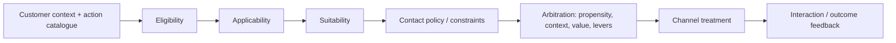

# Next-Best-Action Arbitration: Where Business Eligibility Ends and Ranking Begins

**PFA-211** | **Audience:** Senior and Lead System Architects | **Status:** Reference architecture; live Pega test pending

An action can have the best model score and still be the wrong action to show. Design and test eligibility, suitability, contact constraints and arbitration separately.

## 1. The enterprise failure this design prevents

A bank's web channel can present one of several credit products. An adaptive model strongly predicts a response to an expensive credit offer, but the customer is in financial difficulty and the bank must not present it. Marketing requests a large business-value lever so the product still wins. That is an architectural category error: **suitability determines whether an action may participate**; arbitration ranks the remaining actions. A high lever should not reverse a mandatory suitability exclusion.

## 2. Component and execution architecture

The following diagram is an **illustrative reference design**. It is not a screenshot from a running Pega environment.

## 3. Which Pega objects own each concern?

| Component | Why it exists |
|---|---|
| `Next-Best-Action Designer` | Business structure and engagement policy |
| `Actions and treatments` | Business proposition versus channel presentation |
| `Eligibility / Applicability / Suitability` | Distinct filtering conditions |
| `Contact policies / constraints` | Control contact frequency and channel restrictions |
| `Arbitration setup` | Rank qualifying actions by configured decision factors |
| `Interaction history` | Provide traceable contact and outcome evidence |

The named objects above are a mix of actual Pega rule categories and illustrative application-specific names. They are not a claim that all such rules exist in a default Pega installation.

## 4. Implementation design and decision sequence

1. Write mandatory prohibitions as suitability or other hard exclusion policy, not as a low ranking score.

2. Define action catalogue and channel treatments separately. The same action may require different rendering or contact constraints by channel.

3. Create small persona fixtures, including a financially vulnerable customer, a current product holder and an eligible but low-propensity customer.

4. Inspect the candidate set after eligibility, applicability and suitability. No amount of arbitration change should reintroduce an excluded action.

5. Define and review the ranking model only for the surviving action set. Pega documents propensity, context weighting, business value and business levers as arbitration factors; actual formulas/configuration vary by release.

6. Control contact policies across channels. A web impression followed by call-centre interaction can exhaust the same business-level contact budget.

7. Record decision reasons in a supportable form and test outcome feedback timing, missing-data defaults and model unavailability.

## 5. What an architect must choose

| Approach | Effect and trade-off |
|---|---|
| All business policy encoded as one priority formula | Difficult to audit, risks ranking impermissible actions |
| Explicit filtering then arbitration | Auditable separation of eligibility and commercial preference |
| Channel-specific duplicated strategy | Quick local exceptions but drift between web, call centre and outbound |

**Decision standard:** choose the smallest design that satisfies consistency, auditability, security, performance and operational recovery, not the design that simply looks easiest in Dev Studio.

## 6. Failure modes and root-cause investigation

**Suitability breach:** segmentation data was stale or null and exclusion defaults incorrectly permitted an action. **Contact fatigue:** channel teams count impressions separately, causing repeated offers. **Lever dominance:** a ranking override hides a model drift problem. **Outcome skew:** only clicked offers generate feedback, so sample bias goes unexamined. **Decision mismatch:** a customer calls seconds after a web offer and the policy context changed. Capture the exact policy version and interaction sequence.

For troubleshooting, preserve the application/ruleset version, access context, precise business identity, timestamp and correlation ID. Never include secrets or production customer documents in publicly shared traces.

## 7. Verification matrix for a Pega lab

These are **tests to run**, not tests that have already passed.

| Experiment | Evidence and expected assertion |
|---|---|
| Mandatory exclusion | Ineligible/vulnerable persona never sees restricted action even with maximum lever |
| Ranking | With identical eligibility, alter propensity and expected priority as configured |
| Cross-channel | Web treatment followed by agent channel observes contact constraints |
| Missing attribute | Verify conservative handling of unavailable suitability signal |
| Model unavailable | Execute documented fallback and confirm no prohibited recommendation |

At the end of the experiment, attach redacted screenshots of the relevant rule forms, Clipboard/Tracer/PAL evidence when applicable, and an actual observed outcome. If any result differs, update the design instead of changing the evidence description.

## 8. Production readiness and ownership

Track action eligibility pass rates, contact-policy suppression, rank distribution, model drift and reasons for no-action outcomes. Review with risk/compliance as well as marketing. The operational question is not just conversion uplift but whether every chosen action was appropriate.

**Architecture acceptance:** the design has an explicit owner, a version-specific reproducible test, a failure/recovery procedure, the relevant security controls and a way to detect regressions.

## 9. Product references and limitations

- [Pega Academy: Action arbitration](https://academy.pega.com/topic/action-arbitration/v2)
- [Pega Academy: Engagement policies](https://academy.pega.com/module/defining-customer-engagement-policies/v5)
- [Pega Academy: Customer Decision Hub overview](https://academy.pega.com/module/customer-decision-hub-overview/v7)

Pega functionality changes by release. Treat exact editor labels, extension points and service behaviours as version-sensitive until verified in the target environment. This independent article is neither an official Pega document nor a claim of an executed customer implementation.
