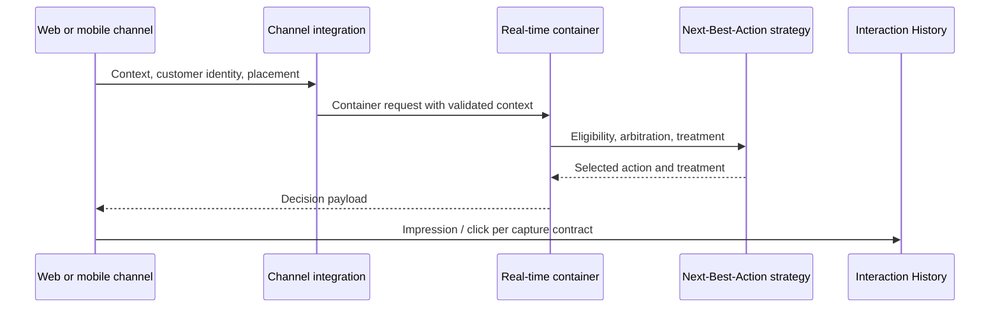

# Customer Decision Hub channel integration patterns

**Scope:** Pega enterprise architecture and LSA implementation guidance. Version-dependent configuration and recovery semantics require verification against the target platform release.

## When the website and the decision engine disagree

A retail bank uses Customer Decision Hub to choose an offer for a web banner. The website calls the real-time container on page load, then records an impression when the user scrolls the banner into view. The container is also configured to capture an impression on retrieval. A single view now creates two impressions, distorting performance measurement and potentially influencing adaptive learning. On a different channel, an agent desktop supplies a customer identifier that does not match the authenticated session, allowing an offer to be evaluated for the wrong person.

The integration boundary must specify not only how an action is selected but who owns identity, placement, impression and response interpretation. A real-time container is not merely a generic recommendation endpoint. It connects an external channel with configured Next-Best-Action strategies and their interaction-history semantics.

## Contract design

For each channel, define a placement or container identifier, authenticated customer context, allowed attributes, treatment schema, channel-specific eligibility and an interaction event contract. A web banner may need image URL, alternative text, call-to-action and destination. A call-centre desktop may need a concise reason, disclosure text and a guided next step. Do not force both into one unversioned response shape.

Use Next-Best-Action Designer for policy configuration and real-time container rules for channel integration. Define action groups and treatments with clear ownership between decisioning and channel teams. The channel may render the selected treatment, but it must not silently override eligibility or invent a substitute offer. If no action is eligible, return an explicit empty outcome with a documented user experience.

Impression capture must be chosen deliberately. Captured-on-retrieval suits placements where delivery is a valid impression; captured-by-channel suits placements where the channel can reliably detect actual presentation. Clicks and outcomes should carry a stable decision or interaction correlation identifier where the supported API permits. Do not log the same interaction twice in both paths.

## Implementation sequence

1. Inventory consuming channels, placements, request volumes, customer identity sources and consent requirements. Record which team owns each data element.
2. Register a real-time container for each meaningful placement contract. Configure active status and associated strategy according to the target CDH release.
3. Establish a trusted mapping from channel session to customer identity. Validate tenant, consent and channel eligibility before calling decisioning.
4. Define request and response schemas with versioned fields. Use a minimal context payload; fetch governed customer attributes within CDH where practical.
5. Model action eligibility, suitability, arbitration and treatment selection separately. Record which conditions are channel-specific and which are enterprise-wide.
6. Configure impression behaviour for the placement. Choose one authoritative event producer and define deduplication keys for late or repeated callbacks.
7. Add timeouts and a channel-owned fallback for empty or unavailable decisions. Fallback content must still comply with consent and product eligibility requirements.
8. Run contract tests for web, mobile and agent desktop independently, then verify Interaction History event counts and event-to-decision linkage.
9. Review deployment ordering: container configuration, strategy rules, treatment assets and channel code must be compatible at cutover.

## Architecture tradeoffs

A shared container can reduce configuration overhead but creates a tightly coupled schema and may mix channel semantics. Per-placement containers provide cleaner contracts at the cost of governance. Capturing impressions at retrieval is simpler but can overcount when content is never displayed. Capturing at the channel reflects presentation more accurately when the channel is reliable, but requires replay protection and event delivery monitoring. A precomputed recommendation can reduce latency but may become ineligible after consent or account state changes; validate policy at the appropriate decision point.

## Production failure mechanics

A container can return a valid action while the asset URL is broken, resulting in an invisible recommendation. Conversely, a browser can render cached content after the decision expires. Correlate container requests, selected action IDs, treatment versions and interaction events to distinguish decision failures from rendering failures. If click volume rises without corresponding impressions, investigate duplicate click callbacks or mismatched correlation keys before modifying adaptive models.

## Reproducible verification matrix

| Test | Setup | Required result |
| --- | --- | --- |
| Eligible customer | Valid consent and placement | Correct action and treatment schema |
| Ineligible customer | Suppress consent or suitability | No prohibited offer |
| Empty decision | All actions filtered | Explicit no-action contract |
| Double callback | Send same impression twice | One logical impression |
| Delayed render | Request then abandon page | Impression count matches configured capture mode |
| Cross-channel | Same customer, web versus agent | Channel-appropriate treatment and policy |
| Timeout | Disable container in test | Safe channel fallback, no invented decision |

These are proposed checks, not observed results. Capture the installed CDH version, container configuration and sanitized Interaction History evidence.

## Primary references

- [Pega Academy: Real-time containers](https://academy.pega.com/topic/real-time-containers/v1/in/59656/59836)
- [Pega Academy: Creating a real-time container](https://academy.pega.com/topic/creating-real-time-container/v1)

## Architecture flow

## Evidence required before production approval

Attach a reviewed architecture decision, application and Pega release versions, rule identifiers, sanitized test evidence, observed results, open risks and rollback criteria. The matrix is a design-backed verification plan rather than a claim of completed laboratory testing.
