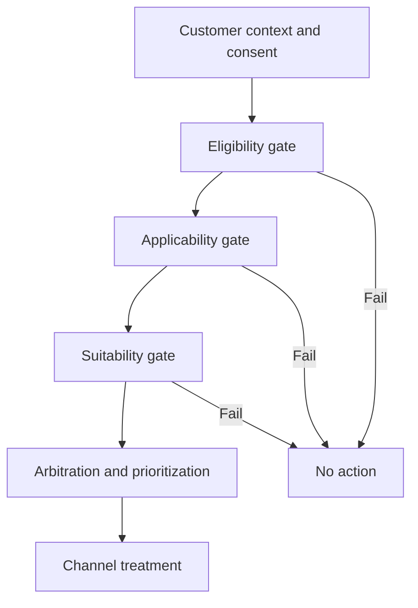

# Action eligibility and suitability design

> Architecture study for Lead System Architects. The failure narrative is a hypothetical engineering scenario; no production incident or test result is claimed.

## Enterprise failure scenario

A retail bank launches a premium credit offer. Marketing defines a high propensity threshold and observes strong response rates. A customer who has opted out of marketing nevertheless receives an offer because an old eligibility flag remains cached. Another customer qualifies by score but is not suitable under affordability policy. A propensity model answers likelihood, not permission or suitability. The decision architecture must prevent optimization from bypassing mandatory policy.

## Architecture decision and Pega rule design

Model Eligibility, Applicability and Suitability as separate engagement-policy gates in Next-Best-Action Designer. Eligibility expresses hard participation constraints such as age, residency and consent. Applicability expresses whether the action makes sense now, such as not already holding the product. Suitability expresses risk, affordability and customer-interest restrictions. Only after these gates should arbitration consider business value, propensity and channel constraints. Keep a documented owner and effective date for each policy. Missing mandatory attributes should produce no offer, not an optimistic default.

## Technical flow

## Implementation sequence

1. Create a policy taxonomy with legal, compliance, product, marketing and data stewardship. Decide which checks are non-negotiable and which are business targeting choices.

2. Define the action hierarchy and issue/group organization in Next-Best-Action Designer. Place shared rules at the group level only where every child action truly shares the condition.

3. Map consent, age, account status, product ownership and affordability to governed data sources. Record freshness requirements, source timestamps and behavior when data is unavailable.

4. Configure eligibility rules for hard boundaries, applicability for current need and suitability for harm or risk constraints. Keep action-specific thresholds on the relevant action.

5. Build a traceable reason-code contract: each excluded action has a policy version, input snapshot reference and high-level reason that can be audited without leaking protected model features.

6. Apply prioritization and treatment choice only to the remaining eligible action set. Never use a high model score to bypass a failed suitability rule.

7. Simulate boundary cases and channel differences with a reproducible customer cohort. Include opt-out changes immediately before decision invocation.

8. Set up controlled business changes with approval and rollback. Measure policy exclusion distributions and unexpected no-action rates separately from conversion metrics.

## How the design fails in production

A stale data page can make withdrawn consent appear valid. Group-level policy may be too broad for one action and too weak for another. A null affordability score interpreted as zero or as pass can produce opposite and equally serious errors. A strategy that ranks actions before filtering can waste resources or accidentally expose an ineligible action to downstream channels. A fallback recommendation should never be an unfiltered generic offer. Store enough policy context to explain a decision without retaining unnecessary personal data.

## Genuine tradeoffs

Strict freshness for every eligibility attribute can increase decision latency. Relaxed caching improves throughput but creates compliance exposure. Shared policies reduce duplication yet can conceal action-specific exceptions. A no-action result may lower short-term conversion but protects customer outcomes and regulatory obligations.

## Reproducible verification matrix

| Test setup and stimulus | Expected observable result |
| --- | --- |
| Consent withdrawn immediately before request | No marketing action returned |
| Affordability missing or stale | Suitable action excluded pending verification |
| Customer already holds product | Applicability rejects duplicate offer |
| High propensity but ineligible | Optimization cannot override hard gate |
| Different channels same customer | Policy consistent; treatment channel-specific |
| Policy version changes during campaign | Decision evidence records effective version |

Run each test against a named application version with independent requestors where relevant. Record configuration, input fixtures, observed response, persisted state and log correlation identifiers. The expected results above are acceptance criteria, not claims of execution. A failed row blocks a production recommendation until investigated.

## Release and evidence boundaries

Pega Academy defines engagement policies in Next-Best-Action Designer as Eligibility, Applicability and Suitability. UI terminology and arbitration options vary across Customer Decision Hub releases. Verify behavior with a version-matched Pega environment and approved sample data. Include security review, recovery runbook, and rollback assessment in the change record. Do not infer correctness from a successful UI response alone.

## Primary references

- [Pega product guidance](https://academy.pega.com/topic/defining-eligibility-applicability-and-suitability-rules/v2)
