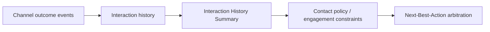

# CDH Contact Policies: Suppressing an Offer Across Web, Agent and Outbound

**PFA-214** | Senior / Lead System Architect level | Design reference, not a lab result

## The practical failure

A customer sees a loan offer twice in web, declines it in the agent channel, then receives outbound promotion. Each channel has tracked a different subset of exposure events and believes the action is allowed. Contact policy architecture must unify impression and response semantics over the correct action or group and time window.

## Technical flow

The diagram describes a proposed execution boundary rather than a captured Pega implementation.

## Pega rules and interfaces involved

| Rule or component | Architect's checklist |
|---|---|
| Next-Best-Action Designer Constraints | Owns one part of this design |
| Contact policy rule | Requires clear data and security contract |
| Interaction History Summary | Needs actual release-specific configuration |
| Engagement policy | Should yield evidence for diagnostics |
| Customer Profile Viewer | Has a testable operational responsibility |

## Implementation design

1. Define event semantics first: what counts as impression, send, click and acceptance in every channel.

2. Choose suppression scope explicitly: individual action, action group or policy cohort; different choices yield different contact fatigue.

3. Choose the tracking window and suppression duration, including policy for delayed interaction events.

4. Apply the contact policy through the relevant Next-Best-Action engagement configuration and verify effective deployment.

5. Use one synthetic customer journey through web, call centre and outbound to show cross-channel suppression.

6. Keep hard suitability exclusions distinct from ranking and contact suppression; increasing a business lever cannot legitimately resurrect a prohibited offer.

7. Monitor suppression outcomes and policy version in decision logs, while minimising customer data.

## Competing patterns

| Approach | Trade-off |
|---|---|
| Independent per-channel suppression | Simpler teams, inconsistent cross-channel contact frequency |
| Shared policy and interaction history | Coherent customer treatment, needs shared identity and event quality |
| Only lower commercial ranking | Does not guarantee actual suppression |

A valid architecture makes the consistency, permission and recovery contract explicit. Do not optimize for one successful demonstration while ignoring the retry or failure case.

## Why it breaks in production

Missing web impression events, different customer identifiers between channels and late arrival of outcomes all distort counts. A business lever is a ranking factor, not an exception to a hard policy. Diagnose candidate eligibility and suppression before examining arbitration scores.

For incident triage, retain a redacted operation/case ID, node, ruleset/app version, timestamp and evidence of the dependent system. Never publish private client payloads or authentication tokens.

## Reproduction and verification plan

| Scenario | Evidence to obtain |
|---|---|
| Test 1 | Record two web impressions and verify action suppression. |
| Test 2 | Request an agent decision immediately afterward and confirm the same configured policy. |
| Test 3 | Expire the tracking window and verify re-eligibility per business rule. |
| Test 4 | Test a different action in the same group to validate scope. |

These are proposed tests. No claim is made that the scenario has been executed in a Pega lab. A complete validated edition should show the actual Pega rule forms, configuration values and observed result for the target release.

## Release checklist

Record system of record, data and authorization boundary, expected volume, timeout/retry or conflict strategy, owner of failures, migration impact and a repair runbook. Confirm behavior across at least two realistic user/role contexts where applicable.

## Source and version note

- [Relevant Pega Academy reference](https://academy.pega.com/topic/contact-policies/v1/in/9776)

Independent original engineering content. Version-specific editor names and configuration controls must be checked against the Pega release used by the reader.
