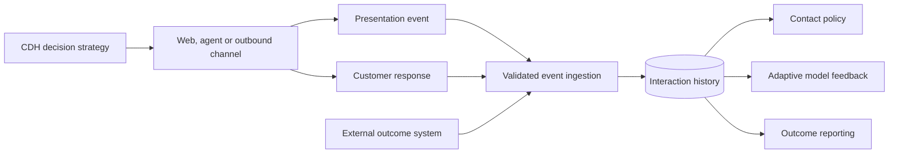

# Interaction history data flow and persistence

**Audience:** Pega Lead System Architects and platform engineers. Design guidance is not a claim of laboratory validation.

A telecoms provider launches a retention action through its contact centre and mobile app. The same customer receives the offer in both channels, but only the mobile app records the impression. Customer Decision Hub's contact policy then treats the call-centre interaction as nonexistent and recommends the same action again. Reporting shows a high apparent acceptance rate because unsuccessful presentations are missing. The issue is not model tuning; it is an incomplete interaction history event contract.

Interaction history is a decisioning control plane input. The architecture must define what constitutes an impression, response and final outcome, how events are correlated, and which system is authoritative for each event.

## Event semantics and data ownership

Specify event types separately: decision generated, action presented, customer responded, response amended and downstream outcome confirmed. A generated decision is not automatically a customer impression. Store a unique InteractionID with customer key, action/proposition identifier, treatment, channel, placement, decision timestamp, impression timestamp, response timestamp, response code and source event ID. Preserve the distinction between event time and ingestion time.

Pega Customer Decision Hub supports interaction history for contact policies, adaptive models and reporting. The exact event schema, data set, retention and API interfaces depend on the deployed CDH release. Do not write directly to internal interaction history tables from a custom SQL job. Use supported CDH ingestion and decisioning interfaces and test their behavior in the target version.

## Implementation sequence

1. Create a channel-neutral event dictionary. Agree with marketing, analytics and operations on what counts as a presentation versus a decision not shown to the customer.
2. Define stable identifiers. InteractionID must connect decision, presentation and response; SourceEventID must allow idempotent ingestion of duplicate channel events.
3. Map actions and treatments to canonical identifiers. A treatment rename or action version change must not split history unintentionally.
4. Configure CDH decision strategies, action eligibility, contact policies and supported interaction history capture. Validate that the relevant channel integration emits actual presentation and response events, not only decision requests.
5. For asynchronous channels, design a durable event buffer with retry and dead-letter handling. Reconcile buffered events against channel delivery acknowledgements.
6. Normalize timestamps to UTC while preserving original source time and timezone metadata. Apply an explicit late-arrival policy so a delayed response does not overwrite a newer state incorrectly.
7. Use Data Flows and supported Data Sets for ingestion or transformation where appropriate to the installed CDH release. Validate source contracts and schema evolution before production rollout.
8. Map downstream business outcomes such as completed purchase, cancellation or repayment to the correct earlier interaction. Do not feed an inferred success when the outcome is still pending.
9. Reconcile daily counts by channel: decisions, presentations, responses, confirmed outcomes, duplicates rejected and unmatched events. Segment by source system and action.
10. Apply data minimization, retention and subject-rights procedures to the customer identifiers and response data in the decisioning store.

## Tradeoffs

Synchronous recording provides prompt contact-policy updates but increases channel response latency and introduces availability coupling. Asynchronous ingestion decouples the channel but creates a consistency window in which the next decision may not see the latest impression. A hybrid design may use a lightweight synchronous suppression signal and durable asynchronous detailed events, provided both are reconciled. Storing every diagnostic attribute makes analysis easier but increases privacy risk and storage cost.

## Production failure mechanics

If an agent desktop sends a presentation event when the offer is loaded but not actually displayed, contact policy may suppress an action the customer never saw. Conversely, if a web page sends an impression only on successful page exit, abandoned sessions disappear from history. Duplicate mobile retries can inflate impressions unless SourceEventID is deduplicated. Delayed outcomes can incorrectly train adaptive models if they are linked to the wrong action or if the feedback window is not configured appropriately.

The repair procedure must identify affected event windows, compare raw source counts with accepted interaction history and replay only events whose identities and semantics are verified. A blind bulk replay may double-count customer contact.

## Reproducible verification matrix

| Scenario | Reproduction | Expected result |
| --- | --- | --- |
| Decision not displayed | Request action but close before rendering | No false presentation |
| Two channels | Present same action in web and agent | Both events captured with distinct IDs |
| Duplicate event | Replay SourceEventID | One logical event |
| Late response | Ingest response after newer interaction | Correct correlation and ordering policy |
| Missing outcome | Delay CRM confirmation | No fabricated positive feedback |
| Action rename | Change treatment label, keep canonical ID | Continuous analytical identity |
| Partial outage | Stop event ingestion, restore | Durable replay and count reconciliation |
| Privacy request | Exercise retention and access controls | Policy-compliant handling |

**Primary reference:** [Pega Platform: decision management overview](https://docs.pega.com/bundle/platform-242/page/platform/decision-management/decision-management-overview.html). CDH data model and operational settings must be checked for the installed version.
