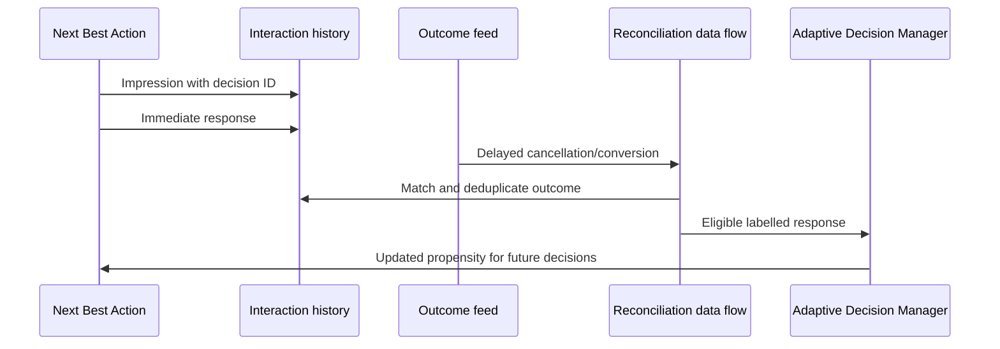

# Adaptive Model Feedback and Delayed Outcomes

## Enterprise failure scenario

A telecom operator trains next-best-action models from immediate web clicks. The retention offer looks successful on day one but cancellations arrive weeks later. The same customer receives repeated offers across channels and a late conversion event is counted twice after a data-flow replay. Adaptive Decision Manager learns from biased, incomplete labels and starts promoting offers that damage longer-term retention.

## Architecture decision and Pega rule boundary

Separate impression, response, business outcome and model label as distinct events with durable identities and timestamps. Capture interactions in the Customer Decision Hub interaction-history design appropriate to the release. Associate each delayed outcome with the original Action, treatment, channel, customer and decision context. A data flow should reconcile late events and prevent duplicate training signals. Configure Adaptive Models and monitoring only after the business defines a label horizon and attribution policy.

## Implementation in order

1. Define the target outcome precisely: accepted offer, activated service, retained account at day 30 or another approved measure. Document observation horizon and what an unknown outcome means.

2. Assign a durable decision/impression identifier across channels. Persist action, treatment, context version, timestamp and eligibility outcome in an auditable interaction record.

3. Map inbound delayed events to the originating decision with explicit attribution windows. Record late and unmatched events separately rather than inventing a negative label.

4. Create a Data Flow or supported ingestion pipeline that deduplicates events, reconciles ordering and tracks processed outcome IDs. Test replay and correction of an earlier event.

5. Review Adaptive Model configuration, predictor availability, customer segmentation and monitoring with decisioning specialists. Avoid including attributes prohibited by privacy or fairness policy.

6. Measure model performance by label maturity cohort and channel. Compare immediate click-through with the delayed business outcome before changing arbitration.

7. Reconcile historical interaction counts to the model input population. Establish a documented process for retracting or correcting bad feedback if the release supports it.

## Failure mechanics in production

A negative outcome inferred too early can bias training against customers whose conversion takes longer. Duplicate feedback inflates apparent success, while unmatched outcomes create survivorship bias. A channel may send only positive responses, leaving the denominator of non-responders unknown. An adaptive model can react quickly to misleading labels and propagate the effect into arbitration. A replayed data flow must not silently create additional learning events. Monitoring model AUC alone does not prove that the chosen business outcome improved.

## Design tradeoffs

- Short label windows improve feedback speed but misclassify slow conversions; long windows delay learning and require larger retained event stores.
- Per-channel models can capture behavioural differences but reduce sample size; pooled models simplify operations while hiding channel bias.
- Immediate click labels are observable and cheap, but a retained-customer outcome is closer to the actual business objective.

## Reproducible verification matrix

Run these checks with synthetic data in a controlled test environment. Capture the application version, ruleset stack, requestor identity, test stimulus and expected persisted outcome. These are proposed checks, not executed results.

| Test and stimulus | Expected result and evidence |
| --- | --- |
| Conversion arrives after observation window | Outcome classified under documented late-event policy |
| Same outcome delivered twice | One effective training label and auditable duplicate |
| Cancellation precedes delayed acceptance | Event-time ordering yields defined attribution |
| Only positive channel events available | Incomplete label population detected and flagged |
| Data flow replays full day | Model input counts do not double |
| Offer treatment changes mid-campaign | Decision and treatment versions retained |
| Compare mature cohorts across channels | Delayed outcome metrics reported separately from clicks |

## Incident runbook

If propensities shift unexpectedly, first inspect label completeness, duplicate rates, late-event distribution and channel-specific data quality. Suspend suspect feedback ingestion before changing model settings. Retain raw event IDs and reconciliation decisions so the correction can be reproduced without exposing personal identifiers.

## LSA release acceptance and limitations

A design sign-off needs a label dictionary, event schema, reconciliation rules, retention policy and a model-monitoring owner. Customer Decision Hub features and licensing vary by version; validate the exact ADM, Interaction History and Data Flow capabilities in the target deployment.

The architecture is design-backed and laboratory verification remains pending. A technical reviewer should inspect rule resolution, authorisation, Pega guardrail warnings, negative-path behaviour and rollback feasibility before promoting it. Capture controlled Tracer or PDC evidence only where available, and exclude sensitive clipboard content from shared logs. Do not interpret a diagram as evidence that the implementation has been tested.

## Verified Pega primary references

- [Pega decision management overview](https://docs.pega.com/bundle/platform-242/page/platform/decision-management/decision-management-overview.html)
- [Pega Adaptive Decision Manager configuration](https://docs.pega.com/bundle/platform-88/page/platform/decision-management/adaptive-decision-manager-service-config.html)
