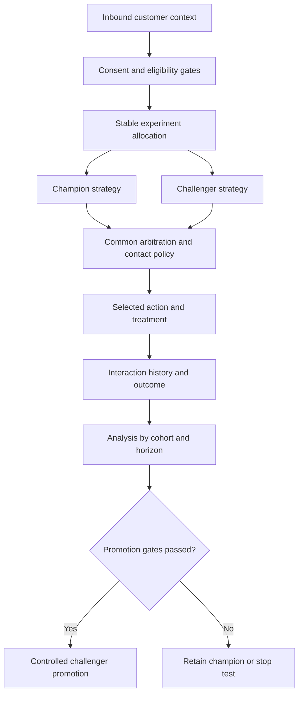

# Champion challenger strategies in decisioning

## Failure scenario: a challenger wins on clicks but loses customer value

A telecom provider runs Pega Customer Decision Hub to choose next-best actions for customers contacting support. A new challenger strategy increases promotional offer clicks in a small pilot. The business promotes it as champion, but subsequent complaints rise because the challenger favors high-response offers over customer suitability and contact-policy limits. The experiment lacked stable audience allocation, consistent eligibility, a complete outcome horizon and a rollback criterion.

Champion-challenger is an **experiment in decision policy**, not merely a switch between two Strategy rules. The experiment must hold regulatory eligibility, customer consent and suitability constraints constant, while isolating the decision logic being evaluated. Short-term response rate cannot substitute for long-term value or fairness review.

## Pega decisioning boundaries

Model candidate actions in Customer Decision Hub with appropriate Issues and Groups, Actions, Treatments and engagement policies. Use decision strategies to apply eligibility, applicability, suitability, prioritization and arbitration. A champion-challenger split can be implemented using supported strategy components or revision-management features available in the deployed CDH version; the precise component names and governance screens vary by release.

Keep contact policies and suppression rules as shared safety gates. A challenger must not bypass consent or a maximum-contact rule just to gain exposure. Define the experimental unit as a stable customer or account identifier, not a requestor session, or the same person may oscillate between strategies across channels.

## Decision flow

## Implementation plan

1. **Define the hypothesis before changing rules.** Example: replacing a fixed priority with a propensity-weighted ranking improves accepted service-plan recommendations without increasing complaints or unfair exposure. Document primary metric, guardrail metrics, outcome window and stopping conditions.
2. **Freeze shared eligibility.** Identify the engagement-policy conditions, consent source, contact policies, action availability and arbitration constraints that both variants must obey. Use a review checklist to prevent accidental policy divergence.
3. **Allocate customers consistently.** Select a stable, privacy-safe experiment key and persist assignment where appropriate. Test that web, agent and outbound channels resolve the same cohort if the experiment is intended to be cross-channel.
4. **Version the variants.** Record Strategy rule versions, model versions, action catalogue and Treatments used by each arm. Revision management must capture the decision configuration as well as the release approval.
5. **Simulate before exposing customers.** Use CDH simulation tests on representative, permitted audience samples to inspect the decision funnel, proposition counts, suppressed actions and differences in action mix. Simulation can detect logical anomalies but cannot establish causal uplift.
6. **Run a bounded pilot.** Limit exposure according to business and risk approvals. Capture selected action, variant, context version, treatment and outcome using supported interaction-history mechanisms. Do not store unnecessary personal features in experiment logs.
7. **Analyze delayed outcomes.** Evaluate both immediate acceptance and later cancellation, complaint, churn or value realization. Account for incomplete observation windows and repeated customer contacts. Avoid promoting based on a single favorable day.
8. **Promote or roll back with evidence.** Document statistical approach, sample sufficiency, segment effects, fairness review, operational impact and sign-off. Keep the champion deployable until the challenger has passed the agreed monitoring period.

## Tradeoffs and production mechanics

A request-level random split is easy but contaminates a cross-channel experiment. A customer-level split reduces contamination but can be imbalanced across segments and requires stable identity resolution. A very small pilot limits harm but may not yield meaningful evidence for rare adverse outcomes. Long outcome windows improve decision quality but delay promotion. Adaptive models can continue learning while the experiment runs; freeze or explicitly account for model-version drift to avoid attributing unrelated model changes to the challenger.

A decisioning outage should fall back to a compliant, deterministic action or no action, not to an unfiltered marketing offer. If a challenger causes elevated complaints, disable its exposure through the approved decision release mechanism, then verify that interaction history still records the experiment cohort for audit.

## Reproducible verification matrix

| Scenario | Input or intervention | Expected evidence |
| --- | --- | --- |
| Consent denied | Same customer in both variants | No action violating consent |
| Ineligible product | Missing eligibility criterion | Action suppressed in both arms |
| Stable assignment | Repeat customer across channels | Consistent experiment cohort |
| Different rankings | Controlled candidate set | Difference attributable to intended strategy |
| Contact cap reached | Repeated interactions | Both arms respect suppression |
| Delayed outcome | Acceptance then cancellation | Outcome attribution follows agreed window |
| Challenger disabled | Stop pilot through governed release | Champion or safe fallback resumes |
| Simulation | Run same audience on both variants | Funnel and action-mix differences documented |

**Verification status:** Design and verification plan only. No experimental uplift, conversion rate, fairness result or CDH simulation has been measured.

## Primary reference

- [Pega Customer Decision Hub simulation testing, including decision funnels and champion-challenger components](https://docs.pega.com/bundle/customer-decision-hub-23/page/customer-decision-hub/cdh-portal/simulation-testing.html). Check release-specific revision and simulation capabilities.
