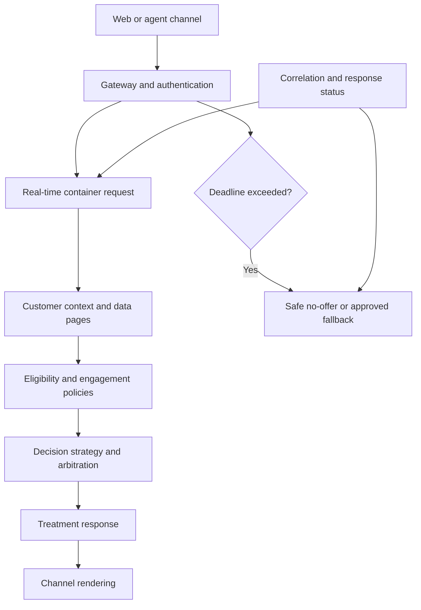

# Real-time container integration resilience

## Failure scenario: a personalized page with no offers
A telecom website invokes a Customer Decision Hub real-time container when a subscriber opens the upgrade page. During a profile-store slowdown, the request reaches the decision service but misses the website's response deadline. The channel retries automatically. The customer sees an empty offer area, while two overlapping requests may later produce conflicting impression events. The business labels the incident a model outage even though the adaptive model service is healthy.

## Architecture boundary
A real-time container is a synchronous decision boundary, not a guarantee that every upstream data source will respond. Define a contract between the channel, API gateway, container request, customer profile data, engagement policies, decision strategies and treatment rendering. Identify the channel's end-to-end deadline and allocate a budget to each hop. The **caller** owns the final fallback display; Customer Decision Hub owns the decision contract and its internal dependencies. Never replace a missing eligibility result with an unfiltered offer.

## Implementation decisions
1. Document request shape: container identifier, placement, customer/context identifier, channel, consent state, correlation ID and schema version. Keep the channel's business identity separate from transport authentication. Do not accept arbitrary customer IDs without authorization and tenant checks.
2. In Next-Best-Action Designer, define applicability, suitability, eligibility and contact-policy rules. Make unavailable or unknown mandatory data result in **no offer** or a specifically approved conservative action. Do not let an error bypass a legal exclusion.
3. Model data access explicitly. Parameterized data pages for customer context must include relevant identity and tenant dimensions. Bound synchronous connector timeouts so the sum of worst-case waits cannot exceed the channel deadline. An additional retry inside a data page can multiply tail latency.
4. Version the response schema and treatment rendering contract. Pega Customer Decision Hub '24.2 documents channel-specific response properties for real-time containers; consumers must not assume all channel fields are always present.
5. Separate decision response from interaction-history updates. Design idempotent impression/click event handling using a stable request or placement identifier and a downstream deduplication contract. The exact persistence behavior depends on CDH version and configuration; test it rather than asserting built-in exactly-once semantics.
6. Use a circuit breaker at the channel or gateway to prevent retry storms during sustained failure. Set a short bounded retry only for operations proven safe and idempotent. Never retry until a stale result looks successful.
7. Expose metrics for request rate, response status, no-action rate, missing-context rate, policy exclusion counts and latency by dependency. Avoid logging full profile or propensity values. Correlate a channel request with a decision response without exposing personal identifiers.
8. Validate a safe fallback with product and compliance owners. A static marketing banner may be acceptable; a credit or regulated financial recommendation usually cannot be substituted without full suitability checks.

## Tradeoffs and failure mechanics
Aggressive caching can reduce decision latency but undermine contact policies and consent freshness. Live lookups improve freshness but make decision latency depend on slow source systems. A default offer improves page fill rate but may breach eligibility rules. Precomputing candidate lists helps scale if the final real-time decision still rechecks mandatory policies. Returning an empty result can be correct when no action is eligible; distinguish it from a transport timeout or schema failure.

During a slowdown, distinguish gateway queueing, Pega requestor saturation, data page misses, strategy execution and rendering delay. A decision service 200 with no actions is not equivalent to a 504. Compare CDH's recorded decision context with the channel's correlation record. Investigate whether repeated retries are inflating interaction history before adjusting model thresholds.

## Verification matrix
| Case | Fault injection | Required outcome | Evidence |
|---|---|---|---|
| Healthy customer | Complete eligible profile | Valid treatment response | Contract snapshot |
| No eligible action | Explicit exclusion | No unauthorized treatment | Policy trace |
| Missing consent | Unknown consent field | Conservative no-offer result | Eligibility result |
| Profile timeout | Delay data source | Deadline honored, safe fallback | Latency trace |
| Gateway 503 | Reject container request | Bounded retries, no storm | Gateway counters |
| Duplicate request | Replay same correlation ID | Defined impression deduplication | Event ledger |
| Channel schema | Remove optional field | Consumer remains compatible | Consumer contract test |
| Multi-tenant ID | Cross-tenant customer key | Access denied | Security audit |

The matrix specifies desired behavior, not measured results. Set numerical budgets using a load test with realistic profile distribution and target release.

## Verified Pega references
- [Customer Decision Hub '24.2 enhancements, including real-time container response properties](https://docs.pega.com/bundle/customer-decision-hub-242/page/customer-decision-hub/release-notes/cdh-enhancements.html)
- [Get started with Customer Decision Hub '26](https://docs.pega.com/bundle/customer-decision-hub)
