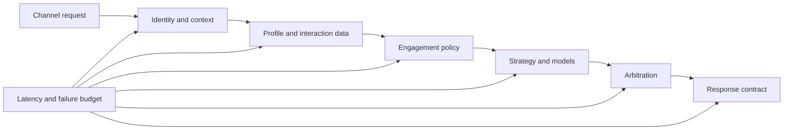

# Strategy execution latency budgets
## Failure scenario
A telecom customer opens a retention offer screen. The channel requires a next-best-action response within its interaction budget, but the decision service occasionally takes several seconds. The strategy has grown to include repeated profile retrievals, a large proposition filter, an external fraud score and an adaptive model. The team optimizes the final arbitration expression while ignoring time spent loading the data. When the external score times out, the channel receives no recommendation and displays an error. The true architecture problem is an unallocated end-to-end latency budget.

## Define a decision path
A Customer Decision Hub request may evaluate engagement policies, eligibility, suitability, contact policy, model propensity and prioritization, depending on the release and configuration. Treat the exact generated Next-Best-Action strategy and its components as the source of truth, not a generic diagram. The budget should span channel network time, authentication, context assembly, Data Page loads, Strategy execution, adaptive model access, result serialization and channel rendering.

Pega Strategy rules can combine data, filtering and prioritization components; their result may be a clipboard or virtual list. A Globally Optimized Strategy is a supported option for some high-throughput decision workloads, but suitability and optimization boundaries depend on the installed release. The architecture must preserve policy semantics before chasing speed. Never cache a customer's final action without considering current eligibility, contact policy and consent.

## Budget and implementation
1. Agree a business response-time objective for each channel. Decompose the total into named sub-budgets and explicitly reserve capacity for network variability and a safe fallback. These are design targets to be measured, not published Pega performance guarantees.
2. Trace the exact decision entry point, Strategy rule and Next-Best-Action Designer configuration for the target CDH version. Inventory all Data Pages, Decision Data rules, proposition data, model calls, and external connectors used during evaluation.
3. Create a representative synthetic decision dataset spanning eligible, ineligible, low-data, high-proposition and restricted-consent customers. Preserve expected action IDs and reasons as golden outputs; performance changes must not silently change business outcomes.
4. Instrument server-side timing at approved boundaries. Distinguish a slow external profile connector from a slow Strategy component and an overloaded decisioning node. Record sample size, percentiles, timeout rate and result completeness.
5. Remove repeated source calls where one validated context load can be reused. For shared, non-sensitive reference data, a carefully scoped Data Page can reduce overhead. Do not use node-scope caches for identity-sensitive recommendations.
6. Bound candidate set size using eligibility and suitability filters before expensive enrichment, where semantics allow. Validate that moving a filter does not exclude a candidate required for later prioritization or fairness checks.
7. Review model and proposition access patterns. Where supported, benchmark an optimized Strategy or data-flow approach against the same expected outputs, rather than assuming that an optimization option is universally faster.
8. Define timeout ownership for each external dependency. If a fraud score is mandatory for suitability, fail closed for that offer and return an approved safe alternative. If optional, use a documented stale-data or no-score path with explicit provenance.
9. Add decision observability: outcome category, fallback reason, model and strategy version, policy rejection counts and per-stage latency. Minimize customer data in traces and avoid logging raw predictors.
10. Run load tests at target and burst concurrency with cold and warm caches. A fast warmed benchmark alone hides first-interaction latency and downstream saturation.

## Tradeoffs and failure mechanics
Early filtering reduces work but can alter arbitration if filters are moved across business conditions. Precomputing scores reduces synchronous latency but creates freshness and consent risks. A single global timeout prevents hanging requests yet may cause an abrupt rise in no-action results when dependencies degrade. A fallback is not equivalent to bypassing suitability or regulatory restrictions.

A common false diagnosis is attributing a long channel round trip to strategy logic when the external profile service consumed most of the budget. Another is optimizing mean latency while the tail remains dominated by cold caches and contention. Segment results by channel, region, customer shape and strategy version.

## Verification matrix
| Experiment | Input | Pass condition | Evidence |
|---|---|---|---|
| Warm baseline | Repeated eligible customers | Meets agreed percentile budget | Stage timing |
| Cold context | First request after refresh | Within cold-start allowance | Cache and trace |
| Mandatory score down | Fraud service unavailable | Unsafe offer suppressed | Decision explanation |
| Optional score down | Approved fallback path | Safe result with reason | Fallback log |
| Policy parity | Old/new strategy on same fixture | No unauthorized action drift | Golden output diff |
| Burst load | Concurrent channel requests | Bounded timeouts and error rate | Histograms |
| Consent change | Revoke consent before request | Excluded action not returned | Policy audit |

These are planned experiments, not measured results. Confirm CDH product version, optimization features and policy execution order in the deployed configuration.
## Verified primary guidance
- [Building Strategies to generate Decisions and results, Pega Platform '23](https://docs.pega.com/bundle/platform-23/page/platform/decision-management/building-strategies.html)
- [Customer Decision Hub documentation](https://docs.pega.com/bundle/customer-decision-hub)
