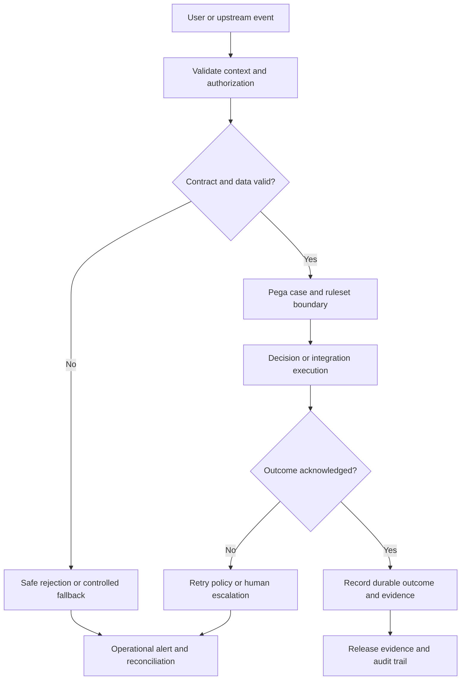

# Designing decision fallback when models are unavailable

## Architecture problem and business context

During a payments surge the predictive model endpoint times out, leaving a case flow waiting and customer agents repeatedly retrying the same recommendation. This is not merely a defect in a single rule. It is a contract failure across application ownership, runtime execution, observability and release governance. The architect must design deterministic safe fallback paths for model-serving outages without creating a second uncontrolled system of record. The design below is a reference implementation, not a claim of a tested Pega environment. Validate rule availability and precise settings against the installed Pega Platform release, deployment model and licensed capabilities.

The business consequence is measurable in customer outcomes: inconsistent decisions, delayed service, disputed audit trails or releases that cannot be safely rolled back. An LSA should begin by defining the exact failure boundary and the owner of every datum, rule, service and operational alert. Avoid treating a successful UI submission as proof that asynchronous processing or a downstream side effect completed.

## Pega components and design boundaries

Relevant platform objects include **Decision Strategy, predictive model, data page, Connect-REST, decision table, circuit-breaker integration pattern, queue processor**. Choose the actual class hierarchy and ruleset ownership before implementing any rules. The case class owns durable business state, while integration classes represent external contracts and data pages expose controlled reads. Do not write mutable integration responses into a global cache without explicit freshness and authorization semantics.

Establish a contract with these fields: unique case identifier where available, request or decision identifier, UTC occurrence time, source and version, outcome status, retry/attempt identifier, and a reason code that an operator can interpret. Keep diagnostic identifiers separate from regulated customer attributes. For the topic **designing decision fallback when models are unavailable**, the primary architectural decision is deterministic safe fallback paths for model-serving outages.

## Technical flow

The diagram describes logical responsibilities rather than claiming that every named operation is implemented by a single Pega rule. In particular, acknowledgement must represent the business outcome, not just an HTTP success code or a queued job acceptance.

## Implementation sequence

1. **Define invariants.** State the non-negotiable outcomes in plain language. For PFA-225, require a deterministic response to invalid input, an identifiable owner of every state transition and a recoverable audit path. Identify which data must never appear in logs.
2. **Model classes and rulesets.** Place case lifecycle logic in the application case hierarchy, shared validation in a narrowly scoped component and integration mapping in a dedicated integration layer. Version contracts independently where consumers deploy on different cadences.
3. **Implement the control.** Set latency budget and timeout; distinguish model error from negative score; select a preapproved deterministic decision table or no-action fallback; log fallback reason and monitor its frequency. Use explicit parameters and meaningful result statuses rather than depending on implicit clipboard state. Apply least privilege to all maintenance and override paths.
4. **Set failure semantics.** Define timeout, retry limits, idempotency key scope and escalation ownership. For irreversible external effects, reconciliation is safer than blindly replaying a request whose result is unknown.
5. **Create operational evidence.** Capture versioned rule identity, a stable correlation key, a sanitized reason code and the outcome of each significant boundary. Keep access and retention consistent with enterprise policy.
6. **Test and promote.** Build PegaUnit checks for deterministic rule logic, scenario tests for representative case journeys, contract tests for integrations and release gates for security and failure recovery. Re-run the same tests against the exact artifact promoted to production.
7. **Plan recovery.** Document a feature flag or ruleset rollback, the handling of already-running cases and the reconciliation of partially completed external operations. Assign a named support team and an incident severity threshold.

## Design alternatives and tradeoffs

A conservative no-action fallback limits risk but sacrifices conversion; static rules keep service operating yet may become stale. The correct choice depends on the cost of false positives, the sensitivity of case data, peak transaction volume, and the ability of operations to repair partial outcomes. A synchronous implementation is easier to reason about but can amplify dependency latency. An asynchronous implementation isolates interactive response time but introduces eventual consistency, duplicate delivery and monitoring obligations.

Avoid a universal helper rule that hides domain policy. Reuse stable technical contracts, not mutable business meaning. Where a common component adds cross-team coordination or release coupling, prefer a small explicit adapter owned by the consuming application.

## Failure mechanics and operational response

Retries multiply traffic during outage, cached predictions survive consent revocation, and failure is incorrectly treated as low risk. During an incident, inspect the durable case state, associated queue or integration attempt, rule version and external acknowledgement independently. A missing log line is not proof that a transaction never occurred. Reconcile by stable business identifiers before retrying side effects. Distinguish failures caused by policy, stale data, permissions, platform capacity and external service health.

A practical runbook should say when to pause new work, how to identify affected cases, how to replay only safe operations, how to prevent duplicate completion and which evidence is required before closing the incident. Alerts should measure business-impacting failures, not just technical exceptions.

## Reproducible verification matrix

| Test | Setup and execution | Expected evidence |
| --- | --- | --- |
| Happy path | Supply complete authorized input and run the representative case journey | Valid state transition and matching versioned outcome |
| Contract violation | Remove a required field or supply an invalid enum | Explicit rejection or safe fallback, no silent default |
| Dependency outage | Simulate timeout or unavailable downstream endpoint | Bounded response, recorded failure reason and escalation |
| Duplicate delivery | Submit the same business operation twice with one idempotency key | One business effect, distinguishable attempt records |
| Authorization | Repeat as a user without the required role or privilege | Access denied without exposing sensitive content |
| Stale or changed rule | Change a ruleset or contract version in a test branch | Compatibility check fails or migration path is invoked |
| Recovery | Restore dependency and reconcile an uncertain outcome | No duplicate effect and consistent durable case status |
| Observability | Follow one synthetic journey through each processing boundary | Correlated evidence with sensitive fields redacted |

For PFA-225, add these topic-specific acceptance assertions: Model available selects normal strategy; timeout selects approved fallback within budget; consent denial always blocks; recovery returns to model path; outage alert fires. These are proposed tests only. Record the actual build, environment, input fixtures, observed results and exceptions when a lab is available. Do not promote a design-backed example as production-verified evidence.

## Architecture review checklist

Before approving the design, ask: Who owns the policy? Which rule version executed? What is the source of truth? Can a timeout be safely retried? Can an unauthorized actor change the outcome? Can an operator reconstruct the journey without reading raw personal data? Can a rollback coexist with in-flight cases? What explicit signal tells operations the system has recovered?

Document unresolved assumptions in an architecture decision record and connect each assumption to an executable test. Review deployment-specific behavior against the organization's licensed Pega documentation and support matrix before implementation.

**Verification status:** Design-backed reference architecture; lab validation pending.
