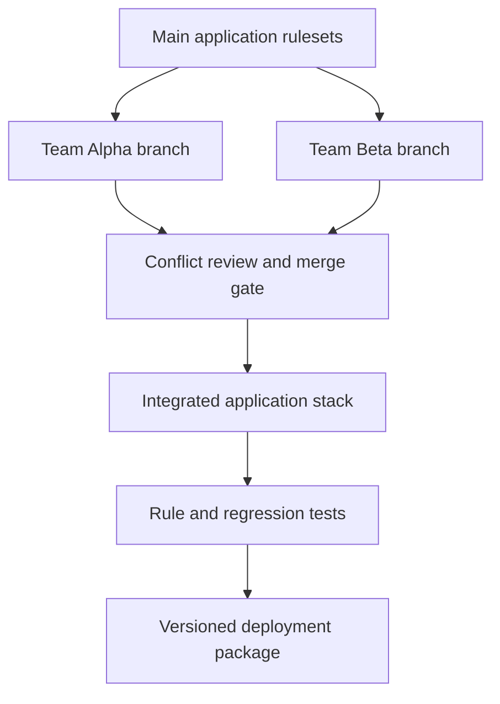

# Parallel branch development in shared rule applications

> Architecture study for Lead System Architects. The failure narrative is a hypothetical engineering scenario; no production incident or test result is claimed.

## Enterprise failure scenario

Two delivery squads modify the same CustomerOnboarding application. One changes a Decision Table for KYC routing, while another adds a fraud-exception branch to the same rule. Both teams validate in isolation. The second merge overwrites a condition introduced by the first, and an environment-specific Dynamic System Setting is absent from the package. The application starts correctly but routes high-risk cases to ordinary review. A passing unit test in one branch did not prove compatibility with the merged application stack.

## Architecture decision and Pega rule design

Use short-lived Pega Rule branches within team development applications, not long-running copies of entire applications. Define ownership of shared rules and require explicit integration tests after merge. Keep reusable components in separately governed rulesets and make consumers declare built-on dependencies. Treat rule resolution, ruleset version, branch merge order and environment data as one release contract. Do not deploy a development branch into production. Maintain a change ledger for shared Decision Tables and critical Access Control Policy rules.

## Technical flow

## Implementation sequence

1. Inventory shared rules that change frequently: Decision Tables, Data Transforms, Views, Access Control Policies and integration rules. Assign a review owner and identify rule resolution impact.

2. Create team development applications built on the baseline application, then create feature-scoped Rule branches. Limit each branch to one coherent change with a short expected lifetime.

3. Keep application ruleset versions and built-on dependencies visible in each team's environment. Compare Access Groups and production ruleset stacks before approving merge.

4. Before merging, refresh against the latest shared baseline and review conflicting rule keys, circumstances and dependencies. Resolve behavior, not only textual or form-level conflicts.

5. Run unit tests for the modified rule plus integration scenarios for rules it calls. For a shared Decision Table, include boundary inputs, new rows, old rows and default outcomes.

6. Merge once into the integration baseline. Run a post-merge suite using the actual combined ruleset stack and confirm which version of each key rule resolves.

7. Package rules, data instances and configuration dependencies through the supported deployment process. Explicitly account for settings that do not travel with the Rule branch.

8. Prohibit direct emergency production edits without a reconciled hotfix path. After release, compare effective rule resolution and application stack with the tested baseline.

## How the design fails in production

A conflict-free merge can still produce semantic regression when a new When rule changes another team's branch path. A branch may compile against an older ruleset version and resolve a different class after merge. Teams may create the same data object with different property types, leading to runtime serialization errors. Dynamic System Settings, access groups and integration endpoints may differ even when rule packages match. Merging long-lived branches magnifies these risks and makes rollback hard to isolate.

## Genuine tradeoffs

Short branches increase integration frequency but reduce merge risk. A single shared Decision Table gives business users one policy surface but creates delivery contention. Splitting the rule into delegated sub-decisions reduces contention but can obscure evaluation order. Prefer clear ownership and tested composition over artificial separation.

## Reproducible verification matrix

| Test setup and stimulus | Expected observable result |
| --- | --- |
| Two branches modify same Decision Table row | Conflict reviewed with explicit chosen behavior |
| No syntactic conflict but changed When outcome | Combined regression catches semantic change |
| Ruleset stack differs in staging | Deployment gate fails before promotion |
| Missing environment setting | Preflight identifies dependency |
| Feature rollback after partial release | Previous tested ruleset and active-case impact assessed |
| Production application contains branch ruleset | Release gate rejects configuration |

Run each test against a named application version with independent requestors where relevant. Record configuration, input fixtures, observed response, persisted state and log correlation identifiers. The expected results above are acceptance criteria, not claims of execution. A failed row blocks a production recommendation until investigated.

## Release and evidence boundaries

Pega Academy describes branch rulesets, team applications and short-lived merge practices. The newer Workspace model may change the development UI, but the architectural need to validate the integrated rule stack remains. Verify behavior with a version-matched Pega environment and approved sample data. Include security review, recovery runbook, and rollback assessment in the change record. Do not infer correctness from a successful UI response alone.

## Primary references

- [Pega product guidance](https://academy.pega.com/topic/best-practices-branch-based-development/v1)
