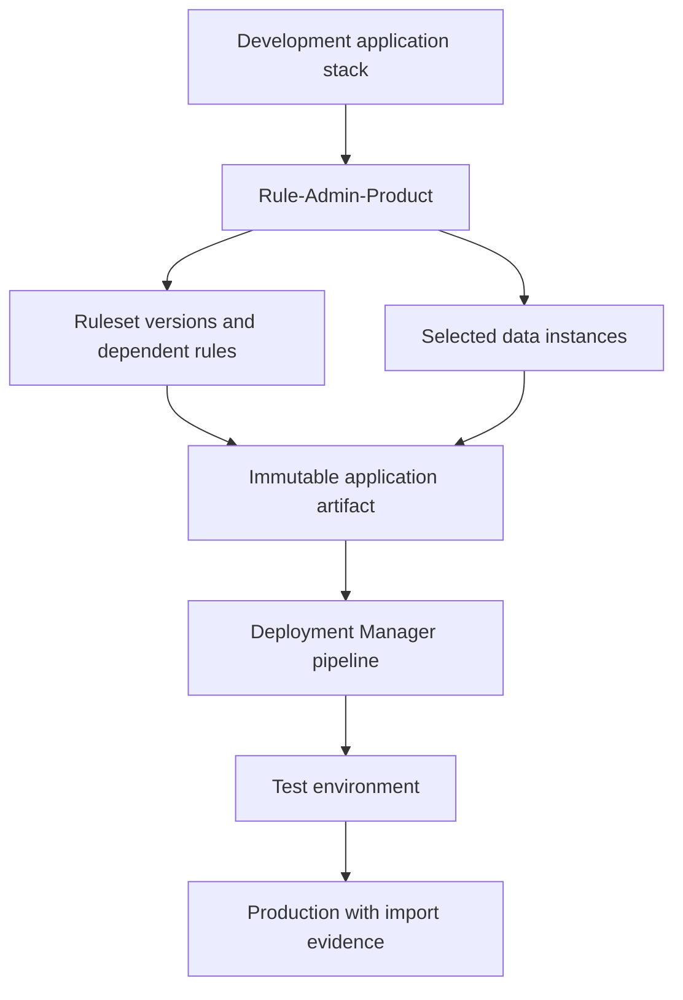

# Packaging rules and data with product definitions

**Scope:** Pega enterprise architecture and LSA implementation guidance. Platform capabilities and menu paths may vary by release; verify in the target version.

## The release that imported successfully but could not run

A lending platform releases a new affordability flow. The deployment artifact contains the flow and decision rules, but not a supporting data instance used by a parameterized data page. The pipeline import reports success. At the first production assignment, the lookup returns no row and the flow routes to an exception queue. A second team attempts a hotfix by exporting an entire ruleset and accidentally includes a work-in-progress integration endpoint.

A product definition is an explicit deployment contract, not a convenient ZIP file. It must include the application rules and the correct reference data while excluding environment-specific credentials, transient case data and unrelated work. The Rule-Admin-Product configuration and the deployment pipeline together define what is promoted and what remains an environment responsibility.

## Artifact ownership

Assign one team responsibility for the application definition, component ruleset versions and dependency manifest. Use a Rule-Admin-Product instance to select required rulesets, versions, classes and eligible data instances. Distinguish application-owned seed data from operational records. An insurance product table that is versioned with rules may belong in the package; customer applications, access tokens and queue items do not.

For every external integration, separate Connect-REST and authentication-profile rules from environment-specific endpoint values and secrets. Document the target environment's configuration contract. The product artifact should be reproducible from a known ruleset baseline, with its manifest and checksum captured in the release record. Avoid unreviewed wildcard inclusion of broad data classes.

## Implementation sequence

1. Freeze the release scope by recording the application rule, built-on application versions, ruleset versions and target Pega Platform version.
2. Inventory the new rules and every runtime dependency: flows, Data Transforms, Data Pages, decision rules, correspondence, privileges, class definitions and seed data.
3. Define inclusion and exclusion criteria in Rule-Admin-Product. Review each data class for sensitive or environment-bound instances; default to explicit inclusion.
4. Generate the artifact in a controlled development pipeline and store it in a repository with immutable identity. Capture who approved the manifest and what changed since the preceding release.
5. In a clean test environment, deploy the artifact through Deployment Manager. Run schema checks, data instance existence checks, integration configuration checks and rule resolution smoke tests.
6. Execute representative existing and newly created cases, including a case paused before the changed assignment. Check whether active flows resolve compatible rule versions.
7. Inspect the deployment's rule-change preview, import warnings and dependency results. Do not treat a green import as proof that all runtime data is present.
8. Promote the same reviewed artifact through staging to production. Keep environment-specific settings out of the package and validate them after deployment.
9. Reconcile production evidence: artifact checksum, package manifest, imported rules, seed-data row counts and smoke-test results. Record any manual step as an exception with owner and deadline.

## Packaging tradeoffs

One giant product rule simplifies initial deployment but increases blast radius and makes component ownership ambiguous. Many small packages allow independent releases but introduce ordering and compatibility obligations. Prefer component boundaries aligned with stable contracts and an explicit dependency graph. Data-in-package improves reproducibility for immutable lookup sets; externalized configuration is safer for credentials, endpoints and tenant-specific operational data. A rollback restore point may revert rules and data imported by a deployment, but it cannot automatically undo every external side effect or schema evolution.

## Production failure and recovery

If a missing seed record breaks an assignment, contain the affected path and verify the data class and lookup keys before importing anything. Import the smallest reviewed corrective artifact, not a full ruleset dump. If an aged update warning appears, investigate the target's changed rule rather than overwriting it by default. For a schema change, confirm backward compatibility with existing cases and prior code. Record exact package provenance, because a successful manual correction without traceability creates the next incident.

## Reproducible verification matrix

| Test | Setup | Acceptance evidence |
| --- | --- | --- |
| Clean import | Deploy into a fresh test stack | All declared dependencies resolve |
| Seed data | Load a flow requiring new reference row | Expected row and version available |
| Exclusion | Inspect package for credentials and live work | No prohibited instances |
| Existing cases | Resume case paused before new release | No missing-rule or shape error |
| Pipeline rollback | Revert a deliberately failing test deployment | Documented restoration and limits |
| Environment parity | Promote same artifact to staging | Checksum unchanged; configuration differs only by approved settings |

No deployment has been executed for this article. Verify release-specific Deployment Manager features and rollback behaviour against the target installation.

## Primary references

- [Pega: Deploy application](https://docs.pega.com/bundle/deployment-manager/page/deployment-manager/dm/deploy-application.html)
- [Pega: Moving applications between systems](https://docs.pega.com/bundle/platform-242/page/platform/system-administration/migration-applications-systems-moving.html)

## Architecture flow

## Evidence required before production approval

Attach a reviewed design decision, the actual Pega version and deployment topology, rule references with their Applies To classes, test inputs and observed outcomes. Record open risks, remediation owners and rollback criteria. The verification matrix above is a proposed protocol, not fabricated execution evidence.
