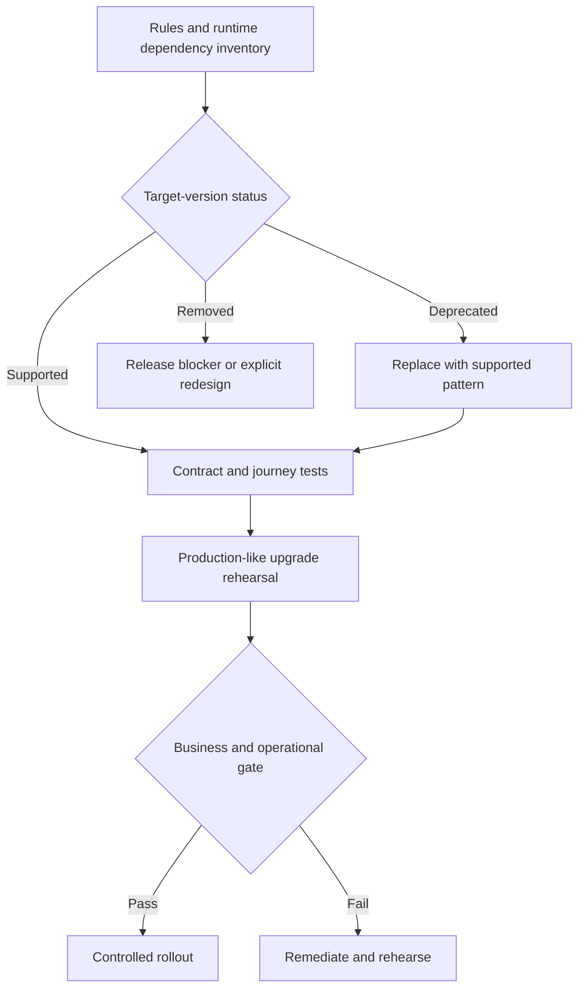

# Upgrade preparation for retired features

**Audience:** Pega Lead System Architects and platform engineers. Design guidance is not a claim of laboratory validation.

A public-sector case platform has run for eight years. Its application uses custom sections, agents, legacy integration rules and a small library of Java utilities. A planned Pega upgrade passes package import, but the first real case stalls because a retired extension point no longer invokes the team's custom activity. The release team had tested deployment mechanics, not behavioral dependence on legacy features.

Upgrade readiness requires a dependency inventory tied to business journeys, with explicit decisions to replace, retain temporarily or retire each feature. A green import result does not establish runtime compatibility.

## Build a retirement dependency map

Collect rule types, class hierarchy, ruleset versions, circumstanced variants, extension points, scheduled agents, queue processors, authentication integrations, UI controls, database customizations and external clients. For each item, capture the supported replacement in the target release, the owning team, the live journeys using it and the consequences of failure. Distinguish features formally removed from features merely discouraged or unsupported in the target deployment.

Do not assume that a feature retired in one Pega release is unavailable in all versions. Use the exact target version's release notes, deprecated feature lists and upgrade guidance as the authority. If an unsupported extension cannot be replaced before cutover, record a risk decision with a time-bound containment plan rather than silently treating it as compatible.

## Pega-specific preparation sequence

1. Freeze a reproducible baseline of application definition, ruleset stack, product packages, schema changes, integration endpoints and scheduled work. Preserve audit evidence of what was actually deployed.
2. Review target-version documentation and analyze guardrail warnings, deprecated rules and custom Java. Use a versioned register rather than relying on a developer's memory.
3. Trace each critical journey through its flow actions, sections or Constellation views, data pages, decision rules, activities, integrations and background execution. A rule that is not directly referenced may still be reached by rule resolution or an extension point.
4. Identify legacy agents and their intended replacements. Do not convert an agent to a Queue Processor solely by renaming it: preserve delivery semantics, retry policy, authorization context and operational monitoring.
5. Replace custom activity loops with data transforms, declarative rules or supported integration patterns where this improves clarity and does not change transaction semantics. Retain activity steps that genuinely require orchestration and are supported.
6. Test access groups and authentication profiles, especially service requestors and workers. Changes in security defaults can surface only in scheduled tasks.
7. Build a migration rehearsal on production-like data volume and case ages. Include long-running cases that entered a stage under an older ruleset and resume under the new one.
8. Establish a release plan with a cutover checkpoint, active-case compatibility tests, queue drain policy, database backup and documented recovery constraints.
9. Run post-upgrade synthetic journeys plus targeted PDC or log review. Include rarely used exception paths, not just the happy path.

## Design tradeoffs

Replacing every legacy construct before an upgrade reduces long-term risk but creates a large change surface. A phased modernization can be safer when supported compatibility remains available. However, carrying an undocumented retired dependency into the next release turns the platform upgrade into a business continuity risk. Parallel-running old and new integration paths can prove equivalence but needs duplicate-side-effect protection and explicit reconciliation.

## Production failure mechanics

A ruleset import can succeed while an old case references a flow shape whose implementation has changed. If a flow resumes and invokes an obsolete activity, the failure may appear days after cutover. Another failure involves background items serialized with an old property structure. A new worker deserializes them differently and sends incomplete connector payloads. Queue drains, compatibility transforms and targeted replay tests are therefore part of upgrade design, not optional cleanup.

A rollback may restore rules but not undo data conversions or irreversible external calls. Treat restore points as one component of a recovery plan and test the exact rollback scope. If the upgrade changes schema or serialized state, prepare a forward-fix or controlled recovery procedure rather than promising one-click reversal.

## Reproducible verification matrix

| Scenario | Method | Release gate |
| --- | --- | --- |
| Legacy UI | Open and submit critical pre-upgrade screens | Supported rendering and validation |
| Resumed old case | Advance a case created on prior version | Correct next assignment and SLA |
| Pending background item | Resume queued work after upgrade | No loss or duplicate side effect |
| Security context | Exercise interactive and service identities | Least-privilege authorization preserved |
| Ruleset fallback | Run rules with overrides and circumstancing | Intended resolved rule selected |
| Integration drift | Replay contract test suite | No incompatible payload change |
| Recovery | Rehearse failed cutover and rollback constraints | Data and business effects reconciled |

**Primary references:** [Pega Deployment Manager: deploy application and rollback considerations](https://docs.pega.com/bundle/deployment-manager/page/deployment-manager/dm/deploy-application.html) and [Pega Platform: application development best practices](https://docs.pega.com/bundle/platform-242/page/platform/app-dev/best-practices-infinity-application-development.html).
