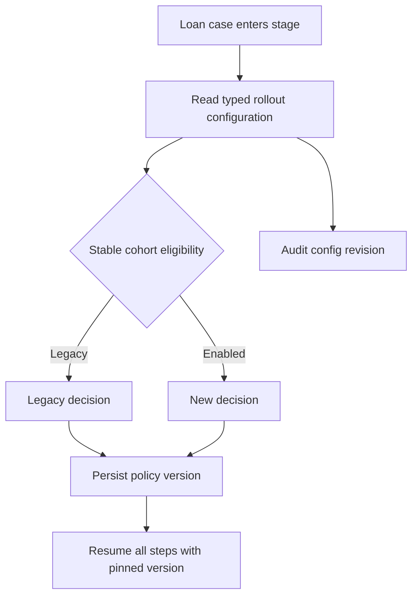

# Feature Toggles for Controlled Business Rollout

## Enterprise failure scenario

A bank enables a new affordability decision after deploying a ruleset. Open loan cases switch policy halfway through their journey because a global Dynamic System Setting is evaluated on every screen. An operations rollback disables the view but leaves a background Queue Processor executing the new rule. Cases now have contradictory outcomes and no reliable record of which policy decided them.

## Architecture decision and Pega rule boundary

Treat the rollout as a versioned business decision. Evaluate a When rule or decision table against a typed configuration data page, and persist the chosen policy version on each case at a defined boundary. Keep old and new rule implementations deployable until all dependent open cases complete. A DSS can be a global operational input, but its scope and caching make it unsuitable as an unqualified per-case policy selector.

## Implementation in order

1. Define eligibility by case creation date, product, geography or stable cohort key. Record an explicit exclusion rule for sensitive or legally restricted segments.

2. Create a configuration data model with toggle owner, approved revision, effective interval, fallback, expiry and business sign-off. Publish it through a read-only data page.

3. Implement cohort selection in a When rule or decision table. Pin the selected policy version when the case enters the relevant stage, before external side effects.

4. Separate legacy and enhanced logic in managed ruleset versions. Avoid a single mutable rule that silently changes the meaning of old case assignments.

5. Apply the same server-side selection in Flow Actions, Service-REST and queue handlers. UI-only hiding does not secure an API or background path.

6. Build an operations control to stop *new* exposure while retaining compatible execution for cases already assigned the new policy.

7. Remove the toggle only after a query confirms no open cases depend on it, and after replay, rollback and audit requirements have been met.

## Failure mechanics in production

Global settings can be cached differently by node or requestor, producing temporary split-brain behaviour during refresh. If the setting is read repeatedly, one case can traverse both versions of a decision. Deleting the new ruleset during rollback can strand cases that persist its version. A delegated decision table adds flexibility but can change independently of code deployment; approvals and effective dating are still needed. Background processors may ignore a toggle applied only in the view.

## Design tradeoffs

- Pinning policy per case improves repeatability but requires an explicit exception process for urgent regulatory changes.
- DSS is convenient for global switches; a versioned configuration record is safer for cohorts and long-running cases.
- Maintaining two paths costs engineering time but preserves rollback and open-case compatibility.

## Reproducible verification matrix

Run these checks with synthetic data in a controlled test environment. Capture the application version, ruleset stack, requestor identity, test stimulus and expected persisted outcome. These are proposed checks, not executed results.

| Test and stimulus | Expected result and evidence |
| --- | --- |
| Enabled new case enters stage | New policy pinned exactly once |
| Open case resumes after switch off | Original policy remains active |
| Two nodes refresh configuration differently | No in-flight case changes branch |
| Queue handler bypasses view | Same server-side policy applied |
| Roll back code while new cases exist | Compatibility gate blocks unsafe deletion |
| Toggle expiry passes | Owner alerted and dependency review initiated |
| Regulatory override approved | Targeted remediation audited, not silent flip |

## Incident runbook

Freeze new exposure first when errors rise. Identify impacted cases from the persisted policy version, not the current toggle. Compare failure and completion rates by cohort. Do not delete a branch or edit a delegated decision until open-case dependencies and rollback paths have been reviewed.

## LSA release acceptance and limitations

Capture the data-page refresh contract, ruleset stack, cohort eligibility, operator privileges for changing settings and retirement date. Rehearse disabling exposure without changing previously selected case decisions. Version-dependent cache behaviour must be confirmed in the target environment.

The architecture is design-backed and laboratory verification remains pending. A technical reviewer should inspect rule resolution, authorisation, Pega guardrail warnings, negative-path behaviour and rollback feasibility before promoting it. Capture controlled Tracer or PDC evidence only where available, and exclude sensitive clipboard content from shared logs. Do not interpret a diagram as evidence that the implementation has been tested.

## Verified Pega primary references

- [Pega ruleset organisation](https://docs.pega.com/bundle/platform-242/page/platform/app-dev/organizing-rules-into-rulesets.html)
- [Pega dynamic system settings and alerts](https://docs.pega.com/bundle/platform-23/page/platform/app-dev/alerts.html)
