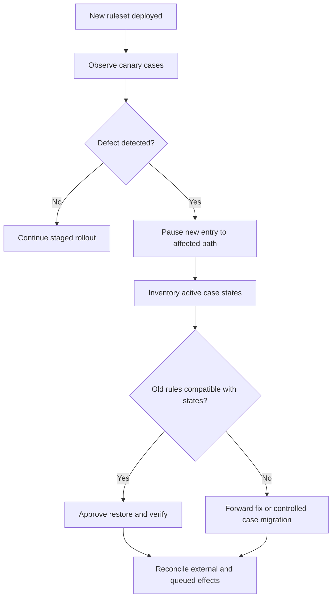

# Rollback when active cases use newly changed rules

## Failure scenario: reverting code strands in-flight applications

A government licensing application changes its case type: a review assignment becomes a parallel approval flow, a new `ReviewOutcome` property is introduced, and a new Data Transform populates a partner request. The deployment succeeds, and hundreds of cases enter the new flow. A downstream integration defect prompts an immediate restore of the old application package. The old rules no longer understand the new flow shape or persisted data. Some assignments cannot resume, and a quick ruleset rollback creates a second incident.

The architecture rule is **restore points recover selected deployment artifacts, not the meaning of already persisted case state or external effects**. A rollback decision must include live-case compatibility, schema, queued work, and remote transactions. Deployment Manager's restore-point behavior is release-dependent and does not by itself guarantee business-data reversal.

## Model the compatibility envelope

Identify old and new rulesets, application versions, flow rules, stage transitions, Data Transforms, properties, When rules, Queue Processors, SLA rules and integration contracts. Classify each change as additive, backward compatible, requiring migration, or destructive. Maintain an explicit compatibility matrix for cases created before deployment, cases that crossed the new stage, and cases created after deployment.

A new property is often safe for old readers if it is optional and ignored. Removing a flow shape, renaming a class or changing the interpretation of an enum may not be safe. An active assignment holds references and context that cannot be repaired merely by restoring a rule version. Keep the previous flow available during a transition window where feasible.

## Deployment and rollback decision flow

## Implementation sequence

1. **Before deployment, inventory in-flight states.** Use a read-only Report Definition or approved operational query to count cases by `pyStatusWork`, stage, flow and assignment shape. Include SLA events and background work that can resume after deployment.
2. **Publish a change-impact map.** Link every modified Flow rule, Data Transform, property, class, queue processor and connector to the case states that invoke it. Review rule resolution for each Access Group and ruleset stack, not only the developer's context.
3. **Prefer expand-and-contract changes.** Add the new property and rules while retaining old flow paths; migrate or complete older cases; remove compatibility rules in a later release. Avoid changing the semantics of an existing status value in place.
4. **Introduce a controlled entry gate.** A version-aware When rule or supported rollout configuration can direct new cases to the new path while existing cases continue using the compatible old path. Test that toggling the gate does not reroute already-created assignments unexpectedly.
5. **Capture deployment evidence.** Record the Product rule, artifact hash, schema changes, dependencies, Deployment Manager pipeline, restore point, ruleset versions and the case population at cutover. A restore point is only one part of the recovery plan.
6. **Simulate rollback in a representative environment.** Start cases on the old release, progress them through the new flow, then apply the proposed recovery method. Validate old, transitional and new case cohorts separately.
7. **Define incident triage gates.** If a defect is limited to a connector mapping, a forward fix may be safer than reverting a flow. If the old application cannot interpret persisted assignments, freeze affected progression and run an approved migration rather than forcing a restore.
8. **Reconcile non-transactional effects.** An external approval, payment, email or regulatory submission may already have happened. Check idempotency keys and receipts before reissuing any integration from recovered cases.

## Production failure mechanics

A rollback can restore rules while leaving database schema additions, case history and queued payloads unchanged. Queue processors may deserialize old payloads using new rule resolution or vice versa. SLA callbacks can fire against an assignment no longer represented by the restored flow. These are not necessarily platform defects: they result from incompatible versions of persisted workflow state and executable rules.

Avoid emergency direct SQL edits to `pc_work` or internal flow structures. Use supported case migration or repair procedures for the installed release, with a case-level manifest, audit trail and rollback of the repair itself where possible.

## Tradeoffs

A fast restore is attractive for a purely stateless rule change. For a long-running case type, compatibility scaffolding costs additional rules and testing but greatly reduces recovery risk. Keeping two flow paths temporarily increases maintenance burden. A one-time migration reduces that burden but may be hard to reverse. A feature gate can reduce new exposure, but it does not undo actions already completed. The safest option depends on the affected cohort, not the number of changed files.

## Reproducible verification matrix

| Case cohort | Fault injection | Pass condition |
| --- | --- | --- |
| Old case, old stage | Deploy then restore | Assignment resumes with correct old rules |
| Old case, new stage | Restore incompatible flow | Case is detected and held, not silently corrupted |
| New case | Gate new flow off | New cases use approved compatible route |
| New property populated | Restore prior rules | No data loss or invalid interpretation |
| Queued background item | Restore while item pending | Item is handled or quarantined with traceable reason |
| External side effect | Timeout after partner accepts | No duplicate submission on recovery |
| SLA due during recovery | Pause and resume processing | Escalation occurs once with correct ownership |
| Schema addition | Restore application artifact | Schema and rule compatibility separately verified |

**Verification status:** This is a design and lab plan, not a claim that a specific Pega release or Deployment Manager restore operation has been tested.

## Primary references

- [Deployment Manager application deployment, restore points and rollback](https://docs.pega.com/bundle/deployment-manager/page/deployment-manager/dm/deploy-application.html).
- [Moving applications between systems, Pega Platform '24.2](https://docs.pega.com/bundle/platform-242/page/platform/system-administration/migration-applications-systems-moving.html).
