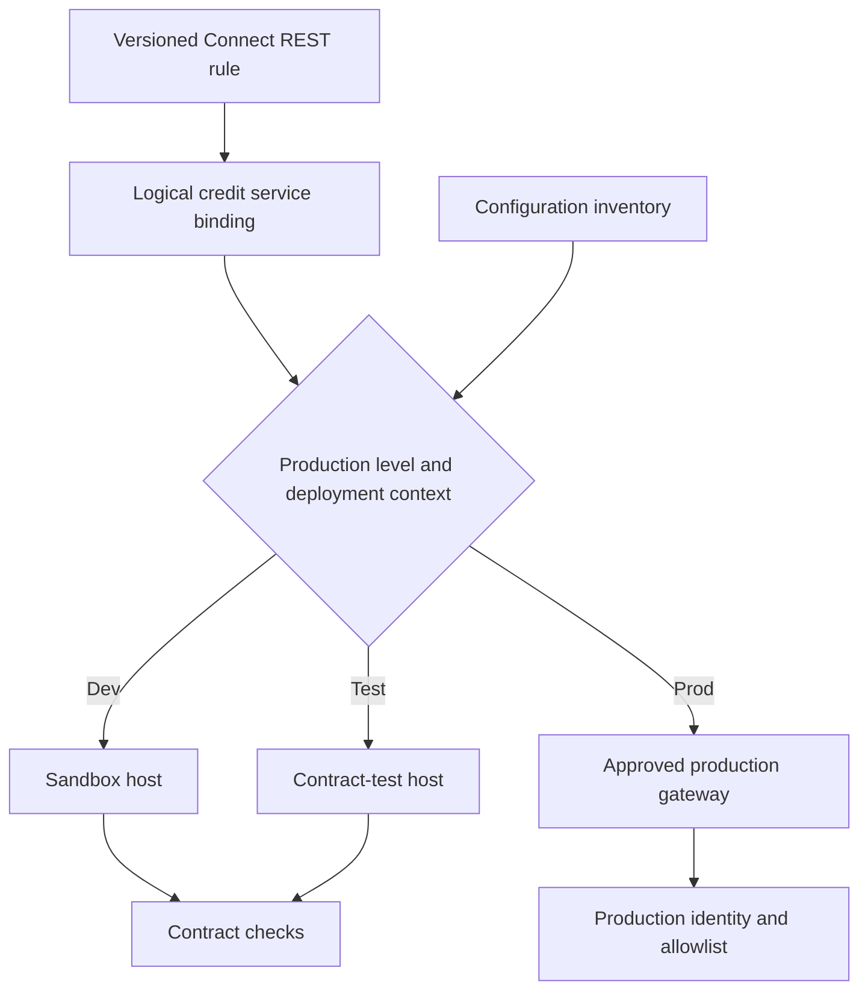

# Promoting endpoint configuration across environments

## Incident: a correct rule calling the wrong service
A retail bank promotes a credit-check integration from staging to production. The `Connect-REST` rule is identical in both environments, but its endpoint is a hard-coded staging hostname. Production cases now send personal information to a non-production test tenant. The release package passes rule validation and the smoke test checks only for HTTP 200. This is configuration drift with a data-boundary consequence, not a connector coding defect.

## Architecture contract
Treat the **logical service name** as part of the application and the **physical address** as an environment-controlled binding. Keep the request and response mapping, authentication profile reference, timeout policy and error classification in versioned Pega rules. Keep hostnames, base paths and environment-specific routing in controlled configuration. Pega supports Application Settings and Global Resource Settings in appropriate contexts; support varies by rule field and release. Do not assume arbitrary connector fields accept a global-resource token.

## Build and promotion steps
1. Create a service catalogue containing logical name, environment endpoints, owning team, data classification, certificate authority, authentication scheme, DNS and network owner. Specify whether the service is internal, partner-managed or internet-facing.
2. Inspect `Connect-REST` endpoint construction. Prefer a supported configuration mechanism such as Global Resource Settings or a dedicated setting/data page resolved before the connector call. Where the rule supports dynamic endpoint override, test the exact behavior on the target Pega release. Do not scatter URL concatenation across activities.
3. Define `Data-Admin-AuthProfile` and OAuth client registration configuration as appropriate to the integration. Separate credentials from URLs. Keep secrets in an approved secret-management facility and ensure that application logs never expose Authorization headers.
4. Establish a promotion manifest with one entry per environment and service. Validate host, scheme, path, expected certificate identity, API version and DNS reachability. Treat production endpoints as allowlisted, not merely different strings.
5. Configure service package and inbound endpoints separately from outbound connectors. A change to a Service REST resource path can break clients even when outbound connector tests pass.
6. Build a non-sensitive contract probe that validates the response schema and identity of the target environment, not just status code. For example, check a gateway-provided environment marker signed or otherwise protected from accidental spoofing. Never submit production customer records to a staging probe.
7. Run deployment checks before enabling the case flow. Compare effective configuration across nodes, since node-local caching or rollout timing can temporarily preserve old settings. Include failback configuration and certificate rotation in the runbook.
8. Record the manifest hash, ruleset version, environment, test evidence and approval. For emergency fixes, use the same manifest process rather than directly editing an endpoint on a single node.

## Failure mechanics and decisions
A DNS alias can hide environment drift but does not solve identity or routing mistakes. Centralized gateway routing simplifies certificate and endpoint rotation, yet introduces another availability dependency. A Pega setting per production level is convenient when environments follow that convention, but two independent production tenants can require more granular configuration. A data page that resolves endpoints at runtime adds flexibility and failure paths; cache it only for a defined refresh window.

A 200 response is insufficient evidence. Staging may accept the request and return a plausible mock decision. A 401 after deployment may indicate wrong OAuth audience, not a bad password. A TLS failure may indicate certificate trust or hostname mismatch. Preserve these distinctions in Pega error handling and operational dashboards. Never implement a silent fallback from a failed production service to a lower environment.

## Reproducible verification matrix
| Scenario | Injection | Required outcome | Evidence |
|---|---|---|---|
| Dev promotion | Dev manifest | Only sandbox host reached | Gateway access log |
| Production promotion | Prod manifest | Only approved production host reached | DNS, TLS and gateway log |
| Stale cache | Change binding after warm-up | Refresh within declared interval | Node-by-node probe |
| Wrong OAuth audience | Staging token against prod | Fail closed, no retry with weaker auth | 401 and audit |
| Expired certificate | Rotate certificate in test | Controlled error, recovery documented | TLS trace |
| Wrong response schema | Return old contract | Fail validation, not silent success | Mapping test |
| Service unavailable | Return 503 | Bounded retry or business exception | Case status and alert |
| Rollback | Restore prior manifest | No cross-environment calls | Manifest hash and logs |

These are required checks, not a claim that the deployment was executed. Version-specific settings and token expansion must be validated against the installed Pega build.

## Verified Pega references
- [Configuring applications and Application Settings per production level, Customer Service '26](https://docs.pega.com/bundle/customer-service/page/customer-service/constellation-implementation/interactions/interaction-transfer-configuring-uikit-application.html)
- [Moving applications between systems, Platform '24.2](https://docs.pega.com/bundle/platform-242/page/platform/system-administration/migration-applications-systems-moving.html)
