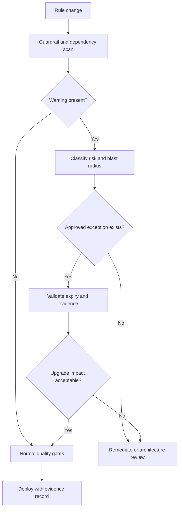

# Guardrail exceptions as architectural debt signals
## Failure scenario
A retail lender reports a green release pipeline despite accumulating hundreds of rule warnings. Developers have justified Activity-based persistence and Java steps as expedient integrations. During a Pega Platform upgrade, a legacy Activity bypasses case locking and writes directly to a work table; a second rule relies on a deprecated UI control. The release fails under production load, but the warning count was never tied to runtime risk or ownership. Treating guardrail warnings as a cosmetic score allowed structural debt to compound.

## Define a decision system, not a warning quota
Pega guardrail warnings are useful review signals, not a universal proof of security or correctness. Separate policy violations, performance hazards, deprecated dependencies, rule complexity, and intentional platform extensions. A warning accepted for a narrow integration may be reasonable; an identical warning in a reusable framework rule may multiply risk across applications. Use application-specific architecture principles and a reviewed exception register rather than setting an arbitrary target of zero warnings.

Maintain each exception as a governed record with rule key, Applies To class, ruleset/version, warning text, reason, alternatives, owner, approval date, expiry, release dependency and verification evidence. Record the operational failure that the exception could produce, not merely the developer's justification. Where possible, use rule and pipeline metadata to detect drift; never infer the active rule from its label alone because circumstancing and rule resolution matter.

## Architecture and implementation
1. Export a baseline of guardrail findings for every application and dependent ruleset. Classify by rule type: Activity, Data Transform, Flow, Decision Table, Report Definition, Connect REST, Section and custom Java. Identify whether the rule is active for target access groups and circumstances.
2. Build a policy taxonomy: prohibited without explicit security review, high-risk requiring architecture approval, transitional with an expiry, and low-risk informational. For example, direct SQL writes to Pega-managed case tables deserve different scrutiny from a complex but read-only reporting expression.
3. Store exceptions in version-controlled YAML or a governance case type with a unique rule identifier and business owner. Link to a reproducible test, incident history, replacement design and planned removal milestone. Avoid an exception with an indefinite expiry.
4. Add a deployment gate to compare new findings against an approved baseline. The gate should fail for new unreviewed high-risk exceptions and expired approvals, not blindly fail on every inherited warning.
5. Inspect Pega rule resolution and application stack when assessing blast radius. A base class Activity used by twenty case types may have a far larger effect than a specialized implementation. Include branch merges, ruleset locks and delegated rules.
6. For activity-heavy implementations, document whether a Data Transform, declarative rule, Queue Processor or supported connector would express the behavior more safely. Do not refactor solely for aesthetic reasons if transactional behavior changes.
7. Before a platform upgrade, review release notes and retirement notices against the exception register. Create a targeted regression pack for each accepted dependency, including rollback and active-case behavior.
8. Publish a dashboard showing aged exceptions, high-risk active rules, newly introduced warnings and verified removals. Use trend and exposure, not a single unexplained compliance percentage.

## Design tradeoffs
Strict gates can slow emergency remediation, so define an emergency approval route with post-release expiry and evidence requirements. Broad waivers improve velocity temporarily but make the warning system meaningless. Rewriting a legacy Activity into several rules can improve maintainability while changing transaction boundaries; preserve observable behavior and case-lock semantics. For reusable components, require stronger evidence because one exception may affect many applications.

A common production failure is a ruleset patch that removes a warning in one application but leaves a lower-priority version selected in another. Another is a quality scan run against development access groups while production users resolve different circumstanced rules. Verify the actual application stack and rule selection for the intended users.

## Verification matrix
| Exercise | Setup | Required outcome | Evidence |
|---|---|---|---|
| New unsafe Activity | Add a synthetic direct-write rule | Gate blocks without approval | Scan report |
| Expired waiver | Set approval expiry before release | Gate blocks | Exception history |
| Circumstance | Test alternate operator context | Active rule correctly identified | Rule resolution trace |
| Approved extension | Register reviewed warning | Gate permits with linked evidence | Approval record |
| Upgrade | Run targeted regression pack | No untested retired dependency | Test manifest |
| Emergency patch | Time-boxed exception | Automatic follow-up recorded | Release audit |
| Exception removal | Replace warned rule | Baseline and owner record updated | Diff and test run |

All results are acceptance criteria, not observed production data. Guardrail tooling and exact warning categories vary by Pega release; inspect the target platform and pipeline integration.
## Verified primary guidance
- [Deploy application, Pega Deployment Manager](https://docs.pega.com/bundle/deployment-manager/page/deployment-manager/dm/deploy-application.html)
