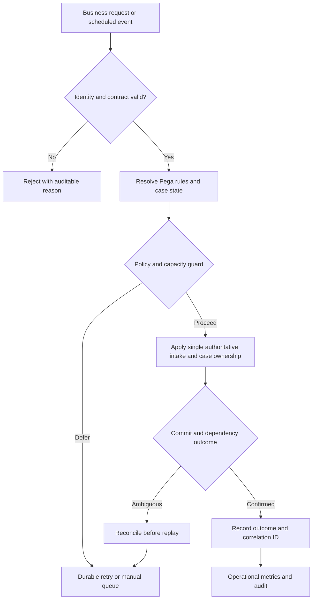

# Production cutover for a new case platform

## Engineering context and failure scenario

A government service cuts over to a new Pega case application while inbound emails and API events still target the old system, creating duplicate applications. This is not simply an isolated slow rule or a missing validation. The architect must decide which component owns the business invariant, where the failure can propagate, and which release boundary can safely be reversed. The critical business journey is **single authoritative intake and case ownership**. Its dependency surface includes **old case platform and new Pega application**. A successful solution must preserve case history, identity boundaries and operational recovery rather than merely making a demonstration succeed.

Begin by drawing the actual request and asynchronous execution paths. Distinguish Pega requestor execution from background queue processing, database commits and external side effects. Capture which rulesets and application versions execute each path. Do not assume that a successful unit test establishes concurrency safety or that a service timeout proves the remote operation did not complete. Agree on ownership of business identifiers, idempotency keys and incident decisions before implementation.

## Architecture decision

The recommended approach is **fenced writers, deterministic routing and reconciliation window**. Implement it as an explicit contract with failure states, not as an informal convention between teams. Relevant Pega configuration surfaces include Service-REST, email listeners, case IDs, data pages, Connect-REST, queue processors, access groups. Verify which of these capabilities are present and licensed in the deployed Pega Platform version. Cloud service configuration, queue processing and Constellation-specific UI behavior may differ from traditional deployments.

Separate business policy from integration mechanics. A decision table or when rule should express eligibility; an activity or data transform should not silently override it for a special environment. An integration adapter should translate errors into a small documented failure taxonomy. Where external services are involved, treat retries as potentially duplicate-producing and require idempotent consumers or reconciliation before replay. Record the source of truth for each mutable field and forbid dual writers during transitions.

## Technical flow

The diagram is a reference design, not evidence that a particular product version implements each node automatically. Assign explicit ownership to each transition and verify persistence semantics under transaction rollback.

## Implementation sequence

1. **Establish invariants.** Document the business key, authorized operator or service principal, permissible case status transitions and what constitutes successful completion. Include failure paths, not just happy-path requirements.
2. **Inventory Pega rules.** Inspect Service-REST, email listeners, case IDs, data pages, Connect-REST, queue processors, access groups. Record owning ruleset, application layer, circumstance and deployment dependency. Prefer supported rule forms over direct database writes or clipboard manipulation.
3. **Define control points.** Implement freeze routing changes; fence old writers; switch intake through versioned gateway; reconcile in-flight work; retain read-only access to history. Put validations at server-side boundaries even if the UI also validates. Record why a request was rejected or deferred without leaking confidential payloads.
4. **Design replay and rollback.** Preserve the prior compatible contract while new rules are introduced. Define how to resume in-flight cases, replay a failed item once and detect already completed work. For external side effects, reconciliation precedes retry.
5. **Instrument by correlation.** Emit stable identifiers that connect service invocation, case ID, background item and release version. Redact personal data and secrets. Configure retention and access appropriate to the organisation.
6. **Promote gradually.** Use an isolated test environment, then a limited business cohort or controlled release window. Define a measurable abort threshold and an operator-owned rollback playbook.
7. **Reconcile after release.** Compare expected and observed work outcomes, inspect exceptions and queue backlog, and keep an explicit list of unresolved cases for operations.

## Design trade-offs and production mechanics

**Strong isolation versus utilization.** Dedicated resources and guarded execution reduce noisy-neighbor effects but may leave capacity unused. Shared pools simplify operations yet allow a burst from old case platform and new Pega application to interfere with single authoritative intake and case ownership. Choose using measured service-level objectives rather than a universal concurrency setting.

**Fail closed versus continuity.** Security or integrity uncertainty should stop irreversible writes. For a non-critical read, a labeled stale result may be acceptable if policy permits. Never turn an ambiguous external outcome into an unconditional retry; the remote side may have committed before the network failed.

**Compatibility versus clean replacement.** A one-step replacement is easier to understand but risky for open cases and asynchronous messages. Expand-contract releases keep old and new consumers compatible until work drains, at the cost of temporary complexity. Treat rollback as a forward-compatible migration of state, not simply restoration of old code.

Common incident signatures include a rising oldest-item age with stable request volume, repeated exception signatures after a ruleset promotion, orphaned assignments, access-denied errors confined to one role, and successful API responses without corresponding case history. These symptoms need separate hypotheses. Correlate PDC events, application logs, case history and database performance before attributing causality. Avoid using Tracer indiscriminately in production.

## Reproducible verification matrix

| Test | Controlled setup | Expected observation | Evidence to retain |
|---|---|---|---|
| Baseline | Representative case and rule version | Existing single authoritative intake and case ownership behavior documented | Rule version, fixture, trace ID |
| Boundary | Minimum, maximum and invalid inputs | Contract enforces business invariant | Assertion and rejection reason |
| Concurrency | Parallel work on same business key | No unowned duplicate side effects | Case history and correlation log |
| Dependency failure | Timeout or unavailable old case platform and new Pega application | Explicit defer, reconcile or safe rejection | Queue state and exception category |
| Access control | Unauthorized operator and service principal | Server denies access without data leakage | Sanitized audit event |
| Recovery | Restore dependency and replay once | Exactly one accepted business outcome | Before/after state comparison |
| Release regression | Prior and new ruleset with same fixture | Differences reviewed against acceptance criteria | Signed diff and package digest |
| Load | Sustained workload plus burst | duplicate intake, lost events, time-to-first-assignment, reconciliation exceptions, fallback viability within agreed budgets | Timestamped dashboards and test parameters |

Do not invent pass rates or latency improvements. Record actual environment, Pega version, workload, data distribution and the test harness. A test is *pending* until a reproducible execution produces evidence.

## Operational handover and review questions

The support runbook should name an accountable business owner and technical on-call, identify dashboards and alert thresholds, and distinguish immediate containment from permanent correction. Include the procedure to pause or drain background processing, isolate an affected cohort, reconcile externally completed operations and restart only after an idempotency check. Define retention for case history and diagnostic records, plus a deletion policy for temporary test fixtures.

At architecture review ask: Can a second writer modify the same business state? Can a request succeed remotely while Pega records failure? Does a new ruleset resolve differently for an existing assignment? Are error messages safe to show to an operator? Can support prove the deployed package and associated approval? What observable signal distinguishes back pressure from a broken dependency? These questions expose design defects earlier than a diagram-only review.

**Verification status:** Design-backed reference architecture; lab verification pending. Validate against the target Pega Platform version, deployment model, access policy and operational contracts before adoption.
