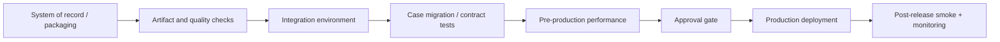

# Deployment Manager Release Gates: Protecting Long-Running Cases During Change

**PFA-181** | **Level:** SSA / LSA architecture | **Evidence status:** Design reference; not yet lab executed

## Business situation and the architectural mistake

A lending case can remain open for 90 days. The application team wants to deploy a changed decision table, updated data model and new integration connector without downtime. A green PegaUnit result is insufficient. Active cases might enter the new stage using persisted data created by the old release. The LSA needs a pipeline design that tests artifact contents, version compatibility, security and the migration behaviour of live cases. Deployment Manager models application scope, candidate environments and stage tasks for releases.

## Reference architecture

The diagram describes a proposed component boundary. It is not a screenshot of a Pega test environment.

## Pega rules and components

| Object or rule category | Architectural responsibility |
|---|---|
| Application version | Declared application scope being promoted |
| Rule-Admin-Product | Product rule packaging relevant changes |
| Repository artifact | Immutable release package and retention |
| Deployment Manager pipeline | Sequenced environments, actions and approval gates |
| PegaUnit plus integration tests | Rule coverage and dependency compatibility |
| Open case migration test pack | Persisted case states from previous release |
| Rollback/compensation runbook | Recovery if data and schema changed |

Illustrative rule and domain names are not assertions that Pega creates those exact names out of the box.

## How to design and implement it

1. **Design step 1.** Freeze the **scope**: application version, product rule, dependencies and targeted built-on applications. An artifact is not valid simply because it contains changed rules.

2. **Design step 2.** Establish a deployment path from candidate/System of Record through integration and pre-production to production, with explicit environment credentials and repository responsibilities.

3. **Design step 3.** Run guardrail/security checks and PegaUnit tests, but pair them with API contract tests and realistic active-case transition tests.

4. **Design step 4.** Restore or generate sample persisted cases at each significant old stage, then apply the proposed ruleset. Attempt completion through the next business milestone.

5. **Design step 5.** For schema changes, classify additive changes separately from destructive transformations. A rollback of rules does not automatically undo a database migration.

6. **Design step 6.** Use progressive checks in the pipeline: packaging correctness, technical regression, dependency compatibility, business sign-off, performance budget and post-deploy health.

7. **Design step 7.** Define how a failed production check stops the rollout and what repair path is safe. If customer data was modified, reverting a product package may be insufficient.

Before changing a production application, reproduce the same process in an environment with the target Pega version, security model and dependency versions. Decide what should remain a Pega case responsibility and what belongs to an external service.

## Which approach should you choose?

| Design choice | Advantages and constraints |
|---|---|
| Big-bang release with manual smoke test | Fast apparent path but limited coverage for active work |
| Pipeline with automated technical gates | Repeatable tests and artifacts, requires ongoing test ownership |
| Phased feature activation after deployment | Separates technical deployment from user exposure; needs activation and rollback controls |

No pattern wins merely because it is newer. Fit the design to recovery, ownership, runtime semantics, security and the actual business volume.

## What fails in production?

Most severe release failures occur at **boundaries**: a new validation rule rejects data persisted by the old version; a child case created under a prior framework cannot resolve a new rule; a connector mapping changes while a delayed Queue Processor item is still waiting; a schema change prevents rollback. Capture the original case, ruleset stack and deployment artifact IDs. Do not label the incident as an infrastructure failure until the business version transition is tested.

An architecture review should identify an observable signal, support owner and recovery action for every material failure. Do not assume that a successful Pega flow status proves every remote dependency or business process completed.

## Validation matrix

| Experiment to run | Expected evidence |
|---|---|
| Artifact parity | The same signed package is promoted across environments |
| Old active cases | Cases created in old release can pass new flow without data corruption |
| Queued work | Items queued before release can be safely executed after it |
| Failed integration | Fallback and repair path are proven under dependency outage |
| Security gate | Privileges and ABAC remain enforced after ruleset promotion |
| Rollback drill | Document which changes can be reverted and which require forward repair |

All results above are proposed assertions, not measured or executed outcomes. A verified edition of this article should include redacted rule screenshots, real diagnostics and release-specific deviations.

## Operations and support

Store the release decision, test evidence, target environment versions, product artifact ID and runbook for each deployment. Assign a release owner and a business owner for emergency cutover decisions. Pipeline success should be backed by production signals, not just a green job status.

## Pega references

- [Pega Academy: Deployment Manager pipeline elements](https://academy.pega.com/topic/deployment-manager-pipeline-elements/v1)
- [Pega Academy: Deployment Manager stages](https://academy.pega.com/topic/deployment-manager-pipeline-stages/v1/in/30226)

**Applicability note:** Specific UI labels, background services and runtime behaviour may vary by Pega release. Verify target-platform behaviour, especially after a major upgrade. Original independent architectural material, not affiliated with Pegasystems.
