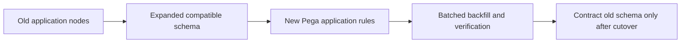

# Rolling Deployments and Pega Schema Changes: Using Expand, Migrate, Contract

**PFA-184** | Senior / Lead System Architect level | Design reference, not a lab result

## The practical failure

A lender exposes a new property and introduces a required validation in the same release. Some runtime nodes still use the previous application version and thousands of saved cases contain no value for the new field. Deployment completes but older assignments begin failing. Database schema and rule compatibility must coexist during rollout.

## Technical flow

The diagram describes a proposed execution boundary rather than a captured Pega implementation.

## Pega rules and interfaces involved

| Rule or component | Architect's checklist |
|---|---|
| Property mapping and exposure | Owns one part of this design |
| Database DDL change | Requires clear data and security contract |
| Rule-Admin-Product | Needs actual release-specific configuration |
| Case data migration batch | Should yield evidence for diagnostics |
| Cross-version release test suite | Has a testable operational responsibility |

## Implementation design

1. Treat schema rollout as phases: add compatible nullable columns or tables, migrate data, then remove old structures only after verification.

2. Run old Pega code against the expanded schema in test before introducing new rules.

3. Backfill persisted case data with bounded batch size, a durable cursor and restart-safe repair logic.

4. Deploy new rule versions that tolerate both populated and not-yet-migrated records during transition.

5. Rehearse queued operations and assignments created by old versions resuming on new worker nodes.

6. Tighten constraints or remove old columns in a separate later release, not during the mixed-version window.

7. Define forward repair because rolling back rules does not roll back schema and case updates.

## Competing patterns

| Approach | Trade-off |
|---|---|
| Single atomic code/schema cutover | Lower apparent effort, poor mixed-node safety |
| Expand/migrate/contract | Safer rolling behaviour and repairability |
| New database for every release | High isolation cost and complicated dual writes |

A valid architecture makes the consistency, permission and recovery contract explicit. Do not optimize for one successful demonstration while ignoring the retry or failure case.

## Why it breaks in production

A NOT NULL column can invalidate older case saves. A property type change can break Report Definitions. A large backfill can lock hot work tables and amplify latency. A ruleset rollback can be unsafe when new cases have already persisted incompatible values.

For incident triage, retain a redacted operation/case ID, node, ruleset/app version, timestamp and evidence of the dependent system. Never publish private client payloads or authentication tokens.

## Reproduction and verification plan

| Scenario | Evidence to obtain |
|---|---|
| Test 1 | Run old rules against expanded schema. |
| Test 2 | Run new rules with pre-backfill case data. |
| Test 3 | Interrupt and resume migration without changing a record twice. |
| Test 4 | Process old queued work after new application rules deploy. |

These are proposed tests. No claim is made that the scenario has been executed in a Pega lab. A complete validated edition should show the actual Pega rule forms, configuration values and observed result for the target release.

## Release checklist

Record system of record, data and authorization boundary, expected volume, timeout/retry or conflict strategy, owner of failures, migration impact and a repair runbook. Confirm behavior across at least two realistic user/role contexts where applicable.

## Source and version note

- [Relevant Pega Academy reference](https://academy.pega.com/topic/data-storage-pega/v6/in/53886/54151)

Independent original engineering content. Version-specific editor names and configuration controls must be checked against the Pega release used by the reader.
