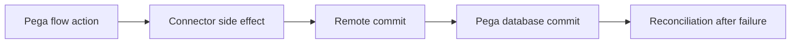

# Flow persistence and transaction checkpoints

**PFA-046** | Lead System Architect study | Architecture design, not yet run as a lab

## Scenario and business consequence

A service step calls an external policy system, then updates Pega case state. Engineers assume both operations are a single atomic transaction. The remote system commits, but the Pega save fails, causing the flow to retry and create duplicate policies.

The critical design issue is the boundary between case lifecycle state, human ownership, persistence and remote side effects. A flow diagram alone cannot establish that business outcomes remain correct under failures or parallel work.

## Proposed execution flow

## Pega implementation assets

1. **Flow/Activity.** Confirm its Apply To class, version, owner and how it behaves when the case is already in a newer state.
2. **Commit boundaries.** Confirm its Apply To class, version, owner and how it behaves when the case is already in a newer state.
3. **Connect REST.** Confirm its Apply To class, version, owner and how it behaves when the case is already in a newer state.
4. **Queue Processor.** Confirm its Apply To class, version, owner and how it behaves when the case is already in a newer state.
5. **business receipt.** Confirm its Apply To class, version, owner and how it behaves when the case is already in a newer state.

## Implementation architecture

1. List each transaction boundary in the interaction: Clipboard changes, Pega database commit, queue enqueue and external HTTP call.

2. Do not treat a Connect REST response as part of the Pega database ACID unit; a remote commit cannot be rolled back automatically with a Pega case failure.

3. Prefer an operation ledger and idempotency key for remote side effects, allowing safe replay after loss of acknowledgement.

4. Stage the case transition into PendingExternalConfirmation when the dependency may take longer than the user response budget.

5. Design compensation explicitly where reversing an external effect is possible and legal, otherwise route to investigation.

### Example rule inventory

Use concrete names such as `D_OperationReceipt`, `ValidateCurrentCaseState`, `D_EligibleAssignments` or `ResolveExternalOperation` only where they match this scenario's needs. These are illustrative application-specific names, not built-in Pega rules. A real implementation should specify exact classes and rule parameters in the reviewed design.

## Design options

- **Choice 1:** Single synchronous activity simplifies wiring but creates partial commits.
- **Choice 2:** asynchronous saga separates outcomes but adds state.

Each option shifts cost among latency, data integrity, recoverability, user experience and operational support. Choose the trade-off explicitly rather than inferring it from a diagram.

## How the design fails and how to diagnose it

Case rolls back to previous stage yet external policy exists. A worker retry using new IDs turns uncertainty into duplication.

Capture case ID, operation IDs, case version, operator access group, assignment/child status, application ruleset stack, queued processing state and partner receipt as relevant. Never treat a successful Pega case save as evidence that an independent remote transaction succeeded.

## Reproduction checklist

1. **Experiment 1:** Force local save failure after remote success. Compare expected and observed case history plus external receipts.
2. **Experiment 2:** repeat operation ID. Compare expected and observed case history plus external receipts.
3. **Experiment 3:** simulate unavailable status lookup. Compare expected and observed case history plus external receipts.

Run the matrix in a representative Pega sandbox and document the actual version, Flow/Rule configurations and sanitized diagnostics. These experiments have not yet been executed for this article.

## Production release criteria

Document how the case or queue item can be safely resumed after deployment, who owns business exceptions and what signals will identify overdue unresolved work. Test concurrent users and retries for workflows with shared state. Keep compensation and archive operations auditable.

## Official foundation

- [Pega Academy: Queue processors](https://academy.pega.com/topic/queue-processors-and-job-schedulers/v2)

*This is an independent scenario-driven design study, not a vendor guide or a claim of verified performance.*
