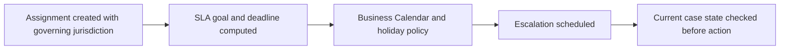

# Assignment SLAs Across Time Zones: Why Two Business Days Is Not 48 Hours

**PFA-047** | **Audience:** Senior and Lead System Architects | **Status:** Architecture design, live Pega verification pending

## The actual failure

UK and Singapore teams share an operations work queue. A two-business-day service commitment excludes the customer's regional holidays, but the application uses a fixed 48-hour deadline. Friday cases escalate on Sunday and a public holiday is ignored. The decision is which region's calendar owns the obligation, not which timezone the browser displays.

## System interaction and ownership

This is a conceptual reference architecture, not a product screenshot or observed runtime trace. Its boundaries must be verified for the actual Pega deployment version and external systems.

## Pega implementation inventory

| Component or rule | Design consideration |
|---|---|
| Service-Level Agreement rule | Owns a defined runtime decision or state boundary |
| Business Calendar | Needs a documented input/output contract |
| Assignment goal and deadline | Requires version-specific access and execution testing |
| Escalation processing | Produces diagnostics for failure isolation |
| Case due-date audit properties | Carries operational ownership |

## How to implement and validate the architecture

1. Define the contractual time basis: customer region, fulfillment team or product jurisdiction; document what happens if that identity changes mid-case.

2. Configure separate goal and deadline behaviours, including what counts as a breach versus a warning.

3. Use business calendar holidays and working hours rather than treating a business day as a fixed 24 hours.

4. Record calculated UTC deadline together with governing calendar ID so the date can be explained after a policy change.

5. Before notifying or escalating, recheck the assignment state and suppress duplicate action when it was just completed.

6. Test weekends, daylight-saving transitions, holiday calendars and reassignment across jurisdictions.

For a production build, annotate the actual class names, access group, ruleset version, node role and recovery owner. Ensure each external operation has an explicit system of record; a successful Pega case save does not, by itself, certify that an external service committed a change.

## Architectural choices

| Pattern | Consequence |
|---|---|
| Fixed elapsed duration | Correct for 24x7 services, wrong for business-hour contracts |
| Business calendar-bound deadline | Matches jurisdiction-specific operations; calendar ownership is essential |
| Custom polling scheduler | May be justified for complex special rules, adds failure modes and operational cost |

Choose by the actual confidentiality, scale, consistency and failure-recovery constraints. A seemingly quicker configuration can shift cost into production support, data repair or lost auditability.

## Failure mechanics and support diagnosis

Even a correctly configured SLA produces incorrect outcomes when the wrong calendar is selected. Delayed escalation work can act on a completed assignment without a live-state check. Historical deadline disputes are impossible to resolve if the application stores only local display text.

Correlate one affected case ID and operation ID across rule execution, logs and dependent services. Record the effective application/ruleset versions and node. Avoid exporting live client data or confidential prompts in community evidence.

## Test matrix

| Test | Expected verification |
|---|---|
| Experiment 1 | Create a UK Friday afternoon case and verify the next business-day calculation. |
| Experiment 2 | Cross daylight-saving change with a controlled test clock. |
| Experiment 3 | Complete assignment just before escalation, then allow the job to run. |
| Experiment 4 | Reassign from UK to Singapore and verify the explicitly agreed deadline policy. |

These are **experiments to execute**, not assertions of a completed test. Include Pega configuration screenshots and sanitized Clipboard, Tracer, PAL or service evidence only after an authorised lab run. A failing experiment is valuable evidence and should update the design.

## Release and production readiness

Before promoting the design, confirm: observable business state; retry and rollback constraints; tenant and privilege isolation; capacity target; accountable support team; release-specific configuration; and a documented repair procedure. A green rule test or a running node does not imply the complete business operation succeeded.

## Primary reference

- [Pega Academy technical documentation](https://academy.pega.com/topic/queue-processors-and-job-schedulers/v2)

This article is an independent architectural study. The example scenario is fictional. It is not affiliated with Pegasystems, and no performance measurement or live test result is claimed.
