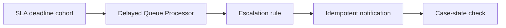

# Escalation architecture that avoids notification floods

**PFA-048** | Lead System Architect study | Architecture design, not yet run as a lab

## Scenario and business consequence

A regulator sets a single deadline for thousands of claims. At 09:00 every overdue case sends an email and creates an assignment simultaneously, overloading notification service and web queues. Repeated scheduler execution sends duplicate escalation messages.

The critical design issue is the boundary between case lifecycle state, human ownership, persistence and remote side effects. A flow diagram alone cannot establish that business outcomes remain correct under failures or parallel work.

## Proposed execution flow

## Pega implementation assets

1. **SLA rule.** Confirm its Apply To class, version, owner and how it behaves when the case is already in a newer state.
2. **Business Calendar.** Confirm its Apply To class, version, owner and how it behaves when the case is already in a newer state.
3. **delayed Queue Processor.** Confirm its Apply To class, version, owner and how it behaves when the case is already in a newer state.
4. **notification.** Confirm its Apply To class, version, owner and how it behaves when the case is already in a newer state.
5. **escalation audit ledger.** Confirm its Apply To class, version, owner and how it behaves when the case is already in a newer state.

## Implementation architecture

1. Quantify the deadline cohort and downstream messaging rate before choosing escalation rules.

2. When large numbers of SLAs converge, size stream and worker capacity appropriately for the supported platform version.

3. Use a stable escalation event ID derived from case, SLA and breach stage so retries do not resend duplicate alerts.

4. Before each escalation action, re-check that assignment is still pending and deadline actually breached.

5. Differentiate first warning, contractual breach and management escalation with clear deadlines and bounded retries.

### Example rule inventory

Use concrete names such as `D_OperationReceipt`, `ValidateCurrentCaseState`, `D_EligibleAssignments` or `ResolveExternalOperation` only where they match this scenario's needs. These are illustrative application-specific names, not built-in Pega rules. A real implementation should specify exact classes and rule parameters in the reviewed design.

## Design options

- **Choice 1:** One mass notification job is easy but bursty.
- **Choice 2:** stream-backed asynchronous workers smooth load and need backlog monitoring.

Each option shifts cost among latency, data integrity, recoverability, user experience and operational support. Choose the trade-off explicitly rather than inferring it from a diagram.

## How the design fails and how to diagnose it

If the email API responds late after accepting a message, a retry can issue duplicate notices. A case resolved seconds before processing should not be escalated.

Capture case ID, operation IDs, case version, operator access group, assignment/child status, application ruleset stack, queued processing state and partner receipt as relevant. Never treat a successful Pega case save as evidence that an independent remote transaction succeeded.

## Reproduction checklist

1. **Experiment 1:** Trigger 1000 deadline events simultaneously. Compare expected and observed case history plus external receipts.
2. **Experiment 2:** resolve case during queue delay. Compare expected and observed case history plus external receipts.
3. **Experiment 3:** drop email response after acceptance. Compare expected and observed case history plus external receipts.

Run the matrix in a representative Pega sandbox and document the actual version, Flow/Rule configurations and sanitized diagnostics. These experiments have not yet been executed for this article.

## Production release criteria

Document how the case or queue item can be safely resumed after deployment, who owns business exceptions and what signals will identify overdue unresolved work. Test concurrent users and retries for workflows with shared state. Keep compensation and archive operations auditable.

## Official foundation

- [Pega Academy: Background process management](https://academy.pega.com/topic/background-process-management/v8/in/108716)

*This is an independent scenario-driven design study, not a vendor guide or a claim of verified performance.*
