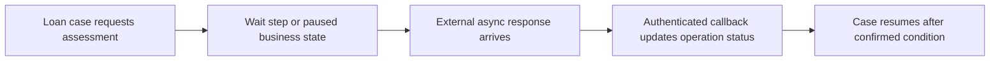

# Wait Step or External Event: Safely Resuming a Pega Case After Asynchronous Work

**PFA-049** | **Audience:** Pega SSA / LSA | **Lab status:** Not yet executed in a live Pega environment

## Enterprise problem

A loan case requires a third-party affordability result before underwriting. One team puts a Timer Wait of five minutes and assumes the result will be ready. Another makes a child case just to receive the callback. Both choices are possible but may not reflect the real dependency. A Wait Step can pause on a timer or a Pega child case dependency; an external callback needs explicit correlation and a trusted way to update the case state.

The purpose is to decide how Pega should behave when there are simultaneous users, service failures, stale state and a deployment boundary. A feature can be configured correctly at rule level but still be wrong for the business process.

## Component and runtime sequence

This is a conceptual design. It is not a claim about actual traces or a particular Pega version.

## Pega artefacts and execution context

| Rule or component | Design requirement |
|---|---|
| Wait Step with Timer/Case Dependency | Architectural responsibility and identity boundary |
| Child Case lifecycle and status | Rule or configuration must be version controlled |
| Service REST callback | Inputs/outputs and failure model must be documented |
| Operation correlation receipt | Expected observability and support ownership |
| Case reopen, lock and state validation | Explicit integration or release validation required |

Before implementation, record the actual Apply To class, ruleset and access group. Business responsibility must remain with the correct system of record. Context supplied through UI request parameters should be treated as untrusted until server-side authorization is applied.

## Technical implementation sequence

1. Classify the dependency: a time-based hold, Pega child-case milestone or truly external event. Do not use Timer as a substitute for guaranteed external completion.

2. For Case Dependency, create the child before the parent reaches the Wait Step and select All/Any and the relevant child status deliberately.

3. For an external service, persist a stable request operation ID and expected version. A response for an old attempt must not resume the current attempt.

4. Use a secured Service REST callback or controlled polling coordinator to update authoritative case status after validating current state and access.

5. If a timer provides a business timeout, model it as an escalation path, not an assertion that the external work succeeded.

6. Define who can cancel a wait, what should happen to late callbacks, and how SLA deadlines interact with ongoing work.

7. Test race conditions where the callback arrives before the parent reaches the wait, during reassignment or after cancellation.

### Design review questions

Who owns each state transition? Which operation is allowed to run again after a lost response? Can a cached value be shared across a session or node? How will an administrator see a failure when the original user has signed out? Each answer must be supported by a reproducible test and a named on-call owner.

## Alternatives and when to reject them

| Approach | Architectural cost and applicability |
|---|---|
| Fixed Wait Timer | Correct for statutory cooling-off periods and explicit timeouts, not unknown external completion |
| Wait on child case | Pega-native coordination with child ownership and status semantics |
| External callback/correlation | Appropriate for remote systems, requires security and deduplication |

Avoid adopting the fastest development path merely because it passes a single-user test. State where complexity has been moved: infrastructure scaling, cache invalidation, support recovery, version migration or customer authorization.

## Production diagnosis

Pega guidance warns that case dependencies must exist before the wait step or the flow can skip the wait. A resolved child may have been rejected, not approved. External callbacks can arrive twice or in the wrong order and should not automatically resume settlement.

Build incident evidence around the case/operation identity, exact requestor or processing node, release/ruleset stack, timestamps and external correlation IDs. The same user-visible symptom can arise from rule resolution, database state, queue processing or a remote API. Investigate the layer that actually owns the failing transition.

## Controlled verification

| Test scenario | Expected behavior to observe |
|---|---|
| Lab test 1 | Parent reaches Wait before child exists; demonstrate actual behavior in lab. |
| Lab test 2 | All/Any child dependency conditions with one rejected child. |
| Lab test 3 | Callback arrives before wait and does not get lost. |
| Lab test 4 | Late response after cancellation is logged but cannot resume old operation. |

For acceptance, store actual screenshots of the rule configuration and sanitized Clipboard/Tracer/PAL data only after the experiment runs in a permitted Pega environment. Do not present theoretical timings as observed measurements.

## Production readiness checklist

- Define data classification and identity boundaries for this capability.
- Capture interface contract and dependency versions.
- Agree business freshness, latency and failure-response requirements.
- Verify retries, duplicates and parallel interactions where relevant.
- Monitor the supported recovery signal, not merely the happy-path success message.
- Retain rollback or forward-repair steps for active cases crossing a release.
- Record the target Pega version and the observed lab result before declaring the design verified.

## References

- [Pega Academy: Managing Case workflow dependency](https://academy.pega.com/topic/managing-case-workflow-dependency/v2/in/80791)

Independent architectural analysis. Examples use fictional business details. This article is not affiliated with Pegasystems, and exact runtime options may vary by release.
