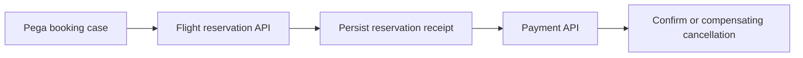

# Compensation in a Pega Flow: Undoing Business Effects When Remote Transactions Cannot Roll Back

**PFA-050** | Technical design study for Pega Senior and Lead System Architects | Laboratory verification pending

## Architecture problem

A travel booking case reserves a flight and then charges a card. Payment fails after the seat has been held. Neither a Pega case rollback nor an Obj-Save rollback can automatically undo the airline reservation. The flow requires explicit business compensation, with evidence of the original remote operation and of the cancel attempt.

## System design

This diagram records a proposed boundary, not a fabricated Pega runtime screenshot. The interfaces and exact rule forms must be verified in a permitted sandbox.

## Feature inventory and design responsibilities

| Pega rule or component | Review requirement |
|---|---|
| Booking case flow | Primary configuration and ownership boundary |
| Connect REST ReserveSeat and CancelSeat | Explicit input/output and identity contract |
| Stable booking operation ID | Apply platform-version-specific controls |
| Compensation queue processor | Test failure handling and observability |
| Operational receipt data class | Validate runtime access and support procedure |

## Implementation approach

1. List external side effects and their irreversible points before drawing the case flow. Pega's database transaction scope is not a distributed transaction across every remote provider.

2. Persist a stable reservation ID and partner receipt as soon as the partner confirms, without falsely treating a missing response as a failed reservation.

3. Separate happy-path outcome from compensating actions. A cancellation attempt can fail and require retry or manual repair.

4. Use an idempotent compensation operation with its own immutable ID, case correlation and maximum permitted retry window.

5. Model intermediate business states such as Reserved, PaymentPending, CancellationPending and Exception rather than jumping back to NotStarted.

6. Design operator repair: who can view a stuck reservation, confirm its true status and safely replay the compensation.

7. Test cancellation that arrives after a new successful booking and prevent it from canceling the wrong booking version.

## Design alternatives

| Option | Architectural trade-off |
|---|---|
| Attempt DB rollback only | Does not reverse remote side effects |
| Explicit business compensation | Reconciles distributed effects, but may not restore exact original state |
| Defer all work until a single vendor orchestration API succeeds | Good where provider owns atomicity, limits application-level control |

Choose the option that satisfies the business consistency contract and operational constraints. Avoid proving only the success path while deferring security, stale state and recovery behaviour.

## Failure modes and troubleshooting

A payment timeout can leave a successful charge with no response. A cancellation may be rejected after ticketing. Multiple retries can accidentally refund twice. Business reconciliation needs separate operation identities for reserve, charge and cancel, and records of confirmed outcomes.

Capture a sanitized case ID or operation identifier, relevant runtime node, application/ruleset version and timestamps. Correlate the origin and outcome across Pega and partner systems instead of relying on a single status message.

## Verification experiments

| Scenario | Evidence required |
|---|---|
| Experiment 1 | Reserve succeeds, payment rejects, cancellation succeeds. |
| Experiment 2 | Cancellation times out after remote success; retry must not cancel twice. |
| Experiment 3 | Payment response lost after charge; query payment status before refund. |
| Experiment 4 | Second booking version succeeds while old compensation is pending. |

These are experiments to perform in a Pega lab. The article does not claim that any test has passed. A lab-verified version should include actual configuration screenshots, observed results and target Pega version.

## Production acceptance

Before deployment, the implementation needs documented data ownership, access context, expected peak volume, case compatibility, timeouts and retry boundaries, monitoring, escalation owner and a tested operational repair path. If the design changes a data model or class structure, verify legacy case paths and queued work.

## Pega technical source

- [Primary Pega reference](https://academy.pega.com/topic/queue-processors-and-job-schedulers/v2)

Independent original technical analysis. Pega version-specific features and terminology must be confirmed against the target release; the scenario is fictional.
