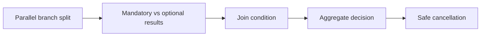

# Parallel branches and joining asynchronous results

**PFA-051** | Lead System Architect study | Architecture design, not yet run as a lab

## Scenario and business consequence

A healthcare referral requires lab verification, financial approval and identity validation in parallel. The case should advance only when all mandatory checks pass, but optional recommendations may finish late. A simple join with all branches required blocks unnecessarily.

The critical design issue is the boundary between case lifecycle state, human ownership, persistence and remote side effects. A flow diagram alone cannot establish that business outcomes remain correct under failures or parallel work.

## Proposed execution flow

## Pega implementation assets

1. **Flow Split/Join.** Confirm its Apply To class, version, owner and how it behaves when the case is already in a newer state.
2. **Case Type processes.** Confirm its Apply To class, version, owner and how it behaves when the case is already in a newer state.
3. **Decision Table.** Confirm its Apply To class, version, owner and how it behaves when the case is already in a newer state.
4. **SLA.** Confirm its Apply To class, version, owner and how it behaves when the case is already in a newer state.
5. **case status.** Confirm its Apply To class, version, owner and how it behaves when the case is already in a newer state.

## Implementation architecture

1. Create a dependency matrix identifying mandatory, veto, optional and best-effort branch results.

2. Persist each outcome and receipt independently; one callback should not overwrite another branch's result.

3. Configure join logic around the business decision instead of blindly waiting for every completion.

4. If one branch produces a veto, cancel or mark remaining branches appropriately while preserving their audit trails.

5. Handle late responses after case closure with version checking and reconciliation.

### Example rule inventory

Use concrete names such as `D_OperationReceipt`, `ValidateCurrentCaseState`, `D_EligibleAssignments` or `ResolveExternalOperation` only where they match this scenario's needs. These are illustrative application-specific names, not built-in Pega rules. A real implementation should specify exact classes and rule parameters in the reviewed design.

## Design options

- **Choice 1:** All-branch join guarantees completeness but stalls on optional checks.
- **Choice 2:** conditional join reduces wait but demands precise policy.

Each option shifts cost among latency, data integrity, recoverability, user experience and operational support. Choose the trade-off explicitly rather than inferring it from a diagram.

## How the design fails and how to diagnose it

A late optional branch may trigger an action after case already resolved. A missing mandatory branch must prevent final approval.

Capture case ID, operation IDs, case version, operator access group, assignment/child status, application ruleset stack, queued processing state and partner receipt as relevant. Never treat a successful Pega case save as evidence that an independent remote transaction succeeded.

## Reproduction checklist

1. **Experiment 1:** Mandatory branch failed while optional succeeds. Compare expected and observed case history plus external receipts.
2. **Experiment 2:** late optional result after closure. Compare expected and observed case history plus external receipts.
3. **Experiment 3:** repeated callback to one branch. Compare expected and observed case history plus external receipts.

Run the matrix in a representative Pega sandbox and document the actual version, Flow/Rule configurations and sanitized diagnostics. These experiments have not yet been executed for this article.

## Production release criteria

Document how the case or queue item can be safely resumed after deployment, who owns business exceptions and what signals will identify overdue unresolved work. Test concurrent users and retries for workflows with shared state. Keep compensation and archive operations auditable.

## Official foundation

- [Pega Academy: Case life cycle](https://academy.pega.com/topic/case-lifecycle/v7)

*This is an independent scenario-driven design study, not a vendor guide or a claim of verified performance.*
