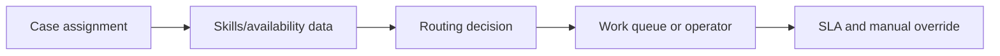

# Routing on dynamic workload rather than fixed groups

**PFA-052** | Lead System Architect study | Architecture design, not yet run as a lab

## Scenario and business consequence

An enterprise support portal routes all escalations to one hard-coded workbasket. One team becomes overloaded while similarly qualified agents are idle. Static routing also fails when agents leave, shift schedules change or languages differ.

The critical design issue is the boundary between case lifecycle state, human ownership, persistence and remote side effects. A flow diagram alone cannot establish that business outcomes remain correct under failures or parallel work.

## Proposed execution flow

## Pega implementation assets

1. **Work queues.** Confirm its Apply To class, version, owner and how it behaves when the case is already in a newer state.
2. **Work Groups.** Confirm its Apply To class, version, owner and how it behaves when the case is already in a newer state.
3. **Routing Decision Table.** Confirm its Apply To class, version, owner and how it behaves when the case is already in a newer state.
4. **Operator skills.** Confirm its Apply To class, version, owner and how it behaves when the case is already in a newer state.
5. **SLA.** Confirm its Apply To class, version, owner and how it behaves when the case is already in a newer state.

## Implementation architecture

1. Define routing constraints before optimization: jurisdiction, certification and restricted-customer access are hard gates.

2. Maintain up-to-date worker capacity, shift schedule, absence and skills as managed data, not flow branch copies.

3. Route to an eligible work queue when no individual is confidently available, with measurable queue age and supervisor reassignment.

4. Ensure chosen operator has record-level access at open/save time; assignment visibility alone is not permission.

5. Rebalance with monitoring of queue p95 age, case reassignments and abandoned handoffs.

### Example rule inventory

Use concrete names such as `D_OperationReceipt`, `ValidateCurrentCaseState`, `D_EligibleAssignments` or `ResolveExternalOperation` only where they match this scenario's needs. These are illustrative application-specific names, not built-in Pega rules. A real implementation should specify exact classes and rule parameters in the reviewed design.

## Design options

- **Choice 1:** Direct named-operator assignment is predictable but fragile.
- **Choice 2:** dynamic workload routing uses live data but requires freshness.

Each option shifts cost among latency, data integrity, recoverability, user experience and operational support. Choose the trade-off explicitly rather than inferring it from a diagram.

## How the design fails and how to diagnose it

An absent skill record can accidentally send regulated work to general agents. Reassignment may change SLA owner but not contractual deadline.

Capture case ID, operation IDs, case version, operator access group, assignment/child status, application ruleset stack, queued processing state and partner receipt as relevant. Never treat a successful Pega case save as evidence that an independent remote transaction succeeded.

## Reproduction checklist

1. **Experiment 1:** Overload one work queue. Compare expected and observed case history plus external receipts.
2. **Experiment 2:** remove operator skill during assignment. Compare expected and observed case history plus external receipts.
3. **Experiment 3:** introduce regional holiday and inspect route. Compare expected and observed case history plus external receipts.

Run the matrix in a representative Pega sandbox and document the actual version, Flow/Rule configurations and sanitized diagnostics. These experiments have not yet been executed for this article.

## Production release criteria

Document how the case or queue item can be safely resumed after deployment, who owns business exceptions and what signals will identify overdue unresolved work. Test concurrent users and retries for workflows with shared state. Keep compensation and archive operations auditable.

## Official foundation

- [Pega Academy: Case life cycle](https://academy.pega.com/topic/case-lifecycle/v7)

*This is an independent scenario-driven design study, not a vendor guide or a claim of verified performance.*
