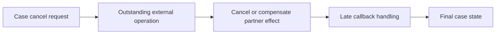

# Case cancellation while integration is in flight

**PFA-053** | Lead System Architect study | Architecture design, not yet run as a lab

## Scenario and business consequence

A travel booking case sends a non-refundable hotel request and then the customer cancels before the partner callback arrives. A late confirmation resumes the original case and enters Fulfilment despite cancellation.

The critical design issue is the boundary between case lifecycle state, human ownership, persistence and remote side effects. A flow diagram alone cannot establish that business outcomes remain correct under failures or parallel work.

## Proposed execution flow

## Pega implementation assets

1. **Cancel stage.** Confirm its Apply To class, version, owner and how it behaves when the case is already in a newer state.
2. **operation correlation ID.** Confirm its Apply To class, version, owner and how it behaves when the case is already in a newer state.
3. **Service REST callback.** Confirm its Apply To class, version, owner and how it behaves when the case is already in a newer state.
4. **Connect REST.** Confirm its Apply To class, version, owner and how it behaves when the case is already in a newer state.
5. **status guard.** Confirm its Apply To class, version, owner and how it behaves when the case is already in a newer state.

## Implementation architecture

1. Define cancellation eligibility and refund rules for each side effect rather than treating Case Type status as control of remote systems.

2. Persist the outstanding operation ID, partner reference and cancellation request timestamp.

3. Where remote cancellation is supported, send an explicit idempotent cancel command and wait for receipt; otherwise create a compensating business action.

4. Handle late positive callbacks by comparing case status and operation version, and record evidence without changing a cancelled case to Approved.

5. Separate Completed, Cancelled, CancellationPending and RequiresReview states as relevant to the domain.

### Example rule inventory

Use concrete names such as `D_OperationReceipt`, `ValidateCurrentCaseState`, `D_EligibleAssignments` or `ResolveExternalOperation` only where they match this scenario's needs. These are illustrative application-specific names, not built-in Pega rules. A real implementation should specify exact classes and rule parameters in the reviewed design.

## Design options

- **Choice 1:** Hard cancel works for uncommitted local work.
- **Choice 2:** compensating workflow is needed when external resources may already be booked.

Each option shifts cost among latency, data integrity, recoverability, user experience and operational support. Choose the trade-off explicitly rather than inferring it from a diagram.

## How the design fails and how to diagnose it

A callback authenticated and correctly correlated can still be obsolete after cancellation. Blind success handling reopens a cancelled financial obligation.

Capture case ID, operation IDs, case version, operator access group, assignment/child status, application ruleset stack, queued processing state and partner receipt as relevant. Never treat a successful Pega case save as evidence that an independent remote transaction succeeded.

## Reproduction checklist

1. **Experiment 1:** Cancel before outbound send. Compare expected and observed case history plus external receipts.
2. **Experiment 2:** cancel after remote commit. Compare expected and observed case history plus external receipts.
3. **Experiment 3:** deliver original success after final cancellation. Compare expected and observed case history plus external receipts.

Run the matrix in a representative Pega sandbox and document the actual version, Flow/Rule configurations and sanitized diagnostics. These experiments have not yet been executed for this article.

## Production release criteria

Document how the case or queue item can be safely resumed after deployment, who owns business exceptions and what signals will identify overdue unresolved work. Test concurrent users and retries for workflows with shared state. Keep compensation and archive operations auditable.

## Official foundation

- [Pega Academy: Case life cycle](https://academy.pega.com/topic/case-lifecycle/v7)

*This is an independent scenario-driven design study, not a vendor guide or a claim of verified performance.*
