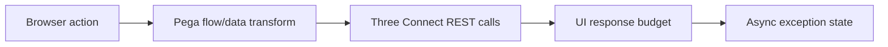

# Timeout budgets across an end-to-end case step

**PFA-054** | Lead System Architect scenario | Verification pending in Pega lab

## Failure scenario

A travel claim screen runs IdentityCheck, PolicyLookup and FraudScore REST calls one after another. Each has a 10-second timeout, even though the user experience target is 2 seconds. A single slow dependency causes 30 seconds of waiting while the browser times out earlier.

The key architectural distinction is between what the Pega engine or data page can execute and what a business transaction guarantees. Rules and scope settings must reflect the data owner, security context, concurrency pattern and recovery policy.

## Technical design flow

## Rules and execution boundaries

1. **Flow Action**. Record the actual rule class/version, source mapping and owner for this boundary.
2. **Connect REST timeouts**. Record the actual rule class/version, source mapping and owner for this boundary.
3. **Data Pages**. Record the actual rule class/version, source mapping and owner for this boundary.
4. **Queue Processor**. Record the actual rule class/version, source mapping and owner for this boundary.
5. **PAL**. Record the actual rule class/version, source mapping and owner for this boundary.

## Proposed implementation

1. Define total response-time target and divide it among Pega rule execution, network and external systems, reserving a margin for variance.

2. Inventory every direct and nested connector called during one interaction; use Tracer and correlation IDs to count hidden dependent Data Pages.

3. Avoid three sequential calls if independent read-only requests can be batched or if some enrichment can be delayed.

4. Set connector timeouts shorter than the overall user/request budget and classify timeouts as unknown effects for write operations.

5. Move slow side effects behind a durable Pending state and notify users of final outcome after asynchronous completion.

These are deliberate architectural choices rather than instructions to copy unknown settings into an application. For every integration or rule, capture the request/response contract, the authenticated caller and the version that was tested.

## Alternative approaches

- **Approach 1:** Increase individual connector timeout might improve success but breaches UI budget.
- **Approach 2:** asynchronous case step controls latency but needs eventual-result design.

Use an ADR to record not just which approach wins, but why the rejected alternatives fail the agreed security, performance, audit and consistency requirements.

## Diagnostic questions

A successful remote write with lost response can be retried as a new operation. Repeated Data Page refresh can consume the entire budget before the Flow Action executes.

Reproduce with the same user, case type, actual parameter values and active application stack. Use Clipboard, Tracer, PAL or partner logs as appropriate, and compare the state before and after the failing interaction.

## Test and acceptance plan

1. **Experiment 1:** Delay each API by 600ms and measure end-to-end. Capture expected and actual outcomes, including source-system state when applicable.
2. **Experiment 2:** force one timeout. Capture expected and actual outcomes, including source-system state when applicable.
3. **Experiment 3:** verify pending state and stable operation ID. Capture expected and actual outcomes, including source-system state when applicable.

No live Pega tests were performed for this publication. Lab-validation requires real redacted rule screenshots, installed platform version, and evidence of both positive and negative behaviors.

## Operating controls

Assign an owner to the failure state, make unresolved work visible, and define safe replay/recovery where a side effect may have been committed independently. For time-sensitive user journeys, measure p95 response and dependency time separately. For Data Pages, test isolation and refresh as well as latency.

## Further reading

- [Pega Academy: Performance analyzer](https://academy.pega.com/topic/performance-analyzer-pal/v8)

*Independent scenario-driven article, not an official Pegasystems document.*
