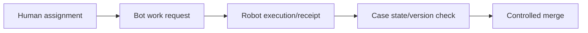

# Orchestrating human and robotic assignments together

**PFA-055** | Lead System Architect scenario | Verification pending in Pega lab

## Failure scenario

A medical claims administrator launches a bot to extract invoice details from a legacy desktop while a human approver reviews the same case. The bot takes longer than expected and returns after the case has been rejected. Without a shared operation identity, its late output overwrites authoritative human decisions.

The key architectural distinction is between what the Pega engine or data page can execute and what a business transaction guarantees. Rules and scope settings must reflect the data owner, security context, concurrency pattern and recovery policy.

## Technical design flow

## Rules and execution boundaries

1. **Flow assignment**. Record the actual rule class/version, source mapping and owner for this boundary.
2. **robotic automation integration**. Record the actual rule class/version, source mapping and owner for this boundary.
3. **Queue Processor**. Record the actual rule class/version, source mapping and owner for this boundary.
4. **case locking**. Record the actual rule class/version, source mapping and owner for this boundary.
5. **audit history**. Record the actual rule class/version, source mapping and owner for this boundary.

## Proposed implementation

1. Treat bot work as an asynchronous external operation with explicit status: Requested, InProgress, Completed, Failed or Obsolete.

2. Capture immutable case ID, operation version, expected input hash and executing identity when dispatching robotic work.

3. Define a least-privileged bot account and prevent direct edits to fields reserved for final human approvals.

4. When the result arrives, reopen current case state and check that its stage and operation version still allow incorporation.

5. Make bot retries idempotent and route low-confidence extraction to a human correction assignment rather than blind continuation.

These are deliberate architectural choices rather than instructions to copy unknown settings into an application. For every integration or rule, capture the request/response contract, the authenticated caller and the version that was tested.

## Alternative approaches

- **Approach 1:** Inline bot invocation blocks user and tightens coupling.
- **Approach 2:** asynchronous child task improves independence but needs event correlation.

Use an ADR to record not just which approach wins, but why the rejected alternatives fail the agreed security, performance, audit and consistency requirements.

## Diagnostic questions

A robot posts a result after cancellation; retry causes duplicate attachment extraction; shared operator credentials mask who changed a value.

Reproduce with the same user, case type, actual parameter values and active application stack. Use Clipboard, Tracer, PAL or partner logs as appropriate, and compare the state before and after the failing interaction.

## Test and acceptance plan

1. **Experiment 1:** Cancel case mid-robot run. Capture expected and actual outcomes, including source-system state when applicable.
2. **Experiment 2:** repeat bot completion callback. Capture expected and actual outcomes, including source-system state when applicable.
3. **Experiment 3:** compare extracted value to human override. Capture expected and actual outcomes, including source-system state when applicable.

No live Pega tests were performed for this publication. Lab-validation requires real redacted rule screenshots, installed platform version, and evidence of both positive and negative behaviors.

## Operating controls

Assign an owner to the failure state, make unresolved work visible, and define safe replay/recovery where a side effect may have been committed independently. For time-sensitive user journeys, measure p95 response and dependency time separately. For Data Pages, test isolation and refresh as well as latency.

## Further reading

- [Pega Academy: Case life cycle](https://academy.pega.com/topic/case-lifecycle/v7)

*Independent scenario-driven article, not an official Pegasystems document.*
