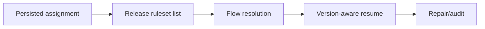

# Recovering stalled flows after an application release

**PFA-056** | Lead System Architect scenario | Verification pending in Pega lab

## Failure scenario

A new application ruleset is deployed while thousands of cases wait in Flow assignments created under the previous version. Some cases progress, others remain stuck because a flow rule or subflow reference now resolves differently.

The key architectural distinction is between what the Pega engine or data page can execute and what a business transaction guarantees. Rules and scope settings must reflect the data owner, security context, concurrency pattern and recovery policy.

## Technical design flow

## Rules and execution boundaries

1. **Flow Rule**. Record the actual rule class/version, source mapping and owner for this boundary.
2. **Assignment**. Record the actual rule class/version, source mapping and owner for this boundary.
3. **Case Type**. Record the actual rule class/version, source mapping and owner for this boundary.
4. **Ruleset version**. Record the actual rule class/version, source mapping and owner for this boundary.
5. **Tracer**. Record the actual rule class/version, source mapping and owner for this boundary.

## Proposed implementation

1. Inventory pending assignment/flow reference pairs before promoting changes that rename, withdraw or replace a flow.

2. Create old-version case fixtures parked at important steps, then promote new product artifact and resume each fixture.

3. Keep compatible eligible rule versions available when old cases depend on them, or migrate the case with a controlled map.

4. Capture actual rule selection with the relevant operator access group and also under background processing context.

5. For stuck cases, build a support path that preserves history and prevents re-running already completed external side effects.

These are deliberate architectural choices rather than instructions to copy unknown settings into an application. For every integration or rule, capture the request/response contract, the authenticated caller and the version that was tested.

## Alternative approaches

- **Approach 1:** Retaining old rules protects parked assignments but increases governance.
- **Approach 2:** case migration reduces version combinations but adds operational risk.

Use an ADR to record not just which approach wins, but why the rejected alternatives fail the agreed security, performance, audit and consistency requirements.

## Diagnostic questions

An operator clicks a stale assignment and an unexpected newer validation rejects missing legacy data; forcibly moving flow token can skip a required approval.

Reproduce with the same user, case type, actual parameter values and active application stack. Use Clipboard, Tracer, PAL or partner logs as appropriate, and compare the state before and after the failing interaction.

## Test and acceptance plan

1. **Experiment 1:** Resume before/after version change. Capture expected and actual outcomes, including source-system state when applicable.
2. **Experiment 2:** simulate withdrawn subflow. Capture expected and actual outcomes, including source-system state when applicable.
3. **Experiment 3:** test old queued event after promotion. Capture expected and actual outcomes, including source-system state when applicable.

No live Pega tests were performed for this publication. Lab-validation requires real redacted rule screenshots, installed platform version, and evidence of both positive and negative behaviors.

## Operating controls

Assign an owner to the failure state, make unresolved work visible, and define safe replay/recovery where a side effect may have been committed independently. For time-sensitive user journeys, measure p95 response and dependency time separately. For Data Pages, test isolation and refresh as well as latency.

## Further reading

- [Pega Academy: Case life cycle](https://academy.pega.com/topic/case-lifecycle/v7)

*Independent scenario-driven article, not an official Pegasystems document.*
