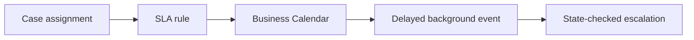

# SLA rules and custom timer design trade-offs

**PFA-057** | Lead System Architect scenario | Verification pending in Pega lab

## Failure scenario

A financial product needs a deadline at 5pm on the second local business day. Developers implement a Job Scheduler polling all open cases every five minutes even though Pega has SLA goal/deadline support. The custom timer produces drift, duplicate escalations and expensive queries.

The key architectural distinction is between what the Pega engine or data page can execute and what a business transaction guarantees. Rules and scope settings must reflect the data owner, security context, concurrency pattern and recovery policy.

## Technical design flow

## Rules and execution boundaries

1. **Service-Level Agreement**. Record the actual rule class/version, source mapping and owner for this boundary.
2. **Business Calendar**. Record the actual rule class/version, source mapping and owner for this boundary.
3. **Job Scheduler**. Record the actual rule class/version, source mapping and owner for this boundary.
4. **Delayed Queue Processor**. Record the actual rule class/version, source mapping and owner for this boundary.
5. **Pega case urgency**. Record the actual rule class/version, source mapping and owner for this boundary.

## Proposed implementation

1. Use the native SLA mechanism where the condition is a goal, deadline or passed deadline tied to case/assignment processing.

2. Model calendar, working hours, holidays and jurisdiction explicitly. UTC timestamps and local display time must not be mixed.

3. Use a custom Job Scheduler only for a genuinely external or aggregate condition not well expressed as an SLA, with a documented reason.

4. Include an idempotent escalation operation key and check actual assignment state before sending notifications or reassigning.

5. Instrument deadline cohort size and backlog age to ensure a surge does not mean missing legal obligations.

These are deliberate architectural choices rather than instructions to copy unknown settings into an application. For every integration or rule, capture the request/response contract, the authenticated caller and the version that was tested.

## Alternative approaches

- **Approach 1:** Native SLA integrates with case rules but needs correct calendars.
- **Approach 2:** custom timer permits unusual conditions but owns all retry and scheduling risk.

Use an ADR to record not just which approach wins, but why the rejected alternatives fail the agreed security, performance, audit and consistency requirements.

## Diagnostic questions

A periodic job runs twice after failover and escalates the same case; fixed elapsed hours violate business-day obligations.

Reproduce with the same user, case type, actual parameter values and active application stack. Use Clipboard, Tracer, PAL or partner logs as appropriate, and compare the state before and after the failing interaction.

## Test and acceptance plan

1. **Experiment 1:** Deadline across holiday. Capture expected and actual outcomes, including source-system state when applicable.
2. **Experiment 2:** repeat scheduler execution. Capture expected and actual outcomes, including source-system state when applicable.
3. **Experiment 3:** resolve assignment immediately before event. Capture expected and actual outcomes, including source-system state when applicable.

No live Pega tests were performed for this publication. Lab-validation requires real redacted rule screenshots, installed platform version, and evidence of both positive and negative behaviors.

## Operating controls

Assign an owner to the failure state, make unresolved work visible, and define safe replay/recovery where a side effect may have been committed independently. For time-sensitive user journeys, measure p95 response and dependency time separately. For Data Pages, test isolation and refresh as well as latency.

## Further reading

- [Pega Academy: Background process management](https://academy.pega.com/topic/background-process-management/v8/in/108716)

*Independent scenario-driven article, not an official Pegasystems document.*
