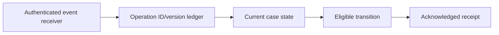

# Business event ingestion without duplicate resumes

**PFA-058** | Lead System Architect scenario | Verification pending in Pega lab

## Failure scenario

A billing partner sends the same payment-confirmed event multiple times, and sometimes sends a correction before the original message. The Pega service handler treats every message as a fresh Resume event and advances the case through settlement repeatedly.

The key architectural distinction is between what the Pega engine or data page can execute and what a business transaction guarantees. Rules and scope settings must reflect the data owner, security context, concurrency pattern and recovery policy.

## Technical design flow

## Rules and execution boundaries

1. **Service REST**. Record the actual rule class/version, source mapping and owner for this boundary.
2. **Service Package**. Record the actual rule class/version, source mapping and owner for this boundary.
3. **case locking**. Record the actual rule class/version, source mapping and owner for this boundary.
4. **event deduplication data**. Record the actual rule class/version, source mapping and owner for this boundary.
5. **Flow continuation**. Record the actual rule class/version, source mapping and owner for this boundary.

## Proposed implementation

1. Authenticate sender and validate message integrity independently of any operator UI session.

2. Persist partner event ID, business operation ID, event type and monotonic version or ordering key; enforce deduplication with a durable uniqueness strategy.

3. Make transition logic a state machine: only PendingPayment may move to Paid, not every event with success text.

4. Lock or otherwise protect current case state while applying the event, with conflict recovery if another process updates the case.

5. Acknowledge duplicate accepted events without rerunning settlement and retain audit of obsolete corrections.

These are deliberate architectural choices rather than instructions to copy unknown settings into an application. For every integration or rule, capture the request/response contract, the authenticated caller and the version that was tested.

## Alternative approaches

- **Approach 1:** Best-effort callback without ledger is easy but duplicates work.
- **Approach 2:** durable event ledger ensures correct replay with storage cost.

Use an ADR to record not just which approach wins, but why the rejected alternatives fail the agreed security, performance, audit and consistency requirements.

## Diagnostic questions

A valid repeated event can cause double payout if processing is not idempotent; an older reversal event can undo a newer authorized decision.

Reproduce with the same user, case type, actual parameter values and active application stack. Use Clipboard, Tracer, PAL or partner logs as appropriate, and compare the state before and after the failing interaction.

## Test and acceptance plan

1. **Experiment 1:** Send same event twice concurrently. Capture expected and actual outcomes, including source-system state when applicable.
2. **Experiment 2:** send version 2 before version 1. Capture expected and actual outcomes, including source-system state when applicable.
3. **Experiment 3:** callback while user cancels. Capture expected and actual outcomes, including source-system state when applicable.

No live Pega tests were performed for this publication. Lab-validation requires real redacted rule screenshots, installed platform version, and evidence of both positive and negative behaviors.

## Operating controls

Assign an owner to the failure state, make unresolved work visible, and define safe replay/recovery where a side effect may have been committed independently. For time-sensitive user journeys, measure p95 response and dependency time separately. For Data Pages, test isolation and refresh as well as latency.

## Further reading

- [Pega Academy: Authentication](https://academy.pega.com/topic/authentication/v6)

*Independent scenario-driven article, not an official Pegasystems document.*
