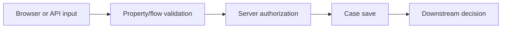

# Validation rules at trusted execution boundaries

**PFA-059** | Lead System Architect scenario | Verification pending in Pega lab

## Failure scenario

A credit application hides an income field when a user selects 'student', and frontend validation is skipped. A crafted Service REST request still writes an invalid income value directly to the case because the validation rule only runs on one View.

The key architectural distinction is between what the Pega engine or data page can execute and what a business transaction guarantees. Rules and scope settings must reflect the data owner, security context, concurrency pattern and recovery policy.

## Technical design flow

## Rules and execution boundaries

1. **Validate rule**. Record the actual rule class/version, source mapping and owner for this boundary.
2. **Edit Validate**. Record the actual rule class/version, source mapping and owner for this boundary.
3. **Flow Action**. Record the actual rule class/version, source mapping and owner for this boundary.
4. **Service REST**. Record the actual rule class/version, source mapping and owner for this boundary.
5. **Access Control Policy**. Record the actual rule class/version, source mapping and owner for this boundary.

## Proposed implementation

1. Classify validations by purpose: format, data integrity, state-dependent business rule and entitlement. Presentation validation is not a security boundary.

2. Use Pega server-side validation for each trusted write path, including API services and background updates, not only App Studio view behavior.

3. Apply object-level permissions before storing input and protect computed values from client overrides.

4. For expensive external checks, persist Pending validation rather than falsely accepting data and treating a timeout as clean.

5. Test negative input through the browser, REST API and worker to ensure invariant holds across channels.

These are deliberate architectural choices rather than instructions to copy unknown settings into an application. For every integration or rule, capture the request/response contract, the authenticated caller and the version that was tested.

## Alternative approaches

- **Approach 1:** Client-only validation improves UX but is bypassable.
- **Approach 2:** server rules preserve invariants and may need separate user-friendly error mapping.

Use an ADR to record not just which approach wins, but why the rejected alternatives fail the agreed security, performance, audit and consistency requirements.

## Diagnostic questions

One integration bypasses flow validation and saves a property inconsistent with the case's approved decision; a late data transform overrides validated values.

Reproduce with the same user, case type, actual parameter values and active application stack. Use Clipboard, Tracer, PAL or partner logs as appropriate, and compare the state before and after the failing interaction.

## Test and acceptance plan

1. **Experiment 1:** Submit negative income via browser and API. Capture expected and actual outcomes, including source-system state when applicable.
2. **Experiment 2:** forge computed eligibility property. Capture expected and actual outcomes, including source-system state when applicable.
3. **Experiment 3:** change field after initial validation. Capture expected and actual outcomes, including source-system state when applicable.

No live Pega tests were performed for this publication. Lab-validation requires real redacted rule screenshots, installed platform version, and evidence of both positive and negative behaviors.

## Operating controls

Assign an owner to the failure state, make unresolved work visible, and define safe replay/recovery where a side effect may have been committed independently. For time-sensitive user journeys, measure p95 response and dependency time separately. For Data Pages, test isolation and refresh as well as latency.

## Further reading

- [Pega Academy: Case life cycle](https://academy.pega.com/topic/case-lifecycle/v7)

*Independent scenario-driven article, not an official Pegasystems document.*
