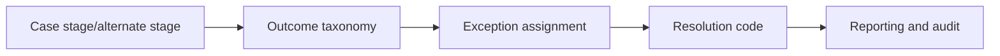

# Workflow exception models for regulated processes

**PFA-060** | Lead System Architect scenario | Verification pending in Pega lab

## Failure scenario

A regulated customer complaint can terminate as Rejected, Withdrawn, NeedsDocuments or SystemFailure. Designers map them all to Resolved-Completed and support staff cannot distinguish business exceptions from technical incidents, causing SLA breaches to go unreported.

The key architectural distinction is between what the Pega engine or data page can execute and what a business transaction guarantees. Rules and scope settings must reflect the data owner, security context, concurrency pattern and recovery policy.

## Technical design flow

## Rules and execution boundaries

1. **Case Type**. Record the actual rule class/version, source mapping and owner for this boundary.
2. **Alternate Stage**. Record the actual rule class/version, source mapping and owner for this boundary.
3. **SLA**. Record the actual rule class/version, source mapping and owner for this boundary.
4. **Decision Table**. Record the actual rule class/version, source mapping and owner for this boundary.
5. **Case History**. Record the actual rule class/version, source mapping and owner for this boundary.

## Proposed implementation

1. Create explicit business and technical exception taxonomies with owners, permitted transitions and final-resolution semantics.

2. Use alternate stages for meaningful case paths such as Withdrawal or RequestMoreInformation, not generic catch-all Exception.

3. Preserve the triggering error and retryable status for technical faults rather than marking them successful business outcomes.

4. Define notification, approval and audit requirements per exception category; policy rejection and integration timeout should not have identical handling.

5. Build reports distinguishing final rejections, temporary blocks, irrecoverable incidents and rework queue ages.

These are deliberate architectural choices rather than instructions to copy unknown settings into an application. For every integration or rule, capture the request/response contract, the authenticated caller and the version that was tested.

## Alternative approaches

- **Approach 1:** Single generic exception stage is simple but unreportable.
- **Approach 2:** typed exception lifecycle supports regulatory evidence with added design work.

Use an ADR to record not just which approach wins, but why the rejected alternatives fail the agreed security, performance, audit and consistency requirements.

## Diagnostic questions

A case resolved on timeout appears in successful throughput dashboards; manual retry from a terminal status reissues external actions.

Reproduce with the same user, case type, actual parameter values and active application stack. Use Clipboard, Tracer, PAL or partner logs as appropriate, and compare the state before and after the failing interaction.

## Test and acceptance plan

1. **Experiment 1:** Inject a service timeout. Capture expected and actual outcomes, including source-system state when applicable.
2. **Experiment 2:** submit business rejection. Capture expected and actual outcomes, including source-system state when applicable.
3. **Experiment 3:** verify report separates outcomes. Capture expected and actual outcomes, including source-system state when applicable.

No live Pega tests were performed for this publication. Lab-validation requires real redacted rule screenshots, installed platform version, and evidence of both positive and negative behaviors.

## Operating controls

Assign an owner to the failure state, make unresolved work visible, and define safe replay/recovery where a side effect may have been committed independently. For time-sensitive user journeys, measure p95 response and dependency time separately. For Data Pages, test isolation and refresh as well as latency.

## Further reading

- [Pega Academy: Case life cycle](https://academy.pega.com/topic/case-lifecycle/v7)

*Independent scenario-driven article, not an official Pegasystems document.*
